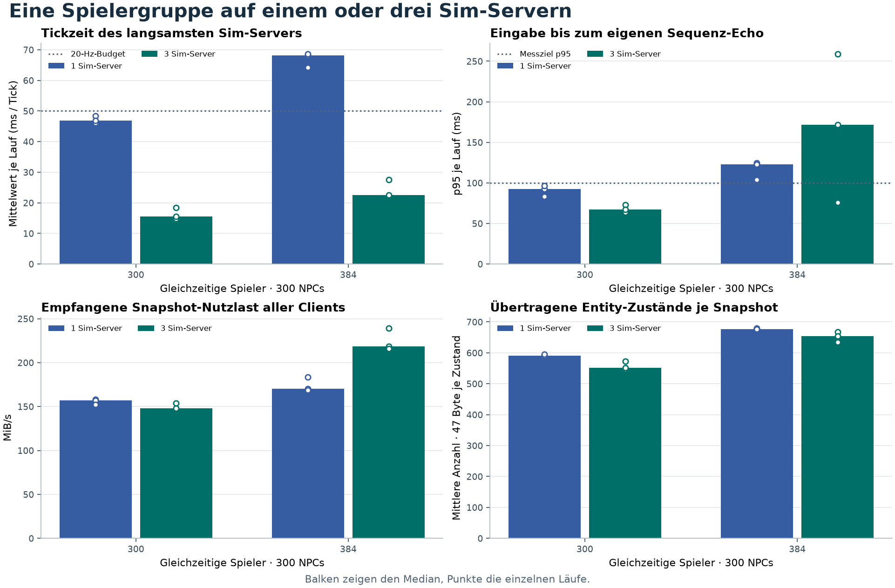
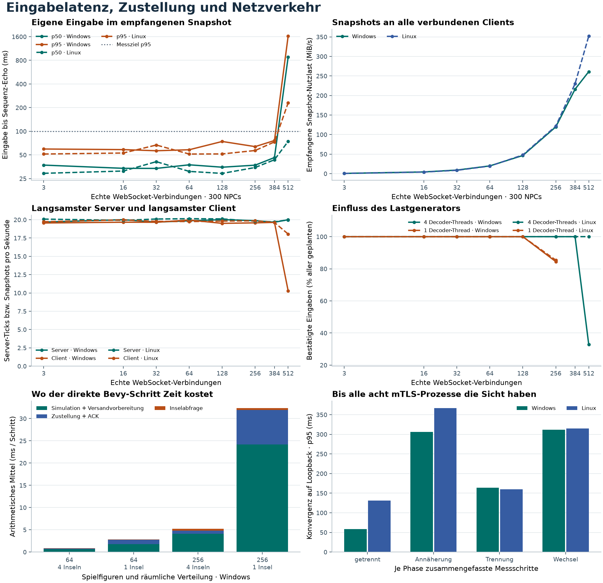
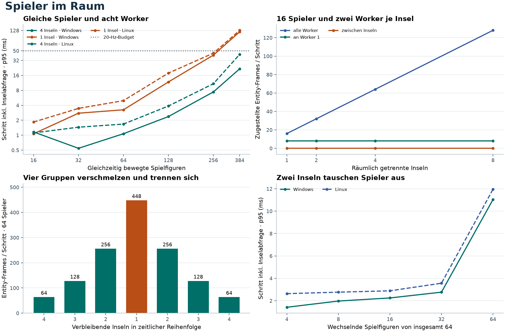
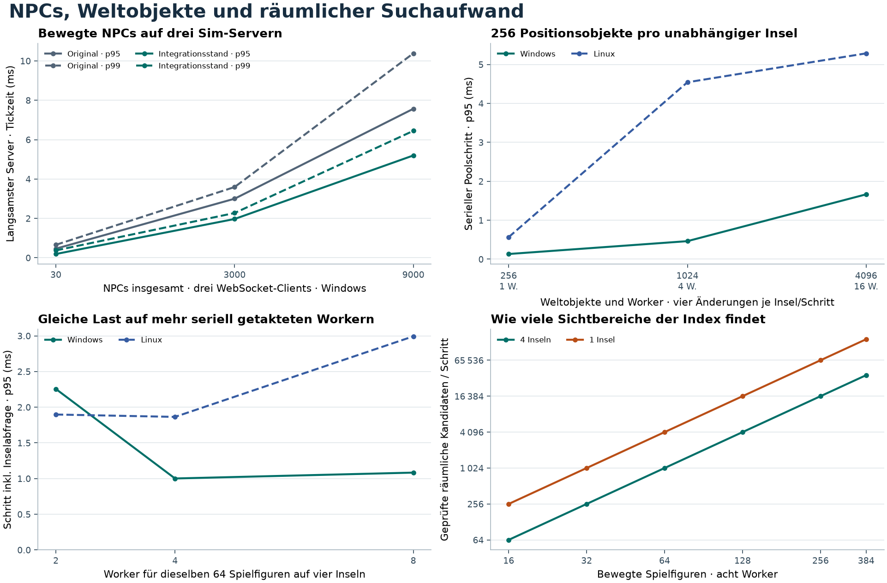

# Leistungsprofil und Spielergrenze

Die 10.000er-Reihe misst aktive und ruhende Spieler, parallele Referenzräume, durable Checkpoints und echte Socket-Empfänger. [Tickprofil mit Messkurven](tickprofil.md)

Die Browser-Demo und das persistente Bevy-Spiel haben eigene Lastprofile. Die aktuellen Messungen für das Spiel mit Octree und separatem Authority-Dienst stehen im ersten Abschnitt. Der anschließende Vergleich der Browser-Demo beschreibt echte WebSocket-Verbindungen. [Betriebsmodell und Abnahme](produktionsabnahme.md)

## Octree und gerichtete Replikation


Die Messwerte für den aktuellen Stand und die zugehörigen Rohdaten stehen in der [Messauswertung](octree-messung.md). Die historischen Windows-/Debian-Kurven weiter unten wurden mit dem damaligen R-Baum erhoben und dienen als Vergleich.

## Ein oder drei Sim-Server für dieselbe Spielergruppe?

Alle neuen Browser-Spieler starten am Ursprung. Der Benchmark bewegt sie in derselben Richtung und wechselt regelmäßig die Richtung. Bei 500 Einheiten Sichtweite bleiben alle Spieler füreinander sichtbar. Auch die 300 NPCs starten im Quadrat von −400 bis +400 auf beiden Bodenachsen. Ein Sim-Server und drei Sim-Server erhielten dieselbe Gesamtzahl an Spielern, NPCs, Eingaben und Decoder-Threads. Der Koordinator lief in beiden Varianten auf demselben Windows-Rechner. Die zufälligen NPC-Positionen variieren zwischen Starts. [Spieler-Spawn](../crates/sim-server/src/network.rs) · [NPC-Spawn](../crates/sim-server/src/game_loop.rs) · [Sichtradius](../crates/shared/src/spatial.rs)

| Spieler | Sim-Server | Tick gesamt / davon Client-Snapshots | Langsamster Server / Client | Eingabe p95 | Empfangene Snapshot-Nutzlast | Läufe im Ziel |
| ---: | ---: | ---: | ---: | ---: | ---: | ---: |
| 300 | 1 | 46,8 / 46,5 ms | 20,0 / 19,6 Hz | 92 ms | 157 MiB/s | 3 von 3 |
| 300 | 3 | 15,5 / 14,9 ms | 19,8 / 19,7 Hz | 67 ms | 148 MiB/s | 3 von 3 |
| 384 | 1 | 68,1 / 67,8 ms | 14,7 / 14,3 Hz | 123 ms | 170 MiB/s | 0 von 3 |
| 384 | 3 | 22,6 / 22,1 ms | 20,0 / 19,7 Hz | 172 ms | 218 MiB/s | 1 von 3 |

Nach 3,2 Sekunden Warmlauf mit bewegten Spielern schickte jeder Protokoll-Client 16 Eingaben im Abstand von 137 ms. Das Messziel verlangt alle 16 Echos, ein p95 bis 100 ms sowie mindestens 18 Ticks/s je Server und 18 empfangene Snapshots/s je Client. Die Clients dekodierten die regulären Browser-Frames ohne Rendering.

Die Tabelle zeigt Mediane aus drei abwechselnden Vergleichspaaren je Spielerzahl. Die Tickzeiten sind Mittelwerte im exakten Messfenster des jeweils langsamsten Prozesses. Die gesamte gemessene Tickzeit endet am Metrikpunkt vor der Pflege der Liste übernehmbarer Spieler. Die Werte sind verstrichene Zeit. Der eigentliche Socketversand läuft asynchron. Die Client-Snapshotzeit umfasst Zustände sammeln, Sichtfilterung, Delta-Auswahl, Kodierung und Einreihen für den WebSocket-Versand. Das Eingabe-p95 misst die Zeit bis zum Echo im empfangenen Snapshot. Alle 4.800 bzw. 6.144 Eingaben erschienen in jedem der zwölf Läufe. In einem vorangestellten Kontrollpaar bei 300 Spielern lag das Eingabe-p95 bei 118 / 78 ms für einen / drei Server. [Einzelwerte und Kontrollläufe](benchmarks/browser-server-count-2026-11-25.json)



**Warum wächst die Bandbreite so schnell?** Im Ein-Server-Lauf mit 300 Spielern enthielt ein Snapshot im Median der Läufe 591 Entity-Zustände. Jeder kostet 47 Byte. Bei 20 Hz ergeben 300 Empfänger × 591 Zustände × 47 Byte × 20 rund **159 MiB/s** vor Headern. Gemessen waren es **157 MiB/s**. Alle empfangenen Frames waren in diesen drei Läufen vollständige Zustandslisten. Der Server wählt unter anderem dann einen vollständigen Snapshot, wenn sich über 80 % der sichtbaren Zustände geändert haben. Mit drei Prozessen waren **82 %** der empfangenen Frames vollständige Snapshots. Die Nutzlast betrug **148 MiB/s**. Die Aufteilung verschafft den Sim-Servern Zeit, während jeder Client weiterhin seine Nachbarn empfangen muss. Bei 384 Spielern lieferte ein Server weniger Daten pro Sekunde, weil sein Tick auf rund 15 Hz fiel. [Sichtfilter und Delta-Auswahl](../crates/sim-server/src/systems/snapshot.rs) · [47-Byte-Format](../crates/sim-server/src/encoding.rs)

**Wie stark bremst der Lastgenerator?** Die vier Decoder-Threads verarbeiteten die Snapshots aller Clients auf dem Server-Rechner. Bei 384 Spielern auf drei Sim-Servern lag das Eingabe-p95 in den einzelnen Läufen bei 76, 259 und 172 ms. In den beiden langsamen Läufen wachten die 137-ms-Sendetimer um 208 bzw. 116 ms p95 zu spät auf. In einem Kontrolllauf mit acht Decoder-Threads lag die Eingabe bei 82 ms p95 und die Timer-Verspätung bei 6 ms. Bei 512 Spielern und acht Threads hielt ein Sim-Server im Mittel 9,2 Hz. Drei erreichten 19,5 Hz und 357 MiB/s Client-Nutzlast, die Lastgeneratoren setzten in ihrem Zeitfenster 5.952 von 8.192 geplanten Eingaben ab. 5.940 erschienen im Snapshot, mit 632 ms p95. Das einzelne Kontrollpaar belegt die Empfindlichkeit dieser Messung gegenüber der Clientlast. [Messfenster und alle Zähler](benchmarks/browser-server-count-2026-11-25.json)

**Was bedeutet das für eine große Welt?** Für die Client-Ausgabe zählen Spieler × übertragene sichtbare Entities × Bytes pro Zustand × Sendefrequenz. Bleibt die lokale Nachbarschaft bei weiteren Inseln gleich groß, wächst diese Datenmenge ungefähr linear mit der Gesamtspielerzahl. Treffen sich alle bewegten Spieler an einem Ort und sehen einander, kann allein der Spieleranteil quadratisch wachsen. Der Nachweis zur Isolation weiter unten gilt für die persistente Bevy-Bibliothek. Die WebSocket-Vergleiche messen die Browser-Demo auf einem Rechner. Über weitere physische Server verteilte Simulation, separate Uplinks, Endgeräte und die Gameplay-Kosten des eigenen Spiels benötigen eine eigene Kapazitätsmessung.

Eine Wiederholung der ursprünglichen Vier-Thread-Rampe mit schrittweise zugeschalteten Clients ergab bei 384 Spielern **71 ms p95**, bei 512 Spielern **1.663 ms p95** und 10,1 Snapshots/s am langsamsten Client. Die Festlastläufe starten jede Variante frisch und wärmen die gesamte Gruppe in Bewegung auf. Beide Verfahren und ihre Rohwerte stehen im selben Bericht.

`npm run bench:servers` misst ein kurzes Vergleichspaar mit 300 Spielern und schreibt `target/server-count.json`. `MESH_BENCH_DRIVERS` bestimmt die Zahl der Decoder-Threads und steht standardmäßig auf vier. Die zwölf Starts der vollständigen Messreihe dauerten einschließlich Hochfahren und Aufwärmen 130 Sekunden, im Mittel 22 Sekunden je Vergleichspaar. Mit den folgenden Befehlen lassen sich die Tabelle prüfen und der Graph für die eigene Hardware erzeugen.

```sh
npm run bench:servers -- --players 300,384 --pairs 3
python scripts/plot-mesh-profile.py --server-count target/server-count.json
```

## Wie viele Spieler verkraftet die Browser-Demo?

Drei Sim-Server, 300 bewegte NPCs und bis zu 512 echte WebSocket-Verbindungen auf Loopback. Jeder Client dekodiert die regulären Full-/Delta-Snapshots, bestätigt den Tick und sucht seine eigene Eingabesequenz. Das lokale Messziel beträgt p95 höchstens 100 ms bis zum Echo, mindestens 18 Ticks/s je Server und 18 Snapshots/s je Client sowie ein Echo für jede der 16 geplanten Eingaben pro Client. Die Tabelle nennt bei Überlast auch die tatsächlich gesendeten Eingaben. p95 bedeutet, dass 95 % der beobachteten Echos innerhalb der angegebenen Zeit ankamen.

| System | Verbindungen | Geplant / gesendet / bestätigt | Eingabe p50 / p95 / p99 | Langsamster Server / Client | Snapshot-Nutzlast gesamt |
| --- | ---: | ---: | ---: | ---: | ---: |
| Windows | 256 | 4.096 / 4.096 / 4.096 | 37 / 64 / 73 ms | 19,9 / 19,6 Hz | 120 MiB/s |
| Debian | 256 | 4.096 / 4.096 / 4.096 | 35 / 57 / 62 ms | 19,8 / 19,9 Hz | 122 MiB/s |
| Windows | **384** | 6.144 / 6.144 / 6.144 | 46 / **76** / 87 ms | 19,7 / 19,6 Hz | 216 MiB/s |
| Debian | **384** | 6.144 / 6.144 / 6.144 | 43 / **73** / 90 ms | 19,7 / 19,6 Hz | 230 MiB/s |
| Windows | **512** | 8.192 / 2.688 / 2.687 | 882 / **1.628** / 1.757 ms | 20,0 / 10,3 Hz | 261 MiB/s |
| Debian | **512** | 8.192 / 8.192 / 8.192 | 74 / **230** / 383 ms | 20,0 / 18,0 Hz | 352 MiB/s |

Bei 384 Spielern entsprechen die empfangenen Snapshots rund **1,81–1,93 Gbit/s** vor TCP/IP-Overhead. Ein einzelner 1-Gbit/s-Uplink wäre für diese Sichtweite und Änderungsrate bereits zu klein. Alle Clients liefen ohne Renderer auf derselben Maschine wie die Server. Die Verbindungen wurden gleichmäßig auf die drei Server verteilt. Der Echozähler erfasst genau beobachtete Sequenzen. Eine neuere Eingabe kann eine ältere im Snapshot überholen. Client-Framerate, Internetlaufzeit und ein dauerhaft tragbares Spielerlimit fürs eigene Spiel brauchen eine eigene Messung.



**Wo entsteht die Wartezeit?**

- **Eingabe bis sichtbare Bestätigung.** Bei drei Clients lag p95 schon bei 60 / 51 ms, obwohl der langsamste Server unter 1,2 ms p95 Rechenzeit brauchte. Eingaben warten auf den nächsten 50-ms-Tick und die Snapshot-Ausgabe. Bei 384 erreichte der ECS-Schritt einschließlich Snapshot-Aufbereitung rund 25,5 / 25,8 ms p95. Bei 512 kamen die Sendetimer der vier lokalen Lastgenerator-Threads um 954 / 136 ms p95 zu spät. Empfang und Dekodierung auf dem gemeinsamen Host tragen also erheblich zur beobachteten Grenze bei. Ein Kontrolllauf mit **nur einem** Decoder-Thread lieferte bereits bei 256 Clients lediglich 3.460 / 3.498 von 4.096 Echos. Serverphasen nutzen ein rollendes Fenster von bis zu 200 Ticks. Ihre Perzentile beschreiben die Serverarbeit in diesem Zeitfenster. Die Zeitstempel für das Eingabe-Echo stammen vom jeweiligen Client. [Browser-Lastgenerator](../scripts/bench-player-clients.mjs) · [Server-Zeitmessung](../crates/sim-server/src/game_loop.rs)
- **Direkter Bevy-Schritt.** Bei 256 Figuren an einem Ort entfielen unter Windows im Mittel 24,18 ms auf Simulation und Versandvorbereitung, 7,74 ms auf Zustellung und ACK sowie 0,42 ms auf die Inselabfrage. Über vier Inseln waren es 4,09 / 0,74 / 0,36 ms. Der erste Block umfasst auch Checkpoint-Verarbeitung, räumliche Suche, Feldauswahl und Warteschlangen. Die Stackgrafik zeigt arithmetische Mittel. [Messgrenzen im Bevy-Szenario](../examples/infinite-stars/src/bin/cluster-bench.rs)
- **Bis alle Worker die richtige Sicht haben.** Acht echte Prozesse, 64 simulierte Figuren und TCP/mTLS benötigten bei Annäherung **306 / 367 ms p95**, beim Austausch **312 / 315 ms p95**. Enthalten sind die 50-ms-Updates der Worker, die Meldung ans Directory, die Weitergabe der Abonnements, Peer-Zustellung und die Kontrolle beim letzten Empfänger im 5-ms-Raster. Die Messung ordnet TLS-Kryptografie und Socketlaufzeit keinen separaten Anteil zu. [Mehrprozess-Test](../examples/infinite-stars/src/bin/cluster-wire.rs)

## Inselmessungen vor dem Wechsel zum Octree



| Bevy-Szene mit acht Workern | Windows p95 je Schritt | Debian p95 je Schritt | Entity-Frames pro Schritt |
| --- | ---: | ---: | ---: |
| 256 Spieler, vier Inseln | 7,4 ms | 10,9 ms | 256 |
| 256 Spieler, eine Insel | 40,9 ms | 44,7 ms | 1.792 |
| 384 Spieler, vier Inseln | 21,6 ms | 42,3 ms | 384 |
| 384 Spieler, eine Insel | 120,2 ms | 128,8 ms | 2.688 |

**Unabhängige Inseln.** Bei 1, 2, 4 und 8 Inseln mit je 16 Spielern und zwei Workern empfing Worker 1 jedes Mal **acht Positionsframes pro Schritt**. Trotz wachsender Welt gingen **null Entity-Frames zwischen getrennten Inseln**. Über die acht echten mTLS-Prozesse ergaben zwölf getrennte Schritte ebenfalls null fremde Frames bei 768 korrekt angewandten Positionsframes. Directory, Steuerung und lokale Nachbarn erzeugten weiterhin TLS-Verkehr. Die direkte Szene prüft nach jedem Schritt die Inselmitglieder anhand einer unabhängigen vollständigen 3D-Suche, die tatsächlich installierten Replikate, ihre Positionen und den Schutz privater Inventare. [Geometrie und Sichtprüfung](../examples/infinite-stars/src/bin/cluster-bench.rs) · [Prüfung über die Netzwerkverbindung](../examples/infinite-stars/src/bin/cluster-wire.rs)

**Bewegliche Gruppen.** Bei 64 Spielern durchlief die Welt 4 → 3 → 2 → 1 → 2 → 3 → 4 Inseln. Die Zustellungen pro Schritt folgten mit **64 → 128 → 256 → 448 → 256 → 128 → 64**. Ein zweites Szenario ließ 4, 8, 16, 32 und 64 Spieler gleichzeitig die Seite wechseln. Beim Wechsel aller 64 stieg die Schrittzeit auf 11,0 / 12,0 ms p95. Die Schreibzuständigkeit bleibt in diesen Szenen fest, damit die Messung den Preis der räumlichen Überschneidung zeigt. Die Bibliothek prüft Zuständigkeitsübergaben separat. [Handoff- und Recovery-Tests](../examples/infinite-stars/tests/contract.rs)

## Was kostet eine weitere Entity, ein NPC oder ein Worker?



| Last | Charakteristik im laufenden Code |
| --- | --- |
| **Spieler mit eigenem Sichtbereich** | Der Octree liefert lokale Kandidaten. Geordnete Ebenenpositionen erkennen Bewegung, die keine Eintritts- oder Austrittsfläche kreuzt. Dann bleiben die vorhandenen Abos gültig. Werden Flächen gekreuzt, prüft die Bibliothek die betroffenen 3D-Boxen mit Vorhersage und Hysterese. Bei vollständig überlappenden Gruppen und ständig wechselnder Sichtbarkeit bleibt quadratische Arbeit möglich. |
| **Empfänger einer Änderung** | Das Directory bündelt mehrere Sichtbereiche desselben Workers in einem Abonnement. Mit acht Workern lagen die Zustellungen je Figur bei **einem** anderen Worker auf vier Inseln und **sieben** in der gemeinsamen Insel. Bei individuellen Clients, die alle anderen bewegten Figuren sehen, kann die auszugebende Datenmenge quadratisch mit der Spielerzahl wachsen. Feldauswahl, Änderungsrate und Detailstufe bestimmen die Bytes. |
| **Server der Browser-Demo** | Pro lokalem Client durchsucht der aktuelle Snapshot-Pfad die bekannten autoritativen und Schatten-Entities zur Sichtfilterung. Bei P Clients und E bekannten Entities kostet diese Prüfung pro Server und Tick bis zu **O(P × E)**, zuzüglich Kodierung der sichtbaren Updates. Auch ein Rechner mit 20 stabilen Ticks/s kann seine Clients oder seinen Uplink überlasten. |
| **Bewegte NPCs** | Im Originalvergleich mit drei echten Clients und 9.000 einfachen Bewegungs-NPCs sank die Tickzeit des langsamsten Servers unter Windows bei p95 von **7,57 auf 5,20 ms**, bei p99 von **10,38 auf 6,45 ms**. Komplexe KI, Navigation, Kollisionen und Spieler-Eingabequittungen erzeugen andere Arbeit. |
| **Selten geänderte Weltobjekte** | 256 Positionsobjekte je Insel, vier Positionsänderungen je Insel und Schritt. Bei 4.096 Objekten auf 16 Inseln dauerte der serielle Poolschritt **1,66 / 5,28 ms p95**. Der Beobachter der ersten Insel erhielt in 160 Schritten stets 697 Frames mit 17.101 Byte Felddaten. Bei Chunks und Bauplänen kommen Datenvolumen, Codec und der Cachezustand bei der Übergabe hinzu. |
| **Weitere Worker** | Der direkte Pool tickt seine Bevy-Worlds seriell. Bei denselben 64 Spielern auf vier Inseln kosteten zwei, vier und acht Worker unter Windows **2,26 / 1,00 / 1,08 ms**, unter Debian **1,90 / 1,86 / 2,99 ms** p95. Ein zusätzlicher Worker bringt eigenen ECS-, Routing- und Zustellaufwand. Horizontaler Durchsatz über weitere physische Rechner ist damit offen. |

Die Rechenpfade und das unabhängige NPC-Vergleichsprogramm sind direkt im Repo nachlesbar. [Räumlicher Index](../crates/zz-mesh/src/spatial.rs) · [Worker-Pool](../crates/zz-mesh/src/pool.rs) · [Browser-Snapshots](../crates/sim-server/src/systems/snapshot.rs) · [Objekt- und Voxelbenchmark](../examples/infinite-stars/src/bin/mesh-bench.rs) · [Originalvergleich](../scripts/compare-mesh.mjs)

**Gegenprobe zur bisherigen Bibliothek.** Bei 64 verschmolzenen Figuren und acht Workern ergaben vier abwechselnde Vergleichspaare gegen `fa3d470` unter Windows 4,08 → 4,09 ms p95 und unter Debian **6,57 → 8,82 ms p95**. Eine Nachmessung isolierte dieselbe dichte Szene auf einer festen virtuellen CPU, mit identischem Messcode, sechs Paaren und 192 Schritten je Lauf. Dort lagen die Mediane bei **7,24 → 7,08 ms p95**. Die mittlere Thread-CPU-Zeit sank in jeder der drei gemessenen Phasen. Die höhere Latenz im ersten Debian-Lauf bleibt dokumentiert. Die kurzen Vergleichsläufe erlauben hier nur eine Aussage über die jeweils gemessene Last und Ausführungsumgebung. [Einzelwerte, Binärhashes und Messcode](benchmarks/mesh-profile-2026-11-25.json)

## Schnell auf der eigenen Hardware nachmessen

```sh
npm run bench:quick
```

Am 25. November 2026 dauerte die eigentliche Last **44,4 s auf Windows und 45,8 s auf Debian**, zuzüglich 1,0 / 0,6 s für den warmen Release-Build. Der erste Build braucht länger. Der Befehl schreibt `target/mesh-quick.json`. Er beginnt mit drei Verbindungen und endet bei der ersten verfehlten Laststufe oder spätestens bei 512. Pro Stufe sind 16 Eingaben je Client in 137-ms-Abständen geplant. Nach vier Sekunden begrenzt jeder Lastgenerator weitere Eingaben. Das trennt geplante, gesendete und tatsächlich beobachtete Sequenzen. Hardware, Revision, Tickraten, Zähler und Perzentile stehen im JSON. [Launcher](../scripts/bench-quick.mjs)

Mit Python 3 und Matplotlib erzeugt der zweite Befehl dieselben drei Graphen unter `target/mesh-profile/`. Er ersetzt die räumlichen und Browser-Messungen des aktuellen Betriebssystems. Die andere Plattform, der Originalvergleich und die mTLS-Messungen stammen aus der archivierten Messreihe.

```sh
python scripts/plot-mesh-profile.py --quick target/mesh-quick.json
```

**Messbedingungen der früheren Vergleichsreihe.** Windows 11 nativ auf einem Intel Core i7-13850HX mit 20 Kernen und 28 logischen Prozessoren. Debian 12.15 in einer WHPX-VM auf demselben Host mit sechs vCPUs und 8 GiB RAM. Beide Reihen liefen nacheinander im Release-Profil mit Rust 1.96.1 und Node 22.16. Der direkte Bevy-Test verwendet SQLite im Speicher, sechs Warmschritte und 32 Messschritte pro Dichtestufe. p95 entspricht dort dem zweithöchsten Schritt. Kurze Stichproben schwanken. In einem zusätzlichen Vier-Thread-Lauf lag die Browser-Eingabe bei 256 Clients bei 72 / 152 ms p95. Das zeigt die Streuung auch unterhalb der höchsten erreichten Stufe. Der Originalvergleich umfasst je drei alternierende Paare mit 5 s Warmlauf und 15 s Messung. Die anderen Leistungsdaten und der längere mTLS-Test lassen sich getrennt reproduzieren. [Rohdaten einschließlich Kontrollläufen](benchmarks/mesh-profile-2026-11-25.json) · [Vorherige Messreihe, Befehle und Härtung](cluster-performance-2026-11-24.md)

**Sicherheitsprüfung am damaligen Stand.** Die Abhängigkeitsprüfungen vom Messtag meldeten null bekannte Schwachstellen in den Rust- und npm-Lockfiles. RustSec listete drei nicht mehr gepflegte Pakete. Auf beiden Plattformen bestanden je 676 Rust-Tests, 85 TypeScript-Tests, der Client-Build und zwei Live-Szenarien. Die Tests prüfen unter anderem private Daten, abgelöste Schreibrechte, verspätete ACKs, Neustart und Wiederholung bestätigter Aktionen. Für öffentliche Verbindungen benötigt das Spiel eigene Zertifikate und die Zuordnung der authentisierten Identität zu Spielrollen. [Prüfstand](benchmarks/mesh-profile-2026-11-25.json) · [Betrieb und Vertrauensgrenzen](infinite-stars.md)
