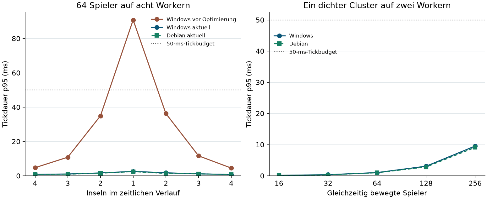

# Bewegte Spielercluster und ursprüngliche Browser-Demo

Bei acht getrennten Inseln mit zusammen 128 bewegten Spielern erhielt der erste Worker über 120 Schritte dieselben 960 Positionsframes wie bei einer Insel. Zwischen den Inseln wurden null Entity-Frames zugestellt. Bei 64 Spielern auf acht Workern verschmolzen vier Inseln schrittweise zu einer und trennten sich wieder. Der vollständig verschmolzene Zustand brauchte einschließlich Abfrage aller Inselmitglieder 2,69 ms p95 unter Windows und 2,55 ms unter Debian. Über acht TCP/mTLS-Prozesse dauerte der langsamste Annäherungsschritt rund 308 ms bis zur korrekten Sicht beim letzten Empfänger.

Auch die ursprüngliche Browser-Demo wurde neu gemessen. Bei 9.000 NPCs sanken p95 und p99 auf beiden Plattformen. Im kleinen Bibliothekstest mit vier Workern und 256 Objekten bleibt im Median eine Mehrzeit von rund 6–7 µs bei p50. Unter Windows betrug die p95-Mehrzeit dort rund 6 µs. Die Phasenmessungen und alle Einzelwerte stehen weiter unten.

## Reproduzieren

Die folgenden Befehle laufen im Repository-Root auf Windows und Linux mit Rust Stable und Node.js ab 22.16.

```sh
npm run setup
npm test
npm run smoke
npm run bench:compare
npm run bench:clusters
npm run bench:cluster-wire
cargo run --locked --release -p infinite-stars --bin mesh-bench -- target/stars-benchmark.json
```

Der Browser-Vergleich baut den Referenzstand `3ef0d789` und den aktuellen Checkout im Release-Profil. Für den ursprünglichen Stand übernimmt er die erste versionierte Cargo.lock aus `a2c478bf`. Windows braucht aus diesem Commit auch die beiden portierten Prozesseinstiegspunkte für Keepalive und Shutdown. Die Simulationsschleife der Referenz stammt auf beiden Plattformen aus `3ef0d789`. Ein bereits gebautes Paar lässt sich mit `--reference PFAD --candidate PFAD` angeben. Der Befehl protokolliert die SHA-256 der gemessenen Binärdateien. [Vergleichsprogramm](../scripts/compare-mesh.mjs) · [Referenzbuild](../scripts/build-benchmark-reference.mjs)

Der Browser-Vergleich nutzt eigene Standardports neben der Entwicklungsdemo. Der Koordinator startet auf 17710 und 17711. Die Basisports für Simulation, UDP und Metriken sind 17717, 19100 und 18100. Bei Bedarf lassen sich `COORD_WS_PORT`, `COORD_HTTP_PORT`, `SIM_WS_BASE`, `SIM_UDP_BASE` und `SIM_METRICS_BASE` setzen. Die Spielerszenen verwenden eigene temporäre Speicher und zugewiesene Ports. Standardausgaben sind `target/browser-comparison.json`, `target/cluster-players.json` und `target/cluster-wire.json`. Der manuell gestartete GitHub-Workflow **Native mesh** führt den Originalvergleich auf Windows und Linux mit `--max-growth-percent 0` aus und archiviert die Einzelwerte auch bei einem gemessenen Anstieg. [Lokaler Start und Ports](quickstart.md) · [CI-Workflow](../.github/workflows/native-mesh.yml)

## Was die Zahlen messen

- **Browser-Demo.** Drei native Sim-Prozesse, drei echte WebSocket-Clients mit Snapshot-ACKs, fünf Sekunden Warmlauf und 20 Sekunden Messung pro Start. Beide Versionen laufen je Laststufe dreimal in wechselnder Reihenfolge. Die ursprüngliche Demo wählt Startpositionen und UUIDs zufällig. Jede Zeile fasst den Median der drei jeweils langsamsten Server zusammen. Die Tickperzentile kommen aus den letzten 200 Server-Ticks. Tick- und Snapshotrate verwenden das gesamte Messintervall. `--max-growth-percent 0` lässt den Vergleich bei jedem gemessenen p95- oder p99-Anstieg fehlschlagen. Mit `--noise-ms` kann ein absoluter Spielraum für eine bestimmte Messmaschine gesetzt werden.
- **Bevy-Worlds.** Jeder Spieler hat eine dauerhafte ID, eigene Schreibzuständigkeit, eine Position, ein privates Inventar und einen aktiven Sichtbereich. Alle Spieler bewegen sich in jedem Schritt. Je Cluster schreiben zwei Worker. Im Test mit geteilten Workern bedienen dieselben Worker mehrere Orte. Der direkte Pool tickt alle Worlds seriell. Die Zeit umfasst Positionsänderung, ECS-Schritt, Discovery, Projektion, Zustellung und ACK. Eine zweite Zeitmessung schließt die explizite Abfrage aller Inselmitgliedschaften ein. Die unabhängige Gegenprüfung und die Auswertung der Zähler liegen außerhalb beider Messintervalle. Die ausgewiesenen Feldbytes stammen aus den typisierten Updates. [Szenen](../examples/infinite-stars/src/bin/cluster-bench.rs)
- **Gegenprüfung.** Nach jedem Schritt vergleicht der Test Abonnements, tatsächlich installierte Replikate, exakte Koordinaten und private Komponenten mit einer vollständigen 3D-Suche. Spieler innerhalb von 10 m Achsenabstand müssen sichtbar sein. Jenseits von 11 m muss die fremde Sicht entladen sein. Dazwischen gilt die Hysterese des Plugins. Alle Writer und Generationen bleiben während der Geometrie-Szenen auf ihrer ursprünglichen Platzierung. Das erlaubt eine eigene Messung der Kosten von Merge und Split. Übergabe und automatisches Placement haben separate Tests. [Räumliche Tests](../crates/zz-mesh/tests/spatial.rs) · [Spiel- und Übergabetests](../examples/infinite-stars/tests/contract.rs)
- **Getrennte Prozesse.** Zwei, vier oder acht Betriebssystemprozesse verwenden den echten Directory-Broker, SQLite, Peer-Publisher und TCP mit gegenseitiger TLS-Authentifizierung. Jeder Worker simuliert acht Spieler. Die Teststeuerung gibt Bewegungen über stdin vor und liest fertige ECS-Sichten zurück. Jede Phase wartet auf die richtigen IDs und exakten Positionen bei allen Empfängern. Die Konvergenzzeit enthält die 50-ms-Simulations- und Directory-Zyklen, Warteschlangen und die Abfrage durch die Teststeuerung. TLS-Bytezähler erfassen alle Listener einschließlich Handshake, Kontrollverkehr und Wiederholung. IP-Header und vom Betriebssystem wiederholte TCP-Segmente fallen außerhalb dieser Messstelle. [Netzwerkszenen](../examples/infinite-stars/src/bin/cluster-wire.rs)
- **Dynamik.** Eine Gruppe startet im Zentrum. Drei weitere starten jeweils 64 m davon entfernt auf unterschiedlichen Raumachsen. Sie kommen nacheinander ins Zentrum und kehren anschließend zu ihren Ausgangsorten zurück. Ein separater Versuch schickt zunehmend größere Teilgruppen auf Gegenkurs. Die Worker behalten beim Wechsel die Schreibrechte ihrer Spieler. Ein gerichtetes Paar zählt einen Sender und einen Empfänger genau einmal, auch wenn viele Spieler am selben Ort dasselbe Objekt benötigen. Der Zähler für fremde Herkunft erfasst zugestellte Frames zwischen den ursprünglichen Orten. Wenn ein Worker mehrere Orte bedient, steht für diesen Zähler in den aktuellen Direktmessungen `null`.

Die Windows-Messung lief nativ auf einem Intel Core i7-13850HX. Debian 12 lief auf demselben Rechner mit sechs virtuellen CPUs und 8 GiB RAM unter QEMU/WHPX. Die Abschlussmessungen der beiden Betriebssysteme liefen nacheinander. Die Mehrprozesszahlen beschreiben Loopback auf einem Host. Ein physischer Mehrrechner-Cluster mit WAN-Latenz, Paketverlust und unabhängigen Datenträgern ist eine andere Messumgebung.

## Messergebnisse vom 24. November 2026



### Browser-Demo im direkten Vergleich

| System | NPCs | p95 Original ms | p95 aktuell ms | p99 Original ms | p99 aktuell ms | Ticks/s aktuell | Snapshots/s aktuell |
| --- | --- | --- | --- | --- | --- | --- | --- |
| Windows | 30 | 0,423 | 0,166 | 0,721 | 0,252 | 19,99 | 19,99 |
| Windows | 3000 | 2,607 | 1,776 | 3,473 | 2,691 | 19,99 | 19,99 |
| Windows | 9000 | 5,390 | 4,295 | 6,098 | 7,004 | 19,99 | 19,99 |
| Debian | 30 | 0,354 | 0,250 | 0,639 | 0,495 | 20,00 | 20,00 |
| Debian | 3000 | 2,816 | 1,713 | 5,697 | 3,124 | 20,00 | 20,00 |
| Debian | 9000 | 7,802 | 5,407 | 10,913 | 6,758 | 20,00 | 20,00 |

Bei 9.000 NPCs unter Windows lag p99 im ersten Dreiervergleich bei 6,098 ms für die Referenz und 7,004 ms für den aktuellen Stand. Zwei der drei zeitlich benachbarten Paare fielen zugunsten des aktuellen Stands aus. Deshalb wurde diese Laststufe um sieben vorab festgelegte Paare erweitert. Über **alle zehn Paare** lag p95 bei 5,422 → 4,236 ms und p99 bei 6,444 → 4,861 ms. In 8 von 10 Paaren war der aktuelle p99-Wert niedriger. Binärdateien, Last, Reihenfolgewechsel und Messdauer blieben über alle 20 Starts gleich. [Alle Messungen bei 9.000 NPCs](benchmarks/browser-windows-9000-confirmation.json)

Die drei Windows-Clients empfingen bei 9.000 NPCs über zehn Paare zusammen im Median 21,21 MiB/s im Original und 21,64 MiB/s im aktuellen Stand. Die Startpositionen und die sichtbaren Entities variieren je Start. In einem zusätzlichen 20-Sekunden-Paar wurden alle Nutzbytes den Headern, Entity-Zuständen und entfernten UUIDs zugeordnet. Beide Versionen benötigten exakt 47 Byte je Entity-Zustand und 16 Byte je entfernter UUID. Das Original lieferte 9.484.349 Zustände in 1.201 Frames, der aktuelle Stand 9.431.102 in 1.202 Frames. [Bytezähler pro Client](benchmarks/browser-snapshot-accounting.json) · [Binärformat](../crates/sim-server/src/encoding.rs)

Ein Zwischenschritt ohne die zeitgesteuerte Scheduler-Übergabe lag bei 30 NPCs auf Debian bei 0,401 ms p95 und 0,771 ms p99 gegenüber 0,367 und 0,657 ms der damaligen Referenz. Danach wurden beide vollständigen A/B-Matrizen mit neu gebauten Release-Servern erneut ausgeführt. [Zwischenmessung Debian](benchmarks/browser-before-scheduler-linux.json) · [Zwischenmessung Windows](benchmarks/browser-before-scheduler-windows.json)

Die erste Kontrollmessung vor der Optimierung lag unter Windows bei 9.000 NPCs bei 6,710 ms p95 gegenüber 5,549 ms für das Original. Die JSON-Dateien enthalten je Server die Snapshotrate, Datenrate, Tickzeiten und p95 der Verarbeitungsphasen. [Vor der Optimierung](benchmarks/browser-before-tuning-windows.json) · [Windows-A/B](benchmarks/browser-comparison-windows.json) · [Debian-A/B](benchmarks/browser-comparison-linux.json)

### Unabhängige Cluster und steigende Spielerdichte

| Inseln | Worker | Spieler | gerichtete Paare | p95 Windows ms | p95 Debian ms | Frames an Worker 1 | Frames zwischen Inseln |
| --- | --- | --- | --- | --- | --- | --- | --- |
| 1 | 2 | 16 | 2 | 0,16 | 0,15 | 960 | 0 |
| 2 | 4 | 32 | 4 | 0,41 | 0,37 | 960 | 0 |
| 4 | 8 | 64 | 8 | 0,77 | 0,76 | 960 | 0 |
| 8 | 16 | 128 | 16 | 1,54 | 1,40 | 960 | 0 |

Alle 120 Schritte je Szene erzeugen dieselbe Zahl von Positionsframes für Worker 1. Für die reine Bevy-Replikation ist die Netzwerklast des direkten Pfads null. Die folgenden Dichtewerte verwenden immer zwei Worker am gleichen Ort, je 100 Schritte pro Durchlauf und den Median der drei Durchlaufperzentile.

| Spieler an einem Ort | Windows p50 ms | p95 ms | p99 ms | Debian p50 ms | p95 ms | p99 ms |
| --- | --- | --- | --- | --- | --- | --- |
| 16 | 0,11 | 0,16 | 0,23 | 0,11 | 0,14 | 0,20 |
| 32 | 0,27 | 0,37 | 0,48 | 0,25 | 0,33 | 0,53 |
| 64 | 0,78 | 1,05 | 1,26 | 0,69 | 1,00 | 1,23 |
| 128 | 2,44 | 3,10 | 3,41 | 2,21 | 2,85 | 3,13 |
| 256 | 7,96 | 9,57 | 10,56 | 7,71 | 9,13 | 9,92 |

Bei gleichem Gesamtaufwand bleiben vier Orte mit je 16 Spielern räumlich unabhängig, auch wenn ein Worker gleichzeitig an mehreren Orten arbeitet.

| Worker | Spieler | Inseln | gerichtete Paare | p95 Windows ms | p95 Debian ms |
| --- | --- | --- | --- | --- | --- |
| 2 | 64 | 4 | 2 | 0,64 | 0,61 |
| 4 | 64 | 4 | 4 | 0,80 | 0,63 |
| 8 | 64 | 4 | 8 | 0,82 | 0,73 |

### Annäherung, Zusammenschluss und erneute Trennung

| Inseln | gerichtete Paare | Abos | Feldbyte/Schritt | Windows vorher p95 ms | Windows aktuell p95 ms | Debian aktuell p95 ms |
| --- | --- | --- | --- | --- | --- | --- |
| 4 | 8 | 64 | 1504 | 4,77 | 0,88 | 0,75 |
| 3 | 16 | 128 | 2800 | 10,87 | 1,09 | 1,00 |
| 2 | 32 | 256 | 5440 | 34,98 | 1,71 | 1,56 |
| 1 | 56 | 448 | 9408 | 90,89 | 2,62 | 2,48 |
| 2 | 32 | 256 | 5440 | 36,34 | 1,78 | 1,44 |
| 3 | 16 | 128 | 2800 | 11,67 | 1,19 | 1,17 |
| 4 | 8 | 64 | 1504 | 4,54 | 0,79 | 0,79 |

Die Tabelle zeigt die stabilen Phasen. Jeder Übergang umfasst zusätzlich 32 Schritte mit bewegten Spielern. Die Rohdaten enthalten diese Übergänge und die Spitzenwerte der Zustellwarteschlange. Neue gerichtete Abos erhalten eine Baseline. In sämtlichen stabilen Phasen entstehen beim Weiterbewegen der Spieler null neue Vollbaselines.

Im vollständig verschmolzenen Cluster wurde zusätzlich die Zeit für die explizite Abfrage aller Inselmitgliedschaften in jedem Tick gemessen. Windows 2,69 ms mit vollständiger Inselabfrage, davon 0,098 ms p95 für die Abfrage und Debian 2,55 ms mit vollständiger Inselabfrage, davon 0,112 ms p95 für die Abfrage. Ein unabhängiger vollständiger Graphvergleich prüft die tatsächlichen Inselmitglieder nach jedem Schritt. Die separaten Perzentile sind nicht additiv.

| Wechselnde Spieler von 64 | Anteil | max. gerichtete Paare auf dem Hinweg | Windows p95 ms | Debian p95 ms |
| --- | --- | --- | --- | --- |
| 4 | 6,25 % | 12 | 1,32 | 1,12 |
| 8 | 12,50 % | 12 | 1,50 | 1,28 |
| 16 | 25,00 % | 12 | 1,60 | 1,47 |
| 32 | 50,00 % | 12 | 1,93 | 1,90 |
| 64 | 100,00 % | 12 | 7,20 | 6,78 |

Je Wechselstufe steht der höhere der beiden p95-Mediane für Hin- und Rückweg in der Tabelle. Die kanonischen IDs, privaten Inventare und Schreibgenerationen werden nach jedem Schritt geprüft. [Direktmessungen Windows einschließlich Vorher-Läufen](benchmarks/player-clusters-windows.json) · [Direktmessungen Debian](benchmarks/player-clusters-linux.json)

### TCP/mTLS mit getrennten Prozessen

| System | Prozesse | Spieler | Konvergenz p50 ms | p95 ms | TLS-TX Byte | TLS-RX Byte | angewandte Frames | Frames zwischen Inseln |
| --- | --- | --- | --- | --- | --- | --- | --- | --- |
| Windows | 2 | 16 | 47,7 | 65,9 | 6936 | 46392 | 192 | 0 |
| Windows | 4 | 32 | 50,2 | 57,4 | 13872 | 94992 | 384 | 0 |
| Windows | 8 | 64 | 52,5 | 63,6 | 28120 | 192760 | 768 | 0 |
| Debian | 2 | 16 | 51,6 | 52,6 | 6936 | 46392 | 192 | 0 |
| Debian | 4 | 32 | 50,5 | 55,3 | 13919 | 95039 | 384 | 0 |
| Debian | 8 | 64 | 51,5 | 59,1 | 27791 | 192431 | 768 | 0 |

Jede Zeile umfasst zwölf Bewegungsschritte mit vollständiger Konvergenz bei allen Empfängern. Die Listener-Bytezähler messen pro empfangendem Server beide Richtungen. Auch bei ruhenden Spielern melden die Worker ihre Anwesenheit beim Directory.

- **Windows mit acht Prozessen.** In 5,5 s Stillstand flossen 81.310 TLS-Byte bei null Entity-Frames. Im vollständig verschmolzenen Cluster kamen 448 Positionsframes pro Bewegungsschritt an. Der langsamste der 24 Annäherungsschritte brauchte 307,9 ms bis zur letzten korrekten Sicht. [Rohdaten Windows](benchmarks/cluster-wire-windows.json)
- **Debian mit acht Prozessen.** In 5,5 s Stillstand flossen 81.216 TLS-Byte bei null Entity-Frames. Im vollständig verschmolzenen Cluster kamen 448 Positionsframes pro Bewegungsschritt an. Der langsamste der 24 Annäherungsschritte brauchte 307,4 ms bis zur letzten korrekten Sicht. [Rohdaten Debian](benchmarks/cluster-wire-linux.json)

Bei acht Prozessen bewegten sich zusätzlich Spieler zweier Herkunftsorte aufeinander zu und wechselten die Seiten. Die anderen beiden Orte liefen weiter. Für jede Stufe enthalten die Werte alle 16 Bewegungsschritte des Hin- und Rückwegs. Die letzte Spalte zählt alle zugestellten Entity-Frames zwischen verschiedenen Herkunftsorten, jeweils über beide Wege.

| Wechselnde Spieler von 64 | Windows p50 ms | Windows p95 ms | Debian p50 ms | Debian p95 ms | Frames zwischen Herkunftsorten Windows / Debian |
| --- | --- | --- | --- | --- | --- |
| 4 | 53,3 | 305,6 | 52,4 | 309,2 | 304 / 303 |
| 16 | 56,5 | 306,8 | 53,1 | 334,4 | 448 / 440 |
| 32 | 55,4 | 293,8 | 53,5 | 300,5 | 320 / 312 |


### Bestehender Infinite-Stars-Benchmark v1

| System | Worker | Inseln | Objekte | vorher p95 ms | aktuell p95 ms | vorher p99 ms | aktuell p99 ms |
| --- | --- | --- | --- | --- | --- | --- | --- |
| Windows | 1 | 1 | 256 | 0,172 | 0,090 | 0,868 | 0,396 |
| Windows | 2 | 1 | 256 | 0,235 | 0,158 | 0,898 | 0,432 |
| Windows | 4 | 1 | 256 | 0,265 | 0,325 | 1,157 | 0,476 |
| Windows | 4 | 4 | 1024 | 0,752 | 0,479 | 3,134 | 1,777 |
| Windows | 16 | 16 | 4096 | 3,705 | 1,589 | 12,898 | 6,676 |
| Debian | 1 | 1 | 256 | 0,136 | 0,126 | 0,806 | 0,345 |
| Debian | 2 | 1 | 256 | 0,284 | 0,168 | 0,776 | 0,401 |
| Debian | 4 | 1 | 256 | 0,340 | 0,246 | 0,996 | 0,456 |
| Debian | 4 | 4 | 1024 | 0,669 | 0,517 | 2,894 | 1,708 |
| Debian | 16 | 16 | 4096 | 2,665 | 1,543 | 11,919 | 6,039 |

Je fünf abwechselnde Release-Läufe pro Variante und System, Median der fünf Perzentile. Die Referenz ist der Stand der Bibliothek vor den Änderungen dieser Messreihe. Der Beobachter der ersten Insel empfing in allen Szenen weiterhin 697 Frames mit 17.101 Byte Felddaten. Die vollständigen v1-Ausgaben enthalten außerdem lokale und über TLS vermittelte Übergaben, Aktionsbatches, UDP/TLS- und Voxelcodec-Messungen. [Gepaarte Szenen einschließlich Einzelwerten](benchmarks/infinite-stars-v1-paired.json) · [Historische Messung](infinite-stars-benchmarks.md) · [Vollständiger Lauf Windows](benchmarks/infinite-stars-v1-repeat-windows.json) · [Vollständiger Lauf Debian](benchmarks/infinite-stars-v1-repeat-linux.json)

Die Szene mit vier Workern und 256 Objekten in derselben Insel wurde auf jedem System mit **20 Paaren** nachgemessen. Die räumliche Suche verwendet ein Suchergebnis für Kapazitätsprüfung und Abonnements. In der Bevy-Phase behält jeder Worker den QueryState für neu angelegte Objekte und liest zur Checkpointprüfung den Mesh-Zustand einmal.

| Perzentil | Windows Original ms | Windows aktuell ms | Debian Original ms | Debian aktuell ms |
| --- | --- | --- | --- | --- |
| p50 | 0,0856 | 0,0915 | 0,0763 | 0,0829 |
| p95 | 0,3272 | 0,3331 | 0,3287 | 0,2514 |
| p99 | 1,0591 | 0,4970 | 0,9635 | 0,4910 |

Unter Debian sank die Zahl der Allokationen über 160 Schritte von 34.127 auf 23.163, die allozierten Bytes von 6.629.552 auf 4.720.520. Die Empfänger erhielten jeweils 20.718 Byte Felddaten. In 9 von 20 Windows-Paaren und 16 von 20 Debian-Paaren war der aktuelle p95-Wert niedriger. [Zwischenfassung vor Wiederverwendung der Routen](benchmarks/infinite-stars-v1-linux-four-workers-before-route-reuse.json) · [20 Paare Debian](benchmarks/infinite-stars-v1-linux-four-workers.json) · [20 Paare Windows](benchmarks/infinite-stars-v1-windows-four-workers.json)

Für das Phasenprofil liefen Referenz und aktueller Stand mit denselben zusätzlichen Messpunkten unter Debian in weiteren 20 abwechselnden Paaren. Jedes Paar hatte sechs Warmlauf- und 160 Messschritte. Der Bevy-Wert summiert die Zeit in den vier `App::update`-Aufrufen. Die Zustellung umfasst das Anwenden der Nachricht und die vom Szenario vorgesehene ACK-Behandlung. Die Perzentile einzelner Phasen lassen sich nicht zu einem Tickperzentil addieren. [Phasenprofil mit Einzelwerten](benchmarks/infinite-stars-v1-four-worker-phases.json)

| Phase | vorher p50 µs | aktuell p50 µs | vorher p99 µs | aktuell p99 µs |
| --- | --- | --- | --- | --- |
| Positionen bewegen | 0,20 | 0,20 | 0,70 | 0,60 |
| Bevy-Worlds einschließlich Persistenz | 46,70 | 59,95 | 926,58 | 451,79 |
| Beschreibungen und Raumindex | 12,45 | 6,20 | 109,80 | 29,85 |
| Routen, Projektion und Warteschlangen | 9,40 | 8,85 | 27,50 | 29,45 |
| Zustellung und ACK | 14,45 | 5,90 | 44,90 | 24,00 |

## Änderungen an den gemessenen Pfaden

Die Produktionspfade für Directory, Peer-Replikation und Client-Snapshots wurden anhand der Lastfälle geändert.

- Das Directory prüft bei einer bewegten Spielerregion nur neu benötigte oder weggefallene Mitgliedschaften sowie geänderte Anforderungen erneut. Mehrere Beobachter desselben Workers behalten ein gemeinsames Abonnement. Die Inselabfrage ermittelt zusammenhängende Bereiche im 3D-Index bei Bedarf und entfernt schon besuchte Bereiche aus der Suche. Dadurch entfällt das Speichern aller überlappenden Spielerpaare.
- Die Browser-Demo löst die Peer-Filter einmal pro Peer auf und aktualisiert die Komponenten eines vorhandenen Schattens in einer ECS-Abfrage. Client-Deltas sparen die Suche nach entfernten IDs, wenn alle vorherigen IDs weiter sichtbar sind. Bei mehr als 80 % geänderten Zuständen kann der Server früh einen vollständigen Snapshot wählen. Bei voller Sendewarteschlange verwirft er die Client-Baseline und erzwingt eine Neusynchronisation.
- Ein kurzer Browser-Tick gibt den Executor am regulären 50-ms-Timer frei. Nach Simulation und UDP-Verarbeitung prüft der Server die verstrichene Zeit. Ist seit Tickbeginn oder der letzten freiwilligen Übergabe mindestens 1 ms vergangen, erhält Tokio einen zusätzlichen Übergabepunkt für die anderen Tasks.
- SQLite hält vorbereitete SQL-Anweisungen für häufige Zuständigkeits-, Änderungs- und Checkpointabfragen im Verbindungscache. Die Parameter werden pro Aufruf gebunden und die Anweisungen in der laufenden Transaktion ausgeführt. Revisionen, Generationen und Objektzustand stammen dadurch auch bei Wiederholung aus dem aktuellen Datenbankstand.
- Eine wiederverwendete Peer-Verbindung kann nach einer Ruhephase vom Listener geschlossen worden sein. Beim nächsten I/O-Fehler verbindet der Worker sich für die sequenzierten Directory-Berichte oder die quittierten Zustandsframes einmal neu. Die Gegenstelle erkennt eine wiederholte Zustellung. Ein Empfängerwechsel übernimmt den Hysteresebereich eines vorherigen Empfängers erst, wenn der neue Empfänger selbst den erforderlichen Sichtbereich erreicht hat.

## Härtung

Auf Windows 11 und Debian 12 bestanden jeweils 670 Rust-Tests, 85 TypeScript-Prüfungen, der Produktionsbuild des Clients und die beiden Live-Szenarien für Eingabe-ACKs und Peer-Replikation. Der Browser-Decoder prüft vor jeder Array-Allokation Header, angegebene Datensatzanzahl und tatsächliche Bytelänge. Zwei Tests laden dafür den Produktionsdecoder direkt. Der aktualisierte MCP-Oracle bestand den TypeScript-Build auf beiden Systemen und die lokale MCP-Tool-Erkennung unter Windows.

Der RustSec-Lauf mit cargo-audit 0.23.0 prüfte am 24. November 2026 insgesamt 295 im Lockfile aufgelöste Rust-Pakete. Das Update auf rusqlite 0.43 aktualisiert die gebündelte SQLite-Version. Das Update auf rstar 0.14 zieht heapless 0.9.4 ein. Danach meldete cargo-audit null Schwachstellen und null Unsoundness-Warnungen. Drei Wartungshinweise bleiben für bincode 1.3, rustls-pemfile 2.2 und basic-toml 0.1. Die npm-Lockfiles von Root, Client, Tools und MCP-Oracle lieferten jeweils null gemeldete Schwachstellen einschließlich Entwicklungsabhängigkeiten. Die CI führt die Audits bei Änderungen aus. [Prüfergebnis und Advisory-Datenbankstand](benchmarks/cluster-dependency-audit.json) · [SQLite-Advisory](https://rustsec.org/advisories/RUSTSEC-2026-0459.html) · [RustSec-Prüfverfahren](https://github.com/rustsec/rustsec/blob/main/cargo-audit/README.md)

Die Tests decken unter anderem private Inventare, alte Zuständigkeiten, Verlust und Wiederholung von ACKs, verspätete Frames bei Split und erneutem Zusammenschluss, Crash nach Commit, Wiederanlauf, Hystereseregeln und Überlastgrenzen ab. Die Netzwerk-Szene lässt direkte Verbindungen zusätzlich länger als den Socket-Timeout ruhen und prüft anschließend alle Replikate erneut. Diese Prüfung betrifft die getesteten Datenpfade und den Advisory-Stand des Messtags. [Netzwerk- und Recovery-Verträge](../examples/infinite-stars/tests/contract.rs) · [Mehrprozesstests](../examples/infinite-stars/tests/process.rs)

Die mTLS-Ergebnisse beziehen sich auf den Adapter der persistenten Spielbibliothek. Der native Starter bindet die WebSocket-, UDP-, HTTP- und Metrikports der Browser-Demo an IPv4-Loopback. Dazu setzt er für seine eigenen Kindprozesse `MESH_LOOPBACK_ONLY=1`. Eigenständig gestartete Board- und Cloud-Dienste nutzen weiterhin ihre Netzschnittstellen. Für einen öffentlichen Spielbetrieb bleiben insbesondere externe Netzgrenzen, Zertifikatsbetrieb und unabhängige Sicherheitsprüfung eigene Aufgaben. [Browser-Demo](quickstart.md) · [Betriebsmodell der persistenten Worker](infinite-stars.md)
