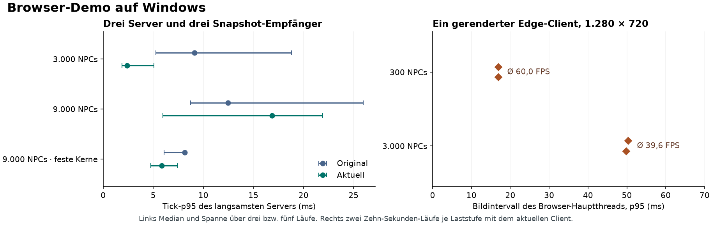
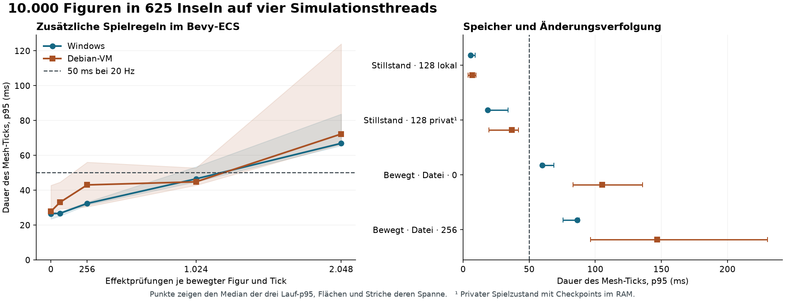

# Einsatzaudit für das persistente Bevy-Spiel

**Stand 26. November 2026, Spielcode `d9928d7`.** Ich würde das eigene Spiel jetzt an `zz-mesh` anbinden und einen begrenzten Mehrspielertest starten. Eine Freigabe für einen öffentlichen, persistenten Betrieb mit 10.000 Spielern würde ich zurückstellen. Räumlich getrennte Gruppen, mehrere zuständige Worker in einer Insel und wiederholbare Inventaraktionen sind ausführbar. Die engsten Grenzen im geprüften Aufbau sind haltbare Schreibvorgänge, die Anbindung einzelner Spielclients und die Lastmessung für die automatische Verteilung. [Integration](../crates/zz-mesh/README.md) · [Betriebs- und Ausfallverhalten](produktionsabnahme.md)

## Ist das heutige Projekt schneller als das Original?

Die gemeinsame Vergleichsgrundlage ist die WebSocket-Demo. Das Original `3ef0d78` enthielt die persistente Bevy-Bibliothek noch nicht. Für Windows ergänzt der vorhandene Referenzbau das Lockfile und die zwei portierten Diensteinstiege aus `a2c478b`. Je Messpunkt starteten drei Release-Server mit drei verbundenen Snapshot-Empfängern. Die Tabelle zeigt den Median über die Läufe, jeweils vom langsamsten Server. [Referenzbau](../scripts/build-benchmark-reference.mjs) · [Einzelläufe und Binär-Hashes](benchmarks/einsatzaudit.json.gz)

| Windows, ursprüngliche Browser-Demo | p95 Original | p95 heute | Beobachtung |
| --- | ---: | ---: | --- |
| 3.000 NPCs, 3 × 15 Sekunden | 9,10 ms | 2,36 ms | 74 % kürzer |
| 9.000 NPCs, 3 × 15 Sekunden | 12,45 ms | 16,85 ms | 35 % länger. Auch der p99 stieg von 15,21 auf 39,77 ms. |
| 9.000 NPCs, 5 × 12 Sekunden auf festen Kernen | 8,15 ms | 5,86 ms | 28 % kürzer. In allen fünf Laufpaaren war der aktuelle p95 niedriger. |

In allen drei Fällen erreichten beide Versionen rund 20 Server-Ticks und empfangene Snapshots pro Sekunde. Jeder Lauf hatte fünf Sekunden Vorlauf. Die erste Reihe nutzte die normale Windows-Threadplanung, die Kontrollreihe acht feste Performance-Kerne, einen logischen Prozessor pro Kern und umgekehrte Startreihenfolge. Innerhalb jeder Reihe wechselten sich die Versionen ab. Im teuersten aktuellen Lauf brauchte die Snapshot-Erstellung 17,17 ms p95 innerhalb von 19,97 ms Simulation. Die NPC-Startpositionen und Bewegungen verwenden Zufall. Die Messungen belegen einen Vorteil auf den festen Kernen. Welcher Anteil der Abweichung auf Scheduling, Weltzustand und Snapshot-Arbeit entfällt, bleibt offen. [Vergleichsprogramm](../scripts/compare-mesh.mjs) · [Spielschleife](../crates/sim-server/src/game_loop.rs)



**Was auf dem Endgerät passiert.** Ein einzelner Edge-Client führte den gebauten Three.js-Client bei 1.280 × 720 mit Rendering und Bewegung aus. Mit 300 NPCs waren 285–297 Figuren sichtbar. Beide Läufe erreichten **60 Bilder/s** und **16,9 ms** p95 zwischen Animationsframes. Bei 3.000 NPCs waren 2.869–2.926 Figuren sichtbar. Es blieben **39–40 Bilder/s** bei **49,8–50,3 ms** p95. In allen vier Messfenstern kamen rund 200 Snapshots in zehn Sekunden an. Der Client interpoliert und synchronisiert die sichtbaren Figuren bei jedem Renderframe. Gemessen wurde der Browser-Hauptthread einschließlich Wartezeit auf dem Testlaptop. Die Frametime des späteren nativen Spiels benötigt eine eigene Messung. [Render-Schleife](../client/src/renderer.ts) · [Browser-Messprogramm](../scripts/bench-render-client.mjs)

Für die **Bevy-Bibliothek** liefert der frühere Vergleich gegen `9a7e77b` die passende Vorhermessung. Beim Sternflug sanken die zu prüfenden Kandidaten von 54.014 auf 400 bei identischen Inseln und Updates. Beim abrupten Trennen von 256 Spielern sank die räumliche Zeit unter Windows von 13,45 auf 7,15 ms. Bei 10.000 bewegten Spielern und vier Threads blieb der p95 des gesamten Ticks auf Windows fast gleich (26,35 → 26,31 ms), auf Debian sank er von 30,96 auf 26,29 ms. Für eine tatsächlich sichtbare, vielköpfige Gruppe bestimmt zusätzlich die Zahl der benötigten Empfänger den Aufwand. [Messung von Sternflug, Annäherung, Merge und Trennung](raumgruppen.md)

## Was kostet zusätzliche Arbeit pro Spieler?

Der Release-Profiler führt ein Bevy-`Update` auf jeder zuständigen Spielfigur aus. Persönliche Effektlisten enthalten Intervall, Phase und Stärke. Bei 1.024 Einträgen je Figur belegen die Listenelemente für 10.000 Spieler zusammen rund 117 MiB (12 Byte je Eintrag). Der Test berechnet fälligen Schaden und Heilung, prüft für jede Figur beide Endwerte unabhängig und kontrolliert private Daten, Positionen und Empfänger. Das bildet CPU- und Speicherarbeit pro Spieler ab. Pfadsuche, Physik mit vielen Kontakten und spielweite Markttransaktionen haben andere Kostenkurven. [Messsystem](../examples/infinite-stars/src/bin/mesh-profile/gameplay.rs) · [Profiler und Prüfungen](../examples/infinite-stars/src/bin/mesh-profile.rs)



**Lesehilfe.** 10.000 Figuren, 625 getrennte Inseln mit je 16 Figuren und zwei zuständigen Workern pro Insel. Insgesamt 32 Bevy-Welten in einem Prozess, vier Simulationsthreads, vier Aufwärmticks und 40 gemessene Ticks je Lauf. Der Tick wartet auf den letzten Thread. Pro Fall gab es drei Läufe. Jede Tabellenzelle zeigt den Median der drei Lauf-p95 und in Klammern die Zahl der Ticks über 50 ms von insgesamt 120. 50 ms entsprechen 20 Hz. Jede bewegte Variante bestätigte pro Lauf 100.000 Eingaben, installierte 400.000 Peer-Updates und prüfte null Abonnements zu fremden Inseln. Die Platzierung bleibt für diese Kostenmessung fest. Windows 11 und die Debian-12-VM mit sechs vCPUs liefen nacheinander auf demselben Core i7-13850HX. [Rohdaten mit Phasen, Allokationen und Einzelläufen](benchmarks/einsatzaudit.json.gz)

| Arbeit je bewegter Figur | Windows p95 (über Budget) | Debian-VM p95 (über Budget) |
| --- | ---: | ---: |
| Bewegung und Replikation, SQLite im RAM | 26,6 ms (0) | 27,8 ms (0) |
| Dazu 64 Effekte je Tick | 26,7 ms (0) | 33,0 ms (1) |
| 256 Effekte je Tick | 32,4 ms (0) | 43,1 ms (6) |
| 1.024 Effekte je Tick | 46,5 ms (3) | 44,8 ms (4) |
| 2.048 Effekte je Tick | 66,9 ms (120) | 72,3 ms (119) |
| 1.024 Effekte, je Figur jeden vierten Tick | 33,5 ms (1) | 57,2 ms (22) |
| Bewegung und Replikation, SQLite-Datei mit synchronem WAL | 59,7 ms (55) | 105,4 ms (120) |
| Dieselbe Datei, dazu 256 Effekte je Tick | 86,2 ms (109) | 146,8 ms (120) |

**Mehr Kerne helfen bei unabhängigen Inseln.** Bei 1.024 Effekten je Figur und Tick erreichten ein, vier und acht Simulationsthreads unter Windows **143,1 / 46,5 / 35,4 ms** p95. Nur mit acht blieben hier alle 120 Ticks im Budget. In der VM ergaben sich **192,8 / 44,8 / 48,5 ms**. Acht Simulationsthreads teilen sich dort sechs vCPUs. Die Messung umfasst mehrere unabhängige Bezugssysteme und einen gemeinsamen Store. Sie liefert keine lineare Hochrechnung auf EPYC, mehrere Hosts oder einen einzigen eng gekoppelten Kampf. [Kernskalierung](kernskalierung.md)

**Seltener rechnen lohnt sich je nach System.** Bei 1.024 Effekten sank die Zahl der Prüfungen durch Staffelung von 10,24 auf 2,56 Millionen je Tick. Auf Windows sank die summierte Zeit der Effektsysteme von 72 auf 19 ms je Tick, auf Debian von 71 auf 23 ms. Diese Zeiten summieren parallel laufende Systeme. Der Gesamt-p95 verschlechterte sich in der VM trotz der Ersparnis. Schaden und Heilung stimmen jeweils bis zum letzten Verarbeitungstick. Ein zeitkritischer Treffer dürfte sich mit dieser Einstellung um bis zu drei Ticks (150 ms) verspäten. Geeignet ist die Staffelung etwa für periodische Regeneration.

**Stillstand zeigt vermeidbare Arbeit.** Ohne Effekte lag Windows bei 2,3 ms p95. Mit 128 lokalen Effekten waren es 5,5 ms, mit identischer Rechnung und privat registriertem, persistentem Ergebnis 18,6 ms. Auf Debian waren es 3,4 / 6,9 / 37,0 ms. Im privaten Fall entstanden in jedem 40-Tick-Lauf 500.000 Komponentenprojektionen und null ausgelieferte Peer-Updates. Die Differenz umfasst Checkpoints, räumliche Neubewertung und Aufbereitung abonnierter Felder. Ihr jeweiliger Anteil bleibt offen. [Änderungserfassung](../crates/zz-mesh/src/bevy_runtime.rs) · [Publisher](../crates/zz-mesh/src/publish.rs)

## Welche Lücken entscheiden über den Einsatz?

| Priorität | Befund im laufenden Spielpfad | Nächste Freigabebedingung |
| --- | --- | --- |
| 1 · Mehrspielerzugang | Der Beispielhost ordnet ein Spielerzertifikat einer festen Actor-ID zu. Der lokale Pool kennt individuelle Clientsichten. Der Netzwerkbroker nimmt Worker-Sichten an und liefert Nachbar-Updates an Worker. Der mTLS-Spielclient synchronisiert seinen eigenen Actor. Der Listener nutzt einen Thread pro Verbindung und teilt die 256 Plätze des verteilten Hosts zwischen Spielern, Peers und Verwaltung. | Konten an Actor-IDs binden, individuelle Nachbarsichten mit ACK und Wiederaufnahme an Spielclients liefern. Gleichzeitige authentifizierte Clients, Eingabe-ACK und Empfangsrate des langsamsten Clients testen. [Host](../examples/infinite-stars/src/host.rs) · [Broker und Versand](../crates/zz-mesh/src/network_mesh.rs) · [Sync](../crates/zz-mesh/src/remote.rs) · [Listener](../crates/zz-mesh/src/wire.rs) |
| 2 · Dauerhafte Wirtschaftslogik | Registrierte Aktionshandler laufen innerhalb der SQLite-Schreibtransaktion. Checkpoints können einen Commit teilen, ihre Aufrufer warten auf die Bestätigung. Schon der Dateilauf ohne Zusatzeffekte überschritt das Budget. Der Authority-Dienst benötigt beim Wiederanlauf seinen intakten Datenträger oder ein Backup. | Teure Kandidatensuche im Spiel-ECS vorbereiten, Bestand und Revision beim kurzen Commit erneut prüfen. Den tatsächlichen Mix aus Bewegung, Handel und Inventar bei konkurrierenden Clients auf dem Zieldatenträger messen. Wiederherstellungszeit und tolerierbaren Datenverlust beim Verlust eines Hosts abnehmen. [Aktionsausführung](../crates/zz-mesh/src/store.rs) · [Checkpoint-Writer](../crates/zz-mesh/src/store/checkpoint_writer.rs) · [Wiederanlauf](produktionsabnahme.md) |
| 3 · Automatische Verteilung | Die gemeldete Tickzeit erfasst Bevy-Systeme und Peer-Replikation. Derselbe Thread bearbeitet danach Eingaben und Aktionen mit einem weichen Zeitlimit. Diese Zeit fehlt in der Lastmeldung. Das Speicherbudget erfasst den Blobcache. Ohne eigene Gruppenmessung verteilt der Controller die Tickkosten rechnerisch gleichmäßig. | Gesamten Worker-Zyklus, Alter ausstehender Anfragen, Commit-Latenz und Prozessspeicher messen. Mit einer wirtschaftlich heißen Gruppe prüfen, ob der Controller sie rechtzeitig auf einen geeigneten Worker verlegt. Der Standardbroker verwaltet bis zu 64 Worker-Slots. [Host-Schleife](../examples/infinite-stars/src/host.rs) · [Lastmeldung](../crates/zz-mesh/src/remote.rs) · [Controller](../examples/infinite-stars/src/supervisor.rs) |
| 4 · Private ECS-Änderungen | Eine Änderung an einem registrierten Schema markiert die ganze Entity als geändert. Dadurch werden bei rein privater Arbeit auch die räumliche Beschreibung und die abonnierten Felder erneut betrachtet. Im Test blieb der private Inhalt auf dem zuständigen Worker. | Getrennt verfolgen, ob sich Position, persistenter Zustand oder ein bestimmtes sichtbares Feld geändert hat. Den Stillstandstest mit unveränderten Sichtbarkeits-, Checkpoint- und Handoff-Garantien wiederholen. [Pool](../crates/zz-mesh/src/pool.rs) · [Änderungserfassung](../crates/zz-mesh/src/bevy_runtime.rs) · [Publisher](../crates/zz-mesh/src/publish.rs) |

**Was schon trägt.** Die Prozesstests prüfen bestätigte Aktionen nach verlorener Antwort, überlebende Sitzungen, Handoff mit nur einem gültigen Writer sowie die gezielte Zustellung zwischen Workern. Der frühere WebSocket-Test erreichte mit dem Browserprotokoll 10.000 verbundene Lastclients in 5.000 räumlich getrennten Paaren. Im längeren Zehn-Sekunden-Fenster kamen alle vorgesehenen Eingaben zurück, Eingabe-p95 75,6 ms, langsamster Empfänger 19,6 Snapshots/s. Im persistenten Bevy-Spiel lagen echte Worker-Verbindungen und simulierte Spielersitzungen in getrennten Tests. Die Framezeit des eigenen nativen Spielclients bleibt offen. [Prozesstests](../examples/infinite-stars/tests/process.rs) · [Client- und Regionsmessungen](tickprofil.md)

**Was ein Wechsel über echte Worker kostet.** Acht Prozesse mit getrennten Datenverzeichnissen, eigener Authority und 64 Figuren lieferten zwischen fremden Ursprungsinseln **0 → 1.536 → 0** Updates in den Haltefenstern vor, während und nach der Vereinigung. Beim Wechseln von Spielern zwischen Inseln erreichte der langsamste p95 der Wechselfenster **319 ms**. Gemessen wurde vom Setzen der Positionen bis zum Nachweis der erwarteten Repliken auf allen beteiligten Workern, einschließlich Abfrage und Wartezeit des Prüfers. Das ist die Konvergenz einer ganzen Gruppe. Die Eingabelatenz eines einzelnen Spielers wird separat gemessen. [Verteilter Messpfad](../examples/infinite-stars/src/bin/cluster-wire.rs) · [Einzelne Übergänge](benchmarks/einsatzaudit.json.gz)

**Wie teuer ist eine echte Inventaraktion?** Der Dateitest mit vier Zielobjekten pro Aktion bestätigte je Pfad 192 verschiedene Drops in Achterbatches. Drei Batches wurden zusätzlich wiederholt. Der p95 für eine Batchantwort betrug direkt **2,65 ms** und über Loopback-mTLS **5,59 ms** (Debian **3,03 / 4,28 ms**). Ein Client sendete seriell direkt an den Service. Bei parallelen Spielern kommen die Warteschlange der Worker-Schleife und konkurrierende Commits hinzu. Für die Abnahme zählt die Zeit von der Eingabe bis zur bestätigten Aktion. [Messpfad](../examples/infinite-stars/src/bin/mesh-bench.rs)

**Freigabemaßstab.** Für das eigene Spiel würde ich zunächst je Lastfall ein p95-Ziel von 35 ms im vollständigen 50-ms-Workerzyklus vereinbaren und p99, verpasste Ticks, Empfangsrate und Aktionslatenz separat erfassen. Der nächste Nachweis braucht den echten Spielclient, gleichzeitig laufende Spielsysteme und Aktionen, getrennte sowie verschmelzende Inseln und mindestens zwei physische Hosts. Für Schreibvorgänge gehören ein absichtlicher Neustart, Wiederholung derselben bestätigten Aktion und Wiederherstellung nach Volume-Verlust dazu. Die gemessene 10.000er-Simulation belegt die räumliche Aufteilung. Die öffentliche Spielergrenze hängt auch von diesen Freigaben ab.

**Prüfstand.** Auf Windows bestanden 699 Rust-Tests, die TypeScript-Tests und der Client-Produktionsbuild. Hinzu kamen die beiden Live-Smoke-Szenarien, zwei Starts eines separaten Spiels gegen den Git-Import und der verteilte mTLS-Test. Unter Debian bestanden die 50 Rust-Tests von `zz-mesh` und `infinite-stars`. Der Formatcheck bestand nach Korrektur eines bereits abweichenden Imports. `cargo audit` meldete mit Datenbankstand vom 25. November 2026 null bekannte Verwundbarkeiten und drei Wartungswarnungen. `npm audit` meldete für die vier geprüften Lockfiles jeweils null. Die Prüfung deckt bekannte Abhängigkeitseinträge ab. [Prüfergebnisse](benchmarks/einsatzaudit.json.gz) · [RustSec zu basic-toml](https://rustsec.org/advisories/RUSTSEC-2026-0374.html) · [bincode](https://rustsec.org/advisories/RUSTSEC-2025-0141.html) · [rustls-pemfile](https://rustsec.org/advisories/RUSTSEC-2025-0134.html)

## Kurzer Test auf dem eigenen Rechner

```sh
npm run bench:compare -- --npcs 3000,9000 --repeats 3 --seconds 15
npm run bench:profile -- --players 10000 --workers 32 --partitions 4 --ticks 40 --status-effects 256 --output target/spielregeln.json
```

Für den direkten Vergleich denselben Aufruf mit `--status-effects 0` und eigener Ausgabedatei wiederholen. Mit `--database target/spielregeln-neu.sqlite` kommt ein eigener, vorher freier Datenbankpfad hinzu. `--effect-interval 4` staffelt die Berechnung. `--active-percent 0` misst ruhende Figuren, `--local-effects` hält die Effektergebnisse als gewöhnliche, flüchtige Bevy-Komponenten.

Für die Browser-Messung Playwright im Repository-Root mit `npm ci` installieren, unter Linux zusätzlich `npx playwright install chromium`. Die Demo mit `npm start -- --servers 3 --npcs 3000` öffnen und in einem zweiten Terminal `node scripts/bench-render-client.mjs --seconds 10 --out target/bilder.json` starten. Der Profiler akzeptiert auch `--url` für einen bereits laufenden Release-Aufbau. Die archivierten Rendering-Läufe verwendeten den Produktionsbuild des Clients und Release-Server. Beide Grafiken lassen sich mit `python scripts/plot-gameplay-audit.py` neu erzeugen.
