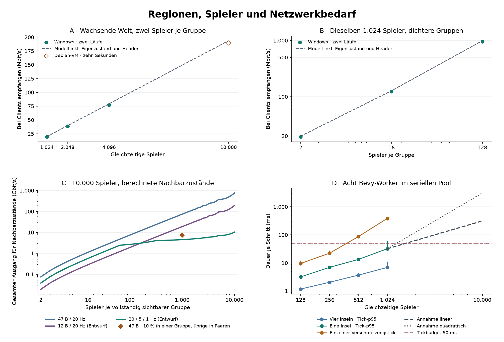

# Kapazitätsplan für 10.000 Spieler

**Für eine Welt mit 10.000 Spielern zählt die Zahl ihrer sichtbaren Nachbarn.** Auf Debian hielten acht Sim-Server 10.000 WebSocket-Verbindungen in 5.000 räumlich getrennten Zweiergruppen. Über vier kurze Läufe wurden 1,1 Millionen geplante Eingaben bestätigt. Im Zehn-Sekunden-Lauf bei 20 Snapshots und fünf Eingaben je Spieler und Sekunde empfingen die Clients zusammen **190 Mbit/s**. Für den persistenten Bevy-Zugang mit 10.000 unterschiedlichen mTLS-Spielkonten und für eine einzige große Schlacht stehen unten die nächsten Abnahmen. [Gemessener 10.000er-Lastpunkt](tickprofil.md)



## Wie viel muss eine Region versenden?

Die genaueste Rechnung summiert für jeden Client die Änderungen seiner tatsächlichen sichtbaren Objekte. Bei 47 Byte je bewegtem Nachbarn und 20 Updates/s gilt für vollständig gegenseitig sichtbare Gruppen

```text
Nachbar-Nutzlast in Bit/s = 8 × 47 × 20 × Summe über alle Gruppen(n × (n − 1))
```

Bei gleichbleibender Gruppengröße wächst die Summe linear mit der Weltbevölkerung. Zwei Gruppen mit jeweils 100 Spielern erzeugen beim vollständigen Verschmelzen 20.000 zusätzliche gerichtete Sichtbeziehungen und damit **150,4 Mbit/s** zusätzliche Nachbarzustände. In einer lang gezogenen Insel sehen die Spieler an den äußeren Enden einander möglicherweise nie. Dann zählen nur die tatsächlich benötigten Beziehungen. Auch auf demselben Worker behalten entfernte Inseln ihre eigenen Spielersichten. [Räumliches Interesse und Isolation](octree-messung.md) · [47-Byte-Datensatz der Browser-Demo](../crates/sim-server/src/encoding.rs)

| Verteilung derselben 10.000 Spieler | Nachbar-Nutzlast gesamt | Beim Spieler mit den meisten Nachbarn |
| --- | ---: | ---: |
| 5.000 Gruppen à 2 | 0,0752 Gbit/s | 0,00752 Mbit/s |
| 625 Gruppen à 16 | 1,128 Gbit/s | 0,113 Mbit/s |
| 100 Gruppen à 100 | 7,445 Gbit/s | 0,744 Mbit/s |
| 4.500 Zweiergruppen und eine Schlacht mit 1.000 | 7,580 Gbit/s | 7,512 Mbit/s |
| 10 Gruppen à 1.000 | 75,125 Gbit/s | 7,512 Mbit/s |
| Alle 10.000 sehen alle anderen | 751,925 Gbit/s | 75,192 Mbit/s |

Im gemischten Beispiel entfallen **99,1 %** der Nachbar-Nutzlast auf die eine Schlacht. Für den Vergleich mit echten Verbindungen kommen Eigenzustand und Snapshot-Header hinzu. Im einfachen Vollbildmodell sind das bei 10.000 Spielern und 20 Hz weitere **118,4 Mbit/s**. Das ergibt **193,6 Mbit/s** für die Zweiergruppen, gegenüber den gemessenen 190 Mbit/s. Die zusätzlich für UDP eingereihten 125 Mbit/s betreffen die Peer-Verbindungen. Verbindungsaufbau, Regionsmeldungen und Kontrollverkehr fallen auch bei getrennten Inseln an. Im mTLS-Prozesstest wurden bei getrennten Inseln 768 Entity-Updates installiert, davon null zwischen den fremden Gruppen. [Messgrenzen und Rohdaten](tickprofil.md)

## Was die kurzen Läufe zeigen

Zum Vergleich der Gruppengrößen liefen auf Windows **1.024 native WebSocket-Clients**, acht Sim-Prozesse und vier Lasttreiber. Jede Verteilung wurde zweimal für vier Sekunden gemessen, in umgekehrter Reihenfolge. Die Clients bewegten sich, prüften den Empfang eines Nachbarn auf einem anderen Worker und bestätigten in jedem Lauf alle 20.480 geplanten Eingaben. In jeder Verteilung erhielt der langsamste Client mindestens 19 Snapshots/s.

| Gruppen × Spieler | Tatsächlich empfangene Nutzdaten, beide Läufe | Eingabebestätigung p95 |
| --- | ---: | ---: |
| 512 × 2 | 19,25–19,27 Mbit/s | 54,0–54,7 ms |
| 64 × 16 | 123,69–124,09 Mbit/s | 54,9–55,4 ms |
| 8 × 128 | 944,91–961,10 Mbit/s | 54,8–56,9 ms |

Die Gegenprobe hält die Gruppengröße bei **zwei Spielern** und erhöht die Weltbevölkerung bei denselben acht Windows-Servern und vier Lasttreibern. Bei **1.024 / 2.048 / 4.096 Spielern** betrug der mittlere Gesamtempfang über zwei Läufe **19,3 / 38,4 / 77,0 Mbit/s**. Die vierfache Bevölkerung verursachte viermal so viele Bytes. Alle sechs Läufe bestanden die interaktiven Kriterien. Bei 4.096 Spielern wurden je Lauf alle 81.920 Eingaben bestätigt, mit **71,3 und 73,5 ms p95**. Der langsamste Client erhielt 18,75 Snapshots/s. Die frühere Windows-Grenze von 2.048 bezog sich auf eine andere Gruppendichte. Unter Debian erreichten die 10.000 Spieler in Paaren 19,0 kbit/s je Client, auf Windows waren es über die drei Größen 18,6–18,9 kbit/s. [Rohdaten der Regionsläufe](benchmarks/kapazitaet-dichte-windows.json.gz) · [Bisherige Windows- und Debian-Lastpunkte](tickprofil.md)

Für den persistenten Bevy-Tick lief dieselbe Bewegungsspur jeweils mit vier getrennten Gruppen und nach ihrer Verschmelzung. Acht Worker-Worlds wurden im lokalen Pool seriell ausgeführt. Die stabilen Phasen umfassen je 32 Schritte. Jede Größe hat drei Läufe mit wechselnder Startreihenfolge. Die Tabelle zeigt den Median der Lauf-p95 und den Median der einzelnen Übergangsticks. [Messcode](../examples/infinite-stars/src/bin/cluster-bench.rs) · [Einzelmessungen, Hardware und Binärhashes](benchmarks/kapazitaet-dichte-windows.json.gz)

| Bewegte Spieler | Vier Gruppen, Tick-p95 | Eine Gruppe, Tick-p95 | Erster Verschmelzungstick |
| ---: | ---: | ---: | ---: |
| 128 | 1,18 ms | 3,19 ms | 9,58 ms |
| 256 | 2,06 ms | 6,99 ms | 22,32 ms |
| 512 | 3,69 ms | 13,39 ms | 86,82 ms |
| 1.024 | 6,95 ms | 32,10 ms | 386,36 ms |

Die 1.024er-Läufe streuten in der dichten stabilen Phase von **29,26 bis 60,58 ms p95**. Vom Median aus ergeben sich für **eine** Gruppe mit 10.000 Spielern bei linearer Fortsetzung **313 ms**, bei quadratischer **3.061 ms** pro Schritt. Diese zwei Rechenbeispiele zeigen die Empfindlichkeit gegenüber der Wachstumsannahme. Wie viel davon parallel nutzbar ist, muss derselbe Kampf auf mehreren Prozessen zeigen. Der abrupte Merge prüfte bei 1.024 Spielern genau **1.048.576 räumliche Kandidaten**. Dasselbe Muster ergäbe 100 Millionen bei 10.000. Mit acht vollständig beteiligten Workern ergäben sich außerdem 70.000 gerichtete Worker-Updates pro Tick, mit 32 Workern 310.000. Der heutige Dichtetest hat eine auf 8.192 Einträge begrenzte Ausgangsqueue. Budgetiertes Zustellen und gemeinsame Verarbeitung identischer Sichtbereiche gehören vor die nächste Dichtestufe.

## Welche Maschinen und Threads einplanen?

**Erster physischer Versuchsaufbau für die regionale Welt und mTLS:** zwei Linux-Spielhosts mit je **16 physischen Kernen, 64 GiB RAM, lokaler NVMe und einem 25-Gbit/s-Port**, dazu ein unabhängiger Lastrechner derselben Klasse. Je Spielhost starten vier Sim-Prozesse. Nach dem Umbau des Listeners beginnt der Vergleich mit einem und zwei asynchronen I/O-Threads je Prozess. Der Authority-Dienst benutzt für den ersten Versuch die NVMe des ersten Hosts. Anschließend lässt sich sein Anteil an der Commit-Latenz auf einem separaten Host bestimmen. RAM und Schnittstellen sind Startwerte für den Versuch. Die Rechnung für den späteren Betrieb verwendet das gemessene RSS, die tatsächlichen Netzwerkbytes und die Leistung je Host auf dem Zielprozessor. Reale Beispiele für diese Hardwareklasse sind der EPYC 9135 mit 16 Kernen und 25-GbE-Adapter mit SFP28. [AMD-Prozessordaten](https://www.amd.com/en/products/processors/server/epyc/9005-series/amd-epyc-9135.html) · [NVIDIA-Adapterspezifikation](https://networking-docs.nvidia.com/connectx6lxhw/specifications)

- **CPU.** Am bestandenen 10.000er-WebSocket-Lastpunkt belegten die Sim-Prozesse 8,89 logische CPUs, die Lasttreiber weitere 6,03. Bei gewählten 70 % Zielauslastung ergibt das rund **13 bzw. 9 CPU-Äquivalente der Messmaschine**. Die Debian-VM hatte 24 vCPUs auf einem i7-13850HX. Auf nativem Windows kosteten die Zweiergruppen mit 1.024 / 2.048 / 4.096 Spielern im Mittel 1,83 / 3,19 / 7,60 Sim-CPUs. Eine lineare Hochrechnung jedes dieser Punkte auf 10.000 ergibt **15,6 bis 18,6 belegte Windows-CPUs** vor Reserve. mTLS, das eigene Gameplay, persistente Aktionen und der Zielprozessor erhalten eigene Messpunkte.
- **Worker.** Bei denselben 10.000 Spielern mit reduzierter Rate sanken die medianen Eingabe-p95 mit 4 / 8 / 16 Sim-Prozessen von **66,5 auf 60,1 auf 54,4 ms**. Der CPU-Bedarf stieg von **3,24 auf 3,98 auf 4,60**. Im internen Bevy-Test mit 32 Workern und 1 / 4 / 8 / 16 parallelen, unabhängigen Referenzräumen lagen die Tick-p95 bei **71,2 / 25,8 / 20,3 / 20,4 ms**. Acht Räume brachten hier Faktor 3,5 gegenüber einem. Eine Schlacht in einem gemeinsamen Raum hat andere Abhängigkeiten. [Worker- und Threadkurven](tickprofil.md)
- **Rechnerzahl.** Trägt ein physischer Spielhost im vorgesehenen Regionsmix mit mTLS und gesetzter Reserve 1.250 / 2.500 / 5.000 Spieler, braucht die Welt rechnerisch **8 / 4 / 2 Spielhosts**. Für die Übernahme der Last eines ausgefallenen Hosts kommt je ein weiterer hinzu. Das setzt teilbare Last und genügend Kapazität für die jeweils größte Kampfgruppe voraus. Ein heutiger Directory-Broker verwaltet höchstens 64 Worker-Slots. Oberhalb davon braucht das Directory eine Aufteilung mit geregeltem Wechsel zwischen den Regionen. Für die dauerhafte Authority ist eine getestete Wiederherstellung erforderlich. [Worker-Verzeichnis](../crates/zz-mesh/src/network_mesh.rs)
- **Netz im Sonderfall der Vollsicht.** 10.000 Spieler mit je 9.999 bewegten Nachbarn verarbeiten je **199.980 Figurenzustände/s** bei 20 Hz. Unter der Annahme von 15 % Protokollaufschlag, 70 % Zielauslastung und gleichmäßig verteilter Ausgabe ergibt das beim heutigen 47-Byte-Format **13 Ports à 100 Gbit/s oder 50 à 25 Gbit/s**. Das sind aggregierte Ausgangsports. Switch, externer Uplink und Empfänger müssen die Rate ebenfalls tragen. Ein Format mit durchschnittlich 12 Byte bei gleicher Frequenz ergäbe **192 Gbit/s** bzw. vier 100-Gbit/s-Ports. Die erreichbare Präzision und die durchschnittliche Feldgröße brauchen einen Codec-Test.

Wenn das Spiel es erlaubt, kann in einer großen Schlacht **jede Figur sichtbar** bleiben und je nach Bedeutung unterschiedlich häufig aktualisiert werden. Ein Rechenbeispiel überträgt 64 priorisierte Gegner zu 20 Hz mit 24 Byte, 256 weitere zu 5 Hz mit 16 Byte und alle übrigen zu 1 Hz mit 8 Byte. Bei 10.000 Spielern ergeben sich **10,29 Gbit/s** an Nachbarzuständen, rund **1,03 Mbit/s pro Spieler**. Für getrennte Gruppen zählt in jeder Stufe nur die jeweilige lokale Nachbarschaft. Priorität muss sich auch nach Ziel, Geschoss oder Interaktion richten, wenn Spieler dicht beieinander stehen. Treffer, Besitzwechsel und dauerhafte Aktionen behalten ihre fachlichen Garantien. Beide kompakteren Profile sind Entwürfe.

## Umsetzung und Abnahme

| Schritt | Änderung | Kriterium für die nächste Stufe |
| --- | --- | --- |
| 1. mTLS-Zugang | Der Beispielhost teilt 256 Plätze je verteiltem Worker zwischen Spiel- und Peer-Verbindungen und startet je Verbindung einen OS-Thread. Allein 10.000 Einstiegsverbindungen benötigen rechnerisch mindestens 40 Prozesse. Dazu kommen sichtbare Quellen und Peers. `provision-client` bindet einzelne Zertifikate an Actor-IDs, und jeder Worker kann Spielersichten vermitteln. Für die Lastabnahme den Listener auf asynchrones I/O umstellen und die Worker-Arbeit pro Abruf budgetieren. | Auf Windows und Debian mit 1.000 → 2.500 → 5.000 → 10.000 offenen Sitzungen erst Login und Leerlauf, dann Eingaben und räumliche Sichten prüfen. Handshakes/s, RSS, Threads, CPU, Verbindungsabbrüche und Fairness je Sitzung erfassen. [Spielersicht](spielersicht.md) · [Heutiger Listener](../crates/zz-mesh/src/wire.rs) · [Beispielhost](../examples/infinite-stars/src/host.rs) |
| 2. Getrennte Regionen | Acht Worker über die zwei Hosts verteilen. Bei gleichbleibender lokaler Dichte die Zahl der Inseln erhöhen. Spielersteuerung, persistente Aktionen und echte Peer-Updates gemeinsam aktivieren. | Je Laststufe dreimal zehn Sekunden nach abgeschlossenem Login. Bei 10.000 Spielern je Lauf 500.000 geplante und bestätigte Inputs, p95 ≤ 150 ms, langsamster Client ≥ 18 Snapshots/s, angestrebter Sim-Tick-p99 ≤ 50 ms. Getrennte Inseln haben null fachlich unnötige Entity-Updates. |
| 3. Regionen treffen sich | Bei gleicher Gesamtbevölkerung erst einzelne Gruppen von 100, dann 1.000 Spielern verschmelzen und wieder trennen. Gleiche Sichtbereiche je Worker zusammenfassen, bevor für jeden Spieler Überschneidungen materialisiert werden. Neue Nachbarn anhand ihrer Bewegung vorab abonnieren, Baselines und Ausgangsbytes budgetieren. | Ersten Merge-/Split-Tick, Baseline-Alter und Queue-Spitze separat prüfen. Nahe Gegner sind rechtzeitig sichtbar. Nach der Trennung endet der fremde Entity-Strom. Die übrigen Regionen halten ihre Empfangs- und Latenzziele. |
| 4. Große Schlacht und endgültige Maschinenzahl | Die dichte Einzelgruppe stufenweise auf 2.000, 5.000 und 10.000 steigern. Für Vollsicht und gestaffelte Aktualität je einen eigenen Lauf fahren. Identische Nutzdaten je Sichtgruppe einmal kodieren. Jeder Client behält seine bestätigte Basis, privaten Felder und seinen TLS-Schlüssel. | Auf unabhängigen Hosts NIC-Bytes und Drops, CPU je Kern, WAL-Commit-p99, Alter der sichtbaren Zustände und Client-Dekodierzeit messen. Ein echter Spielclient misst zusätzlich die Renderzeit. Einen Worker im laufenden Spiel ersetzen und bestätigte Aktionen auf Vollständigkeit und Duplikate prüfen. Aus bestandenen Lastpunkten ergibt sich die Produktionsgröße. |

## Nachrechnen und nachmessen

Der Rechner verwendet Python 3 ohne zusätzliche Pakete. Für die Grafik wird Matplotlib benötigt. `--regions` gibt **Anzahl Gruppen × Spieler je Gruppe** an. Die Linkrechnung macht die Annahmen für Protokollaufschlag, Grundverkehr und Auslastung einstellbar.

```sh
python scripts/capacity-plan.py --regions 5000x2
python scripts/capacity-plan.py --regions 4500x2,1x1000
python scripts/capacity-plan.py --group-size 10000 --link-gbps 100
python scripts/capacity-plan.py --figure docs/benchmarks/kapazitaet-10000.png
cargo run --release --locked -p infinite-stars --bin cluster-bench -- target/crowd-1024.json --crowd 1024
node scripts/local-mesh.mjs bench --servers 8 --socket-players 1024 --socket-drivers 4 --islands 64 --seconds 4
```
