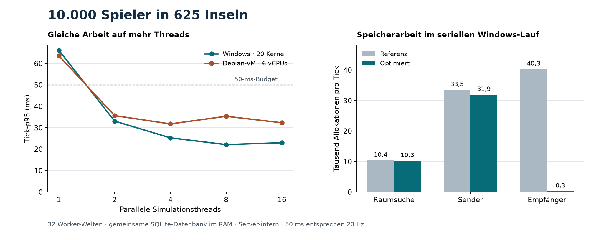

# 10.000 Spieler auf mehreren Kernen

**Für den ersten EPYC-Lastlauf mit 10.000 regional verteilten Spielern würde ich acht physische Kerne für die Simulation budgetieren und mit vier sowie acht Simulationsthreads beginnen.** Wenn Spielzugang, mTLS, Persistenz und Betriebssystem auf derselben Maschine laufen, sind 16 physische Kerne eine erste Planungsgröße. Die zweite Hälfte ist geschätzte Reserve. Gemessen wurden Windows auf einem Core i7-13850HX mit 20 Kernen und Debian auf demselben Rechner mit sechs vCPUs. Die Abnahme für 10.000 gleichzeitige mTLS-Spielclients auf physischer Hardware steht aus. [Aufbau und Abnahmekriterien](kapazitaetsplan.md)



| Simulationsthreads bei 32 Worker-Welten | 1 | 2 | 4 | 8 | 16 |
| --- | ---: | ---: | ---: | ---: | ---: |
| Windows, Tick-p95 in ms | 66,1 | 33,1 | 25,3 | 22,1 | 23,0 |
| Debian, Tick-p95 in ms | 63,6 | 35,6 | 31,8 | 35,3 | 32,3 |

Die Tabelle zeigt pro Stufe den Median zweier Lauf-p95. Ab zwei Threads blieben in dieser Messreihe auf beiden Betriebssystemen alle 64 Ticks je Stufe unter 50 ms. Das strengere unten beschriebene 35-ms-Kriterium für **beide** Läufe erreichte Windows zuerst mit zwei Threads, Debian mit 16. Vier Threads hatten auf Debian den niedrigsten mittleren p95. Der Wechsel von acht auf 16 Threads erhöhte das Windows-p95 um 0,9 ms. Die Worker-Welten teilen sich den Store und warten am Ende jedes Messticks auf den langsamsten Raum.

## Vorher und nachher

Beide Release-Binärstände liefen abwechselnd auf demselben Host. Referenz ist `9781abb`. Der interne 10.000er-Lauf bestätigte je 40 Messticks **100.000 Eingaben und 400.000 Peer-Updates**. Für jede Figur kontrollierte er die Position auf dem zweiten Worker, ihre Zuständigkeit, private Daten und den erwarteten einzigen Peer. Zwischen fremden Inseln bestanden am Prüfpunkt **null Subscriptions**. [Rohmessungen](benchmarks/kernskalierung-10000.json.gz)

| Lastfall | Windows vorher → aktuell | Debian vorher → aktuell |
| --- | ---: | ---: |
| 10.000 bewegt, ein Thread, Tick-p95 | 72,8 → 64,7 ms | 88,4 → 65,8 ms |
| 10.000 bewegt, 16 Threads, Tick-p95 | 24,2 → 19,8 ms | 40,3 → 36,6 ms |
| 256 Spieler, vier getrennte Inseln, Tick-p95 | 2,10 → 1,78 ms | 1,98 → 1,65 ms |
| 256 Spieler, alle in einer Insel, Tick-p95 | 6,91 → 4,74 ms | 7,18 → 5,32 ms |
| Einzelner Tick der Verschmelzung | 23,78 → 22,98 ms | 27,78 → 26,87 ms |
| Einzelner Tick der Trennung | 16,57 → 14,70 ms | 15,60 → 15,11 ms |

Die 10.000er-Werte sind Mediane von drei Lauf-p95. Auf Windows lagen alle 120 parallelen Ticks im Budget. Auf Debian überschritt der optimierte Lauf mit 16 Threads einmal die Frist mit **52,3 ms**. Alle 120 parallelen Ticks der Referenz blieben dort im Budget. Die Clusterwerte beruhen auf **15 Wiederholungen je Stand und Betriebssystem**. Merge und Trennung enthalten jeweils den Aufbau bzw. Abbau der Nachbarschaften. Framezahl, Feldbytes, Baselines und Endzuordnungen stimmten zwischen beiden Varianten in allen Durchgängen überein.

Im seriellen Windows-Lauf sank der Aufwand von **95.550 auf 53.821 Rust-Allokationen** und von **23,00 auf 13,32 MB** angefordertem Speicher pro Tick. Davon entfielen beim Empfänger vorher 40.315 und anschließend 315 Allokationen pro Tick. Am teuersten blieben die räumliche Verarbeitung mit **14,0 ms** und das Erstellen der ausgehenden Updates mit **13,1 ms** im Median. Empfangen und Bestätigen kostete **9,6 ms**. Die End-to-End-Latenz der Spielclients erfassen die separaten Socket-Tests. Bei den 256 vereinten Spielern genügten 12.288 Komponentenprojektionen für 57.344 ausgelieferte Frames in 32 Ticks.

In der ursprünglichen Browser-Demo mit drei Servern, drei Clients und 3.000 NPCs lag der p95 des langsamsten Servers bei **3,36 ms** im Original und **3,18 ms** im aktuellen Stand. Beide lieferten **19,98 Hz**. Gemessen wurden je zwei 15-Sekunden-Läufe.

Ein Debian-Prozesstest traf eine Übergabe zwischen dem Commit einer Inventaraktion und dem nächsten ECS-Tick. Der Controller wartet jetzt auf die bestätigte Revision. Anschließend bestanden die sechs Debian-Prozesstests drei zusätzliche vollständige Durchgänge. Im abschließenden 10.000er-Kontrolllauf mit dem korrigierten Stand bestätigten beide Systeme alle 100.000 Eingaben und installierten 400.000 Peer-Updates. Windows mit acht Threads erreichte **18,8 ms p95**, Debian mit vier Threads **22,7 ms p95**. Alle 40 Ticks je Lauf blieben unter 50 ms.

## Auf dem eigenen Server messen

`npm run bench:cores` startet standardmäßig 10.000 bewegte Spieler in 625 räumlich getrennten Inseln zu je 16 Spielern. In jeder Insel teilen sich zwei Worker die Zuständigkeit. Die Zahl der Worker-Welten bleibt pro Messreihe konstant. Lediglich die Zahl der OS-Threads für unabhängige Referenzräume ändert sich. Alle Threads verwenden denselben Authority-, Sitzungs- und Checkpoint-Store im RAM. Jeder gemessene Tick endet, wenn der letzte Raum fertig ist.

```sh
npm run bench:cores
npm run bench:cores -- --workers 32 --ticks 32 --runs 2 --output target/portable.json
npm run bench:cores -- --workers 32 --ticks 32 --runs 2 --native --output target/native.json
```

Ohne `--workers` richtet sich der Test nach der verfügbaren logischen Parallelität. Der explizite Wert 32 erlaubt denselben Vergleich von 1, 2, 4, 8 und 16 Simulationsthreads auf verschiedenen Rechnern. Zwei Durchläufe kehren die Reihenfolge um. Jeder Lastpunkt hat vier Aufwärmticks und 32 Messticks. Das JSON enthält die einzelnen Läufe, CPU-Zeit der Simulationsthreads, Allokationen, bestätigte Eingaben und die Zahl der Ticks über 50 ms. Als Stufe mit Reserve gilt die kleinste getestete Threadzahl mit p95 höchstens 35 ms in **jedem** Lauf und höchstens 50 ms bei **jedem** gemessenen Tick.

`--native` baut in einem eigenen Cargo-Zielverzeichnis für die CPU des Build-Rechners. Auf einem EPYC wird der Befehl direkt auf dem Zielserver ausgeführt. Für mehrere Generationen in derselben Flotte bleibt der portable Build der gemeinsame Vergleichspunkt. Linux protokolliert die von `lscpu` gemeldeten Sockel, Kerne, SMT-, L3- und NUMA-Daten, sofern verfügbar. Die tatsächlich sichtbare Topologie hängt auch von VM- und BIOS-Einstellungen ab. [Rust-Codegenerierung](https://doc.rust-lang.org/stable/rustc/codegen-options/#target-cpu) · [AMD-Tuningguide für EPYC](https://www.amd.com/content/dam/amd/en/documents/epyc-technical-docs/tuning-guides/58020-epyc-9004-tg-high-perf-toolchain.pdf)

## Wo Arbeit entfällt

- **Räumliche Suche.** Große, bewegte Boxen behalten ihren Octree-Eintrag, solange ihre Hülle in denselben 2.048-mm-Zellen liegt. Der exakte 3D-Test entscheidet, ob eine Figur in Sicht kommt oder den Haltebereich verlässt. Bei gebündelten Bewegungen kann das Directory die erforderliche Warteschlange über die Zahl der Empfänger abschätzen und die endgültige Nachbarschaft einmal nach allen Änderungen berechnen.
- **Replikation.** Der Sender bearbeitet die Empfänger einer Figur nacheinander. Worker mit gleicher Detailstufe teilen die Kodierung eines Feldes für diesen Tick. Der Empfänger installiert einzelne Felder in seiner bestehenden Bevy-Replika und übernimmt die eingegangenen Bytes in den bestätigten Zustand. Volle Snapshots, Löschungen, Kontofreigaben und Wiederholungen besitzen eigene Regressionstests.
- **Meldungen unter Dauerlast.** Der Worker meldet pro Directory-Seite höchstens 128 Änderungen. Ein Umlauf über ausstehende IDs gibt auch hohen IDs einen Platz, wenn die ersten 128 Figuren ständig weiterlaufen. Ein Test bewegt 391 Objekte über vier Seiten, wiederholt jedes Paket und prüft, dass alle Objekte beim autorisierenden Broker eingetragen sind.

Die Kodierarbeit einer öffentlichen Komponente wächst beim Sender mit den angeforderten Detailstufen. Für jeden tatsächlich interessierten Worker fallen weiterhin ein Versand und eine eigene Bestätigung an. Vollständig getrennte Inseln erzeugen füreinander keine Positionsupdates. Im mTLS-Versuch mit acht Prozessen und 64 Spielern kamen im getrennten Zustand 768 Updates an, davon null zwischen verschiedenen Ursprungsinseln. Im Haltefenster nach dem vollständigen Merge waren es 1.536 zwischen den zuvor getrennten Gruppen. Nach der Trennung ging der Wert wieder auf null. [Lastfälle für getrennte und gemeinsame Regionen](kapazitaetsplan.md)

Für einen zusätzlichen Hardwarelauf unter Linux zählt `perf stat` mit zugänglicher PMU die tatsächlichen Cache- und Branch-Ereignisse. Die Zähler dieses Befehls umfassen auch Aufbau und Aufwärmen des Prozesses.

```sh
cargo build --release --locked -p infinite-stars --bin mesh-profile
perf stat -e cycles,instructions,branches,branch-misses,cache-references,cache-misses -- target/release/mesh-profile --players 10000 --workers 32 --partitions 8 --ticks 40
```
