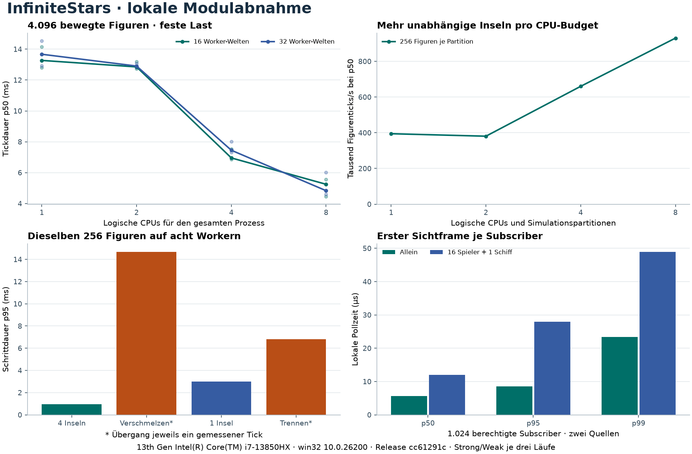

# InfiniteStars Server Meshing · Abnahme der öffentlichen Bibliothek

Ausgangsstand `15739c8`. Diese Datei führt die 23 verbindlichen Kriterien. Zu jeder Änderung gehört der Nachweis für den betroffenen Eintrag. BESTANDEN setzt einen ausgeführten Test oder eine Messung am angegebenen Stand voraus. OFFEN bezeichnet einen ausstehenden Nachweis, BLOCKIERT eine konkrete externe Voraussetzung. NICHT ANWENDBAR verlangt eine fachliche Begründung. [Arbeitsauftrag](../.codex/mesh-v1-auftrag.md)

## Erneute Abnahme für main am 27. November 2026

Gemessen wurde der Modulstand `244b429c7316a39cd6aeb99d0e085522f085c2c4`. Windows und Debian 12.15 liefen nacheinander auf demselben physischen Intel Core i7-13850HX mit 20 Kernen und 28 logischen CPUs. Der Debian-Gast erhielt unter QEMU/WHPX acht vCPUs und 8 GiB RAM. Auf beiden Systemen bestanden 719 Rust-Tests einschließlich Doctest, drei TypeScript-Testsuiten, der Client-Build, der externe Spielimport und beide Live-Smokes.

| Stabilitätslauf mit 2.048 bewegten Figuren und 16 Worker-Welten | p50 | p95 | p99 | Ticks über 50 ms |
| --- | ---: | ---: | ---: | ---: |
| Windows | 9,32 ms | 12,23 ms | 13,90 ms | 0 von 1.200 |
| Debian-Gast | 7,38 ms | 15,64 ms | 19,80 ms | 0 von 1.200 |

Vier Partitionen nutzten vier logische CPUs. Beide Läufe bestätigten alle 614.400 Eingaben und übernahmen alle 2.457.600 Peer-Updates. Zwischen räumlich getrennten Inseln entstanden null Abonnements. Beide p95-Werte lagen höher als am Vortag und innerhalb der festgelegten Grenze von 40 ms. `npm run test:abnahme` prüft die Windows-Messung. Mit `-- --report docs/benchmarks/mesh-v1-debian.json` prüft derselbe Befehl die Debian-Messung. [Windows-Messreihe](benchmarks/mesh-v1.json) · [Debian-Messreihe](benchmarks/mesh-v1-debian.json)

## Modulfreigabe 1.0.0

Mess- und Funktionsstand **`cc61291cff3e9ac6406b6a082d09e6bf0adb13bd`**, 26. November 2026. Auf Windows und Debian 12.15 bestanden jeweils 718 Rust-Tests inklusive Doctest, drei TypeScript-Testsuiten, der Client-Produktionsbuild, der externe Git-Import und beide Live-Smokes. Alle 23 Kriterien sind für den dokumentierten Modulbetrieb bestanden. Das Beispiel prüft einen gespeicherten Reaktor über zwei Starts sowie Migration, Sicht und Wiederherstellung eigener Spieltypen. [Integration ins Spiel](../crates/is-mesh/README.md) · [Betriebsanleitung](produktionsabnahme.md)

| Gemessene Last unter Windows | p50 | p95 | p99 | Ergebnis |
| --- | ---: | ---: | ---: | --- |
| 2.048 bewegte Figuren, drei kurze Läufe | 3,24–3,61 ms | 4,07–5,40 ms | 4,54–6,96 ms | 0 von 240 Ticks über 50 ms |
| Gleiche Figuren, 1.200 getaktete Ticks | 7,15 ms | 8,18 ms | 9,54 ms | 614.400 Eingaben bestätigt, 2.457.600 Peer-Updates angewandt, 0 Deadline-Verletzungen, 36,3 MiB Spitzen-RSS |
| 10.000 stehende Figuren, 128 private Statuseffekte je Figur | 4,86 ms | 5,98 ms | 7,02 ms | 400.000 private ECS-Änderungen in 40 Ticks, 0 öffentliche Projektionen und 0 Peer-Updates |
| 127 Figuren mit je 1.024 Effekten in einer Authority-Gruppe, ein Peer-Beobachter | 0,74 ms | 0,87 ms | 1,20 ms | 5.201.920 Effektprüfungen in 40 Ticks auf einer logischen CPU |
| 256 bewegte Figuren, persistenter technischer Store auf Datei | 1,49 ms | 1,94 ms | 2,32 ms | 2.560 bestätigte Eingaben in 40 Ticks |

Debian lief getrennt vom Windows-Test in einem QEMU/WHPX-Gast auf demselben Rechner, mit acht vCPUs und 8 GiB RAM. Die drei kurzen Läufe erreichten p95 zwischen 3,56 und 4,38 ms. Im 61,65 Sekunden langen Stabilitätslauf lagen p50/p95/p99 bei **3,98 / 5,09 / 5,93 ms**, der Spitzen-RSS bei 30,1 MiB. Alle 614.400 Eingaben und 2.457.600 Peer-Updates kamen an, alle 1.200 Ticks blieben im 50-ms-Budget. Bei 4.096 Figuren und 16 Welten erzielten vier vCPUs mit Faktor 2,69 den höchsten Durchsatz. Acht vCPUs erreichten Faktor 2,64. Das Debian-Ergebnis lässt sich mit `npm run test:abnahme -- --report docs/benchmarks/mesh-v1-debian.json` prüfen. [Debian-Messreihen][v1-debian]

Der Intel i7-13850HX meldete 20 physische Kerne und 28 logische CPUs. Windows ordnete CPUs 0–15 acht physischen Kernen mit je zwei SMT-Threads zu und 16–27 zwölf weiteren Kernen mit je einem Thread. Die Skalierungsläufe banden den gesamten Prozess an die ersten 1/2/4/8 logischen CPUs. Bei vier CPUs nutzte die Messung damit zwei physische Kerne, bei acht CPUs vier. Der Profiler enthält Bevy, Lastgenerator, Peer-Replikation, Fencing und technische Checkpoints. Für das 20-Hz-Profil lag SQLite im RAM. Die ausgewiesenen Sichtzeiten messen die Erstellung eines Anwendungsframes im lokalen Adapter. Netzwerkweg, Client-Dekodierung und Rendering kommen im Spiel hinzu. [Parameter und Messreihen][v1-windows]

Bei 4.096 Figuren und 16 Worker-Welten sank die Median-Tickzeit von 13,27 auf 5,25 ms. Mit 32 Welten waren es 13,67 und 4,83 ms. Bei proportional wachsender Last stieg der Durchsatz von 395.000 auf 930.000 Figurenticks/s. Der größte kurzzeitige Aufwand im Dichtetest lag beim Zusammenführen der vier Inseln. Dabei entstanden 1.536 neue Replikationsbaselines in einem Tick mit 14,67 ms. Im dichten Dauerzustand gingen siebenmal so viele Peer-Updates wie in den vier getrennten Inseln über die Worker-Grenzen. Bei 1.024 individuellen Subscribern betrug der lokale p95 für den ersten Sichtframe alleine 8,5 µs, in der 16er-Gruppe mit Schiff 27,9 µs. [Rohdaten][v1-windows]

Im getakteten Windows-Lauf lagen im Median 5,21 ms zwischen dem Beginn der gemeinsamen Messung und dem Ende der letzten Partition außerhalb der gemessenen Partitionsarbeit. Dieser Rest umfasst Wecken, Synchronisierung und die Prüfungen am Taktende. In den drei ungetakteten Läufen lag derselbe Median zwischen 0,03 und 0,06 ms. Der Messpunkt erklärt einen Teil der beobachteten Latenz beim 20-Hz-Betrieb. Die Herkunft der einzelnen Warteanteile lässt sich daraus allein nicht weiter aufteilen. [Zeitmessung und Barrierestichproben][v1-windows]

Der frühere Bibliotheksstand `732a8af` erzeugte bei demselben privaten 10.000er-Workload 500.000 öffentliche Projektionen in 40 Ticks. V1 erzeugte null. Im separaten Browservergleich gegen `3ef0d789` erreichten drei Server mit 3.000 NPCs und drei Clients in beiden Varianten rund 20 Hz. Der Median des jeweils langsamsten Server-p95 lag nach zwei 15-Sekunden-Läufen beim Original bei 5,82 ms und im aktuellen Checkout bei 5,13 ms. Die beiden Originalläufe streuten von 2,18 bis 9,46 ms. Der überprüfbare Effizienzgewinn im Bibliothekspfad ist die eingesparte Projektionsarbeit. Beim nativen mTLS-Handoff kostete die erste Vorbereitung 4.112 Bulk-Nutzbytes, die beiden Übergaben mit gefülltem Cache jeweils null. [Frühere private Messung](produktionsabnahme.md) · [Browser-, Bulk- und Transportmessungen](benchmarks/mesh-v1-referenz.json.gz)

**Wiederholen.** `npm test`, `npm run test:game` und `npm run smoke` prüfen die Funktion. `npm run bench:v1` erzeugt auf einem Host mit acht verfügbaren logischen CPUs die Messreihen und prüft die Grenzwerte. Einzelne Ergebnisse liegen im ausgegebenen Verzeichnis unter `target/`. Zum Übernehmen eines überprüften Laufs `npm run bench:v1 -- --report docs/benchmarks/mesh-v1.json` verwenden. `npm run test:abnahme` prüft alle 23 Einträge, das Abbild der gemessenen Quelldateien und die numerischen Freigabegrenzen. Der Quellvergleich bleibt auch nach einem Git-Rebase gültig. Die Grafik erzeugt `python scripts/plot-mesh-profile.py --v1 docs/benchmarks/mesh-v1.json --output docs/benchmarks`.

## Festgelegtes lokales Freigabeprofil

- Für das 20-Hz-Profil stehen dem gesamten Messprozess einschließlich Lastgenerator vier logische CPUs zur Verfügung. Das Speicherbudget beträgt 512 MiB für alle 16 Worker-Welten zusammen. Die Abnahme prüft den vom Betriebssystem gemeldeten RSS-Spitzenwert über die gesamte Prozesslebensdauer einschließlich des Aufbaus.
- Rust Stable, Bevy 0.15, optimierter portabler Release-Build. Vier parallele Simulationspartitionen, 16 Worker-Welten, 2.048 bewegte Figuren in getrennten Inseln zu 16, RAM-Koordinationsbackend. Drei Wiederholungen zu 80 gemessenen Ticks nach vier Aufwärmticks. Je Lauf p95 höchstens 40 ms, p99 höchstens 50 ms, höchstens 1 % der Ticks über 50 ms. Alle geplanten Eingaben und Peer-Updates müssen bestätigt sein, fremde Inseln dürfen keine fachlichen Updates erhalten.
- Stabilität mit demselben Lastprofil über 1.200 Ticks bei 20 Hz. Dieselben Grenzwerte gelten. Deadline und Tickdauer werden getrennt von der Wartezeit zwischen Ticks erfasst. Die Lastgeneratoren laufen lokal. Die Standardmessung enthält keinen externen Spieltransport.
- Subscriber mit 1.024 logischen Spielern auf einem asynchronen Adapterthread, jeweils alleine und in 16er-Gruppen. Jede Sicht enthält die erwarteten Objekte, nur der Besitzer erhält private Daten. Je Subscriber maximal eine ausstehende Anwendungsversion, standardmäßig 128 Ereignisse und 128 KiB pro Quellworker und Tick. Bei ausbleibender Bestätigung nach 40 Ticks erfolgt ein Snapshot. Das Ausgangsprofil erlaubt maximal 16.384 sichtbare Objekte je Quelle.
- Bulk und zeitkritische Ausgabe erhalten getrennte Budgets. Während verzögertem Chunk-Transfer muss eine lokale Steuerungs- und Sichtänderung binnen 250 ms verarbeitet werden. Der Test prüft unabhängig davon die vollständige Übertragung. Worker- und Administrationswarteschlangen bleiben begrenzt.
- Strong Scaling mit 4.096 Figuren, Weak Scaling mit 256 Figuren je Partition, je drei Läufe zu 32 Ticks bei 1/2/4/8 Partitionen. Zweite Worker-Topologie bei gleichem CPU-Budget. Für mindestens eine parallele Stufe muss der Durchsatz bei konstanter Last über der seriellen Referenz liegen. Dichte Sicht, eine eng gekoppelte Gruppe und dauerhafter Speicher haben eigene Messpunkte.
- Die historischen 10.000er-Läufe behalten ihren ursprünglichen Plattform-, Transport- und Lastbezug. Reale `is-session`-Clients, Produktions-Gameplay, EPYC, mehrere physische Hosts und automatische Host-Übernahme sind spätere Systemabnahmen.

## Nachweismatrix

| ID | Status | Verbindliches Kriterium | Öffentlicher Einstieg / Implementierung | Prüfung | Ergebnis und Grenze |
| --- | --- | --- | --- | --- | --- |
| M01 | BESTANDEN | Name und Kompatibilität. InfiniteStars/`IS`, is-mesh und is_mesh sind konsistent. Builds und Beispiele funktionieren. Gespeicherte IDs, Schemas und Protokolle bleiben kompatibel oder besitzen einen geprüften Migrationsweg. | [is-mesh](../crates/is-mesh/Cargo.toml), [zz_mesh-Fassade](../crates/zz-mesh/src/lib.rs) | [Externer Import und Originaldatei](../scripts/test-game-integration.mjs) | Beide Paketnamen bauen. Original und V1 lasen gegenseitig den Spielstand mit Schema 4097 v3. Kind-ID, Snapshot-Hash und bestehende Wire-v3-Nachrichten waren bytegleich. |
| M02 | BESTANDEN | Eigenständige Bibliothek. Ein externes Bevy-0.15-Projekt verwendet eigene Components und Systeme ausschließlich über öffentliche APIs. Login, Wirtschaft, Physik und öffentlicher Spieltransport sind keine Pflichtimplementierungen des Mesh-Cores. | [MeshApp und MeshSystems](../crates/is-mesh/src/bevy_runtime.rs) | [Separater Cargo-Verbraucher](../scripts/test-game-integration.mjs) | Git-Abhängigkeit im eigenständigen Bevy-Spiel gebaut. Der Reaktor lud nach zwei Prozessstarts Energie 1 und 2. Das Sessionbeispiel lief über öffentliche APIs. |
| M03 | BESTANDEN | Unsere Objektarten sind abbildbar. Figur, Schiff, Planet/Asteroid und Chunk sind als externe Testtypen synchronisierbar. Große Strukturen können getrennte Objekte und versionierte Datensätze verwenden. Keine Pflicht zu einer Entity pro Voxel. | [Eigene Spielkomponenten](../crates/is-mesh/examples/session_game.rs), [DataProvider](../crates/is-mesh/src/bulk.rs) | session_game und [Bulkverträge](../examples/infinite-stars/tests/contract.rs) | Figur, Schiff, Asteroid und Chunk registriert und übertragen. Eine Objekt-/Teil-ID und eine Datenrevision adressieren den Chunk. Der Provider überträgt Daten separat. |
| M04 | BESTANDEN | Stabile IDs und Referenzen. Globale Identitäten und Beziehungen bleiben bei Migration und unterstütztem Restore erhalten. Schiff, Chunk und Figur können Worker wechseln; lokale Referenzen werden korrekt neu aufgelöst. | [ComponentCodec und restore_group](../crates/is-mesh/src/bevy_runtime.rs) | [session_game](../crates/is-mesh/examples/session_game.rs), ordered_handoff | Schiff, Chunk und Figur behielten IDs und Beziehungen auf Worker B und nach dessen Ersatz. Die lokalen Handles wurden in der jeweiligen Ziel-World geprüft. Eine fehlende Pflichtreferenz sperrt die Aktivierung. |
| M05 | BESTANDEN | Räumliche Korrektheit. Sichtgrenzen, große Koordinaten, Objektausdehnungen und lokale Bezugssysteme sind getestet. Umrechnung und Verhalten bei fehlenden Bezugsdaten sind definiert. | [SightRanges](../crates/is-mesh/src/sight.rs), [Box3](../crates/is-mesh/src/spatial.rs) | [player_sight](../examples/infinite-stars/tests/player_sight.rs), [Octree-Referenzsuche](../crates/is-mesh/tests/spatial.rs) | 100/500-m-Grenzen, eine um 1 mm verkleinerte Hülle und ein Framewechsel nahe i64::MAX geprüft. Bei fehlender oder überlaufender Transformation verschwand das Objekt. |
| M06 | BESTANDEN | Flexible Insel- und Worker-Zuordnung. Eine Insel kann mehrere Worker umfassen; ein Worker kann mehrere entfernte Inseln bedienen. Verschmelzung, Trennung und Objektwechsel erhalten Sicht und Zuständigkeiten korrekt. | [Directory](../crates/is-mesh/src/spatial.rs), [Pool](../crates/is-mesh/src/pool.rs) | [cluster-bench](../examples/infinite-stars/src/bin/cluster-bench.rs), directed_worlds_retry_lost_ack_and_unload_on_split | Vier Inseln mit je zwei Workern verschmolzen zu einer und trennten sich wieder in vier. Getrennte Ursprünge erhielten null fremde Objektupdates. Ein Worker hielt im Sicht-Test fünf entfernte Spieler. |
| M07 | BESTANDEN | Exklusive Authority. Alte Schreibgenerationen werden nach verspäteten Nachrichten, Partitionen und Worker-Wiederkehr abgelehnt. Koordinationsverlust erzeugt keine zweite gültige Authority. | [Store-Fencing](../crates/is-mesh/src/store.rs), [Worker-Kontrolle](../crates/is-mesh/src/session.rs) | [Echte Prozesse](../examples/infinite-stars/tests/process.rs), [Cache-Fencing](../examples/infinite-stars/tests/player_sight.rs) | Frühere Inkarnation und eingefrorene Gruppe wurden abgelehnt, auch bei einer bereits gecachten Projektion im selben ECS-Tick. Bei unbestätigter Koordination pausiert die verbindliche Arbeit. |
| M08 | BESTANDEN | Vollständige Migration. Abbrüche vor, während und nach dem Handoff sind getestet. Registrierte Zustände, Referenzen und Revisionen bleiben erhalten oder werden definiert wiederhergestellt. | [Handoff-Phasen](../crates/is-mesh/src/handoff.rs), [remote](../crates/is-mesh/src/remote.rs) | [stale_preparation_timeout_and_crash_at_each_phase](../examples/infinite-stars/tests/contract.rs), [Prozess-Recovery](../examples/infinite-stars/tests/process.rs) | Vorbereitung, Freeze, Ready, verlorene Umschaltantwort und Ersatzprozess geprüft. Exakter Schlussstand und Writer-Generation blieben konsistent. Eine unteilbare Gruppe wechselt gemeinsam. |
| M09 | BESTANDEN | Verbindliche ECS-Reihenfolge. Registrierung, Filter und SystemSets sind dokumentiert. Authority- und Rechteänderungen werden vor weiterer Input-Ausführung wirksam; erforderliche Deferred-Barrieren sind getestet. | [MeshSystems](../crates/is-mesh/src/bevy_runtime.rs), [SessionIngress](../crates/is-mesh/src/session.rs) | [deferred_grant_revocation_and_full_mailbox_are_fenced_before_gameplay](../crates/is-mesh/tests/external_integration.rs) | Eine über Deferred Commands entzogene Bindung ließ die bereits eingereihte Aktion nicht mehr ins Gameplay. Der belegte Eingangsslot wurde frei. |
| M10 | BESTANDEN | Getrennte Änderungspfade. Private Änderungen ohne öffentliche oder räumliche Folgeänderung erzeugen keine öffentlichen Projektionen. Unveränderte Positionen lösen keine unnötigen räumlichen Updates aus. Component-Entfernung und Despawn werden verteilt. | [SpatialDependencies](../crates/is-mesh/src/pool.rs), [Publisher](../crates/is-mesh/src/publish.rs), [SubscriberSource](../crates/is-mesh/src/subscriber.rs) | [private_checkpoints_skip_public_codecs_spatial_rules_and_peer_projection](../examples/infinite-stars/tests/player_sight.rs), bench:v1 private | Private Änderungen ließen öffentliche Codecs, Raumregeln und Peer-Ausgabe unberührt. Reine Felddeltas, Komponentenentfernung, Despawn und verspätete Tombstones sind geprüft. |
| M11 | BESTANDEN | Individuelle, vertrauliche Sicht. Zwei Subscriber am selben Worker erhalten unterschiedliche berechtigte Zustände, auch über Workergrenzen. Private Felder gelangen nicht in öffentliche gemeinsame Payloads oder nach Rechteentzug in neue Ausgaben. | [SubscriberStream und Encoder](../crates/is-mesh/src/subscriber.rs) | [player_sight](../examples/infinite-stars/tests/player_sight.rs), [Adapter über Worker-Prozesse](../examples/infinite-stars/tests/process.rs) | Unterschiedliche berechtigte Sichten auf demselben Worker und über Workergrenzen geprüft. Das gemeinsame öffentliche Payload enthält kein Inventar. Widerruf sperrte die nächste Ausgabe. |
| M12 | BESTANDEN | Replikation und Resume. Initialzustand, Deltas, Enter/Leave, Reihenfolge, Duplikate, fehlende Baselines und Snapshot-Fallback sind getestet. Resume verlangt gültige externe Zulassung und wiederholt keine alten Inputs. | [SubscriberStream und WorkerSubscription](../crates/is-mesh/src/subscriber.rs) | [ACK-Timeout, Reset und Leave](../examples/infinite-stars/tests/player_sight.rs), [Prozess-Resume](../examples/infinite-stars/tests/process.rs) | Bestätigter Fortschritt setzt gültige Baselines fort. Veraltetes ACK, andere Bindung und fehlende Baseline sind abgedeckt. Eine ersetzte Quelle liefert einen Reset. Die Eingabesequenz verhindert erneute Ausführung. |
| M13 | BESTANDEN | Große Payloads. Chunk-/Bauplan-Transfer unterstützt Versionen, Prüfsummen und Wiederaufnahme. Unterbrechung und beschädigte Daten sind getestet. Zeitkritische Ausgaben bleiben innerhalb des festgelegten Testbudgets bedienbar. | [Download, BlobCache und BulkExecutor](../crates/is-mesh/src/bulk.rs) | [Bulk-Baselines](../examples/infinite-stars/tests/contract.rs), [gleichzeitiger Eingang und Sichtdelta](../examples/infinite-stars/tests/player_sight.rs) | 1.048.576 Byte erfolgreich geprüft und installiert. Während der Provider auf Freigabe wartete, dauerten Eingabebestätigung und Sichtdelta zusammen 1,21 ms unter Windows und 0,81 ms unter Debian bei einem Budget von 250 ms. Falscher Offset, falsche Basis und beschädigter Inhalt wurden verworfen. |
| M14 | BESTANDEN | Externe Session-Zulassung. Ein externer Testadapter kann Steuerungsrechte binden, erneuern, suspendieren und widerrufen. Dafür werden keine Passwörter oder Account-Tokens im Mesh benötigt. Öffentliche Nachrichten können keine privilegierten Grants selbst erzeugen. | [SessionGrant und SessionDirectory](../crates/is-mesh/src/session.rs) | [Öffentlicher Testadapter](../crates/is-mesh/examples/session_game.rs), [Rollentrennung](../examples/infinite-stars/tests/process.rs) | Binden, Erneuern, Suspendieren, Widerrufen und Schließen ausgeführt. Nur ein vertrauenswürdiger serverseitiger Adapter darf Grants ausstellen. Der Referenz-Spielclient erhielt für Operatorbefehle eine Ablehnung. |
| M15 | BESTANDEN | Alte und konkurrierende Verbindungen. Gleichzeitige Übernahmeversuche, verspätete Inputs und alte Disconnects sind getestet. Der ausführende Worker prüft Steuerungsgeneration, Objektbindung und Ablauf. Widerrufsverzögerung und Fehlerverhalten sind definiert. | [ControlBinding und ValidatedInput](../crates/is-mesh/src/session.rs) | [Konkurrierende Store-Verbindungen](../crates/is-mesh/tests/external_integration.rs), [session_game](../crates/is-mesh/examples/session_game.rs) | Zwei Bewerber derselben Epoch erhielten genau eine gültige Bindung. Alter Disconnect, Ablauf und verspätete Eingaben blieben wirkungslos. Gehaltener Input läuft nach 200 ms aus. Widerruf wirkt bei der nächsten erfolgreichen Prüfung vor Update, Koordinationsfehler sperrt die Freigabe. |
| M16 | BESTANDEN | Externe Fachsysteme. Asynchrone Ergebnisse erreichen nach Migration die aktuelle Authority. Duplikate und ältere Revisionen werden gemäß Vertrag behandelt. Wirtschaftliche Transaktionslogik und dauerhafte Buchungsgarantien bleiben extern. | [ExternalActions, hydrate_external und apply_external](../crates/is-mesh/src/external.rs) | [Verspätetes externes Ergebnis](../crates/is-mesh/examples/session_game.rs) | Revision 6 erreichte die neue Authority nach der Übergabe. Eine Wiederholung und Revision 4 änderten den Wert nicht. Nach Restore lud das Spiel den maßgeblichen Fachstand neu. Dauerhafte Buchungen gehören dem Fachdienst. |
| M17 | BESTANDEN | SQL-armer Simulationspfad. Lokale Simulation läuft ohne SQL-Backend. Gewöhnliche Bewegung, Routing und Replikation erzeugen keine verpflichtenden SQL-Zugriffe pro Änderung oder Tick. Notwendige Koordinations- und Checkpointzugriffe sind separat ausgewiesen. | [MeshPlugin::transient](../crates/is-mesh/src/bevy_runtime.rs), [LocalSubscriberPlugin](../crates/is-mesh/src/subscriber.rs) | [transient_world](../crates/is-mesh/tests/external_integration.rs), [lokale Subscriber](../examples/infinite-stars/tests/player_sight.rs) | Die lokale World verarbeitet Steuerung, Raumänderungen und Sichtframes ohne Store-Ressource. Im persistenten Betrieb erfolgen Koordinationsprüfungen für Rechte und Writer sowie separat geplante Checkpoints. Ausgehende Nutzdaten prüfen unterschiedliche Gruppen gebündelt. |
| M18 | BESTANDEN | Technischer Wiederanlauf. Ein unterstützter Checkpoint-Restore wurde ausgeführt. Identitäten, Fencing, Schema-/Integritätsprüfung und Abgleich externer Zustände funktionieren. Alte Steuerungsrechte werden nicht ungeprüft reaktiviert. | [AsyncCheckpoints](../crates/is-mesh/src/bevy_runtime/checkpoint_io.rs), [Store-Format](../crates/is-mesh/src/store.rs) | [Restore, Integrität und verspätetes ACK](../crates/is-mesh/tests/recovery.rs), [session_game](../crates/is-mesh/examples/session_game.rs) | Letzten bestätigten Stand wiederhergestellt. Unbekannte Version und veränderte Checksumme wurden abgelehnt. Lokale Handles und externer Fachstand wurden neu aufgebaut, widerrufene Rechte blieben gesperrt. |
| M19 | BESTANDEN | Begrenzte Ressourcen. Nicht lesende Subscriber, übergroße oder fehlerhafte Payloads und volle Queues sind getestet. Speicher bleibt begrenzt. Andere Teilnehmer und interne Steuerkommunikation bleiben entsprechend ihren Budgets bedienbar. | [RequestBudgets](../crates/is-mesh/src/remote.rs), [SubscriberPolicy](../crates/is-mesh/src/subscriber.rs) | [saturated_sessions_leave_peer_and_operator_turns_available](../crates/is-mesh/src/remote.rs), [langsamer Subscriber](../examples/infinite-stars/tests/player_sight.rs), [Bloblimit](../examples/infinite-stars/tests/contract.rs) | 32 öffentliche Jobs füllten den Kanal. Peer, Operator und eine interaktive Session erhielten in drei Einzelschritten je einen Zug. Volle Mailboxen und zu große Transfers wurden abgelehnt. Der langsame Subscriber resynchronisierte separat. |
| M20 | BESTANDEN | Vollständige Lastmessung. Zusätzliche Arbeit außerhalb der Bevy-Simulation erscheint in Metriken und Lastbewertung. Prozessspeicher, Warteschlangenalter und gruppenbezogene Messung oder gekennzeichnete Schätzung sind verfügbar. | [ProcessLoad und WorkerTelemetry](../crates/is-mesh/src/placement.rs), [Controller](../examples/infinite-stars/src/supervisor.rs) | [Lastbewertung unter Rückstau](../crates/is-mesh/src/remote.rs), [Operator metrics](../examples/infinite-stars/tests/process.rs) | 55 ms Zusatzarbeit und 70 ms Warteschlangenalter beeinflussten die Workerlast trotz 1 µs ECS. Der Prozess lieferte reale TLS-Bytes, laufende Request-Bytes und RSS. Gruppenzeit ist ein Spielmesswert oder eine gekennzeichnete Schätzung. |
| M21 | BESTANDEN | Nachweisbare Parallelisierung. Threadpools und Hintergrundaufgaben sind budgetiert. Strong/Weak Scaling und mehrere Worker-Topologien zeigen bei geeigneter unabhängiger Last reproduzierbaren Mehrdurchsatz. Grenzen sind dokumentiert. | [CPU-Budget](../crates/is-mesh/src/cpu.rs), [HostLimits](../examples/infinite-stars/src/host.rs) | [Drei Strong-/Weak-/Topologiereihen][v1-windows] | Bei 16 Welten erhöhte sich der Durchsatz von einer auf acht logische CPUs um Faktor 2,53, bei 32 Welten um 2,83. Weak Scaling erreichte Faktor 2,36. Zwei SMT-Threads brachten bei der kleinen Weak-Last keinen Mehrdurchsatz. |
| M22 | BESTANDEN | Reproduzierbare lokale Abnahme. Optimierter Build, Testparameter, Git-Stand, p50/p95/p99, Deadline-Verletzungen und Ressourcenwerte sind dokumentiert. Getrennte und dichte Sichtprofile sowie ein angemessener Stabilitätslauf wurden geprüft. Keine lokale 10.000-Client-Pflicht. | [bench:v1](../scripts/verify-mesh-v1.mjs), [mesh-profile](../examples/infinite-stars/src/bin/mesh-profile.rs) | [Release-Profil mit 1.200 Ticks, Dichte und individueller Sicht][v1-windows] | Drei kurze Läufe und 60,87 Sekunden mit Taktung erfüllten die vorab gesetzten Grenzen. Beide 1.024-Subscriber-Läufe prüften jeden Objektbezeichner und die Berechtigung für private Felder. |
| M23 | BESTANDEN | Dokumentierter Release. Start, Konfiguration, kontrolliertes Leeren/Stoppen, unterstützte Fehlerfälle, Restore und Protokoll-/Schemakompatibilität sind beschrieben. Offene echte-Client-, EPYC-, Mehrrechner- und Hochverfügbarkeitsabnahmen sind benannt. Die öffentliche API ist versioniert. | [SemVer und Integration](../crates/is-mesh/README.md), [Betriebsanleitung](produktionsabnahme.md) | [Drain, Resume, Health, Metrics und Shutdown](../examples/infinite-stars/tests/process.rs), test:game | Worker mit aktiven Gruppen verweigerte den Stop. Nach Drain ließ er sich kontrolliert beenden und seine alte Inkarnation wurde gesperrt. Die Freigabe gilt für den beschriebenen Einzel-Authority-Betrieb mit technischem Restore. |

[v1-windows]: https://github.com/AdrianFleckDTecInnovation/ZZServerMeshing/blob/04e2fb62a963b77145dc6a1d5726a375916265fd/docs/benchmarks/mesh-v1.json
[v1-debian]: https://github.com/AdrianFleckDTecInnovation/ZZServerMeshing/blob/04e2fb62a963b77145dc6a1d5726a375916265fd/docs/benchmarks/mesh-v1-debian.json
