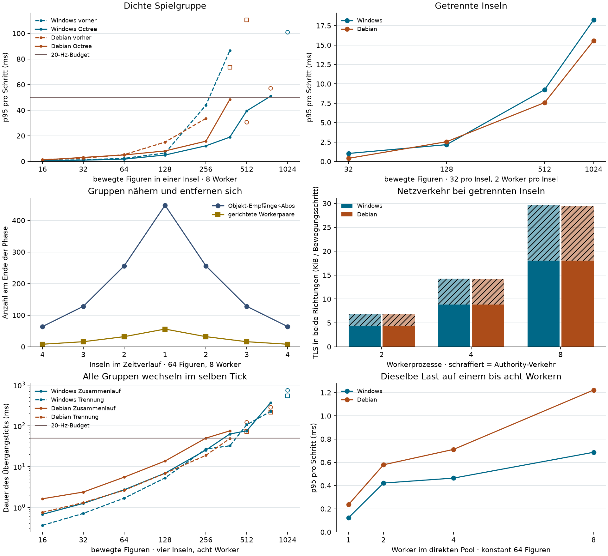
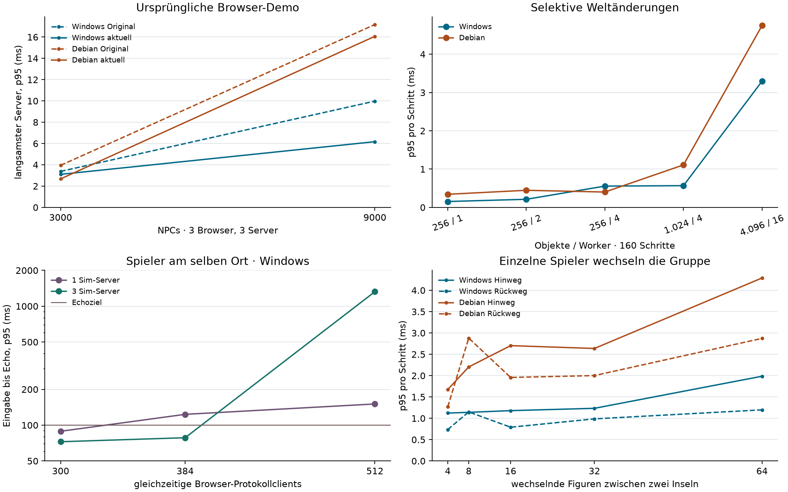

# Infinite Stars unter Last

Die Messung vom 25. November 2026 vergleicht den letzten R-Baum-Stand `6cc85be` mit `5d9c55c`. Beide laufen auf einem Core i7-13850HX. Windows läuft nativ, Debian 12 in einer VM mit sechs vCPUs und 8 GiB RAM. Je Betriebssystem liefen drei kurze Vergleichspaare mit wechselnder Startreihenfolge. Für jeden Schritt wurden Simulation, Publikation, Zustellung, ACK und Topologieabfrage gemeinsam gemessen. Die Tabellen zeigen den Median der erreichten Lauf-p95. Referenzsuche, Start und Aufwärmphase erfolgen außerhalb der Stoppuhr. Das Budget bei 20 Hz beträgt 50 ms.



Offene Punkte in den Dichte- und Übergangskurven markieren Laststufen, die nach der Abbruchregel nur ein oder zwei der drei Läufe erreichten. Die verbundenen Punkte beruhen auf allen drei Läufen.

## Ein Worker, viele Inseln oder eine dichte Gruppe

| Figuren | Windows dicht vorher → aktuell | Debian dicht vorher → aktuell | Windows vier Inseln aktuell | Debian vier Inseln aktuell |
| --- | ---: | ---: | ---: | ---: |
| 16 | 0,9 → 0,6 | 1,4 → 1,1 | 0,2 | 0,6 |
| 32 | 1,3 → 1,0 | 2,6 → 3,1 | 0,4 | 1,2 |
| 64 | 2,4 → 1,8 | 5,3 → 5,1 | 0,5 | 1,4 |
| 128 | 6,5 → 5,0 | 15,1 → 8,2 | 1,1 | 2,5 |
| 256 | 43,9 → 12,2 | 33,6 → 15,8 | 2,0 | 3,2 |
| 384 | 86,5 → 18,9 | 73,5 (2/3) → 48,4 | 5,1 | 4,3 |
| 512 | — → 39,5 | 110,4 (1/3) → 30,6 (2/3) | 4,3 | 6,1 (2/3) |
| 768 | — → 50,9 | — → 57,1 (2/3) | 14,8 | 8,6 (2/3) |
| 1.024 | — → 100,8 (1/3) | — | 18,5 (1/3) | — |

Alle Zeitangaben in ms p95. Ein Strich kennzeichnet eine bereits beendete Rampe. Klammern geben die Zahl der erreichten Wiederholungen an.

Jede Figur bewegt sich in jedem Schritt. Der Dichtevergleich hält acht Worker, Akteure, Bewegungsrate und Komponenten konstant. Auf vier Inseln erhält jede Figur einen entfernten Worker als Empfänger. In einer einzigen dichten Insel erhalten sieben andere Worker die benötigte Positionssicht. Genaue Positionen, Besitzgenerationen und private Inventare werden nach jedem Schritt geprüft. Die Rampe endet beim ersten dichten Messpunkt ab 256 Figuren mit mindestens 50 ms p95 oder bei 1.024 Figuren. [Szenencode](../examples/infinite-stars/src/bin/cluster-bench.rs) · [Windows vorher](benchmarks/octree-before-windows.json.gz) · [Windows aktuell](benchmarks/octree-windows.json.gz) · [Debian vorher](benchmarks/octree-before-debian.json.gz) · [Debian aktuell](benchmarks/octree-debian.json.gz)

| Figuren | Inseln | Worker | Windows p95 ms | Debian p95 ms | Frames am ersten Worker / inselübergreifend je Schritt |
| --- | ---: | ---: | ---: | ---: | ---: |
| 32 | 1 | 2 | 1,0 | 0,4 | 16 / 0 |
| 128 | 4 | 8 | 2,2 | 2,5 | 16 / 0 |
| 512 | 16 | 32 | 9,2 | 7,6 | 16 / 0 |
| 1.024 | 32 | 64 | 18,2 | 15,6 | 16 / 0 |

Bei gleichbleibenden **64 Figuren auf vier Inseln** verbrauchte ein einzelner Worker 0,12 / 0,24 ms p95 unter Windows / Debian. Acht Worker im direkten Pool benötigten 0,69 / 1,22 ms. Ein Worker erzeugte null Peer-Frames, bei acht Workern waren es 64 je Schritt.

Bei 256 bewegten Figuren entfielen im Windows-Median der **Phasenmittel** 4,58 / 4,54 / 0,14 ms auf Simulation samt Versandvorbereitung, Zustellung samt ACK und Topologie in einer dichten Insel. Bei vier getrennten Inseln waren es 1,00 / 0,46 / 0,12 ms. Die Phasenmittel erklären den Aufwand im Lauf. Die Tabelle oben verwendet p95 einzelner vollständiger Schritte.

Der 32er-Punkt auf Debian fiel in der Gesamtrampe langsamer aus als die Referenz. Fünf zusätzliche Wechselpaare nur für diese Größe ergaben für R-Baum → Octree 0,72 → 0,70 ms p95 bei vier Inseln und 1,85 → 1,34 ms bei vollständiger Überlappung. [Kontrollläufe mit 32 Figuren](benchmarks/octree-klein-debian.json.gz)

### Welche Arbeit wächst mit der Welt?

| Last | Wovon die Kosten abhängen |
| --- | --- |
| Bewegter Spieler oder NPC | Das Spiel bestimmt die Simulationsarbeit pro aktiver Figur. Bevy prüft registrierte geänderte Komponenten. Das Directory bearbeitet geänderte Beschreibungen. Nach einem Grenzübertritt hängen die Kosten einer Octree-Abfrage von den besuchten Knoten und den räumlichen Treffern ab. |
| Getrennte Regionen | Bei stabiler Dichte wächst die Gesamtarbeit mit zusätzlichen aktiven Regionen. Zustellarbeit entsteht je geändertem Objekt und tatsächlich interessiertem Empfänger. Die erste Insel behält ihre lokale Empfängerzahl. |
| Alle Figuren am selben Ort | Bei `P` aktiven Sichtbereichen und `E` räumlichen Objekten sind bis zu `P × E` echte Überlappungen möglich. Das Directory hält die Mitgliedschaften für Hysterese. Es fasst gleiche Anforderungen desselben Workers zusammen. Bei acht Workern erzeugt jede geänderte, überall sichtbare Position höchstens sieben Worker-Frames. |
| Individuelle Browser | Jeder Empfänger hat einen eigenen bestätigten Snapshot-Stand. Bei vollständiger gegenseitiger Sicht und Bewegung wächst die versendete Positionsmenge näherungsweise mit `P × (P − 1 + sichtbare bewegte NPCs)` pro Update. |
| Chunk oder zusammengesetztes Objekt | Maßgeblich sind geänderte Komponenten, adressierte Teilbereiche und fehlende verifizierte Bytes. Unveränderte Blobs werden im Cache wiederverwendet. Ein Chunk kann viele Voxel enthalten. |

Die direkte Messung führt alle Worker-Worlds in einem Prozess nacheinander aus. Sie erfasst den Gesamtaufwand. Die Netzwerkmessung verwendet getrennte Prozesse und umfasst die Wartezeit bis zum letzten Empfänger. [Worker-Schritt](../crates/is-mesh/src/pool.rs) · [Komponentenänderungen](../crates/is-mesh/src/bevy_runtime.rs)

**Warum Meshing?** Für kleine Gruppen spart ein einzelner Worker Zustellungen und Kopien. Das Mesh ermöglicht, getrennte Regionen auf zusätzliche Rechenkapazität zu verteilen. Bei unveränderter lokaler Nachbarschaft bleiben die Empfänger der ersten Insel konstant. Ein weiterer Worker in derselben Menge gegenseitig sichtbarer Figuren erhöht die Zahl der benötigten Zustellungen. Für eine konkrete Spielergrenze müssen Spiellogik, Sichtweite, Änderungsrate, individuelle Clients und die Netzanbindung gemeinsam ins Budget passen.

## Annäherung, Wechsel und Trennung

| Figuren | Windows Merge / Split (ms) | Debian Merge / Split (ms) |
| --- | ---: | ---: |
| 128 | 6,9 / 5,3 | 13,7 / 6,8 |
| 256 | 25,4 / 27,0 | 49,9 / 18,8 |
| 384 | 62,8 / 32,3 | 75,1 / 48,8 |
| 512 | 75,3 / 106,3 | 121,5 / 72,8 (2/3) |
| 768 | 369,6 / 225,6 | 283,8 / 213,8 (2/3) |
| 1.024 | 739,6 / 542,7 (1/3) | — |

Jeder Wert ist der Median eines einzelnen abrupten Übergangsticks aus den erreichten Läufen. Bei 256 Figuren auf Debian dauerte der Zusammenlauf vor und nach der Bündelung **824,3 / 42,9 ms**, die Trennung 734,9 / 17,6 ms. Der zeitgleiche Wechsel von vier Gruppen in eine erzeugt genau sechs neue Empfängersichten pro Figur. Die Trennung erzeugt null neue Baselines. Bei 256 Figuren sanken die geprüften Bereichstreffer beim Zusammenlauf von 5.187.488 auf 65.536. Beim Split wurden zuvor 192 Vollbaselines neu angelegt. Die Überlappungen werden jetzt pro geändertem Objekt im Tick zusammengefasst. Die Queue reserviert Kapazität anhand der unterschiedlichen Empfänger. [Gleicher Messcode vor und nach dem Batching](benchmarks/octree-uebergang-debian.json.gz)

64 Figuren bewegen sich mit acht Workern schrittweise durch die Phasen **4 → 3 → 2 → 1 → 2 → 3 → 4**. Die stabilen Phasen haben **8 → 16 → 32 → 56 → 32 → 16 → 8** gerichtete Workerpaare. Beim Zusammenlaufen entstehen die zusätzlich benötigten Sichten. Alle Writer behalten Generation 1. In den stabilen Phasen entstehen null neue Vollbaselines. Ein eigener Wechseltest schickt 4, 8, 16, 32 und 64 Figuren zwischen zwei Gruppen hin und zurück. Er prüft die tatsächlichen Sichtwechsel gegen die Positionen aller Figuren.

Beim Octree liegt jedes Objekt genau einmal in einem räumlichen Knoten. Der Index führt pro Bezugssystem zusätzlich die Koordinaten der Begrenzungsflächen. Wenn eine Bewegung auf keiner Achse eine gegenüberliegende Fläche kreuzt, kann sie die bestehende Überlappung mit keinem Objekt ändern. Andernfalls fragt das Directory den Octree ab und prüft die betroffenen Boxen einschließlich Vorhersage und Hysterese genau. Die schnelle Prüfung umfasst eine konstante Anzahl geordneter Bereichssuchen. Bei Bewegung über viele Sichtgrenzen kann die Arbeit mit der Zahl der tatsächlichen Überlappungen wachsen. Die Kosten für Bevy-Systeme, Datenprojektion und Zustellung bleiben messbar, auch wenn keine räumlichen Treffer erneut geprüft werden müssen. [Index](../crates/is-mesh/src/octree.rs) · [Subscription-Pfad](../crates/is-mesh/src/spatial.rs)

Ein gezielter Einzellauf bei **1.024 Figuren** erreichte beim abrupten Zusammenlauf 490,3 / 550,5 ms und bei der Trennung 252,7 / 330,6 ms unter Windows / Debian. Beim Zusammenlauf prüfte das Directory 1.048.576 Bereichstreffer und erzeugte 6.144 neue Sichten. Beim Split blieben genau 1.024 laufende Positionszustellungen. [Einzelläufe](benchmarks/octree-1024-einzelpunkt.json.gz)

## Reale TLS-Prozesse und bestätigte Zustände

| Workerprozesse | Windows p95 ms / Peer-KiB / Authority-KiB | Debian p95 ms / Peer-KiB / Authority-KiB | bestätigte Frames in zwölf Schritten |
| --- | ---: | ---: | ---: |
| 2 | 56,9 / 4,3 / 2,6 | 56,4 / 4,3 / 2,6 | 192 |
| 4 | 56,2 / 8,9 / 5,4 | 55,6 / 8,9 / 5,3 | 384 |
| 8 | 67,3 / 18,0 / 11,6 | 153,8 / 18,0 / 11,5 | 768 |

Beim Netztest sendet der Treiber neue Positionen und wartet, bis jede Bevy-World exakt die erwarteten Replicas installiert hat. Diese Konvergenzzeit enthält Tickwartezeit, Directory, TLS, ACKs und Abfrage des Ergebnisses. Auf Debian teilen sich in der größten Netzszene acht Workerprozesse, der Authority-Dienst und der Lasttreiber sechs virtuelle CPUs. Die TLS-Zähler erfassen Bytes oberhalb von TCP einschließlich TLS-, Kontroll- und Wiederholungsverkehr. Für Peer/Directory werden beide Richtungen am Listener gezählt, für den Authority-Dienst beide Richtungen am Worker. Jede Verbindung geht damit einmal in die Summe ein. Während der getrennten Phasen kamen **null inselübergreifende Entity-Frames** an. Beim Annähern und Wechseln entstehen messbare zusätzliche Zustellungen. [Netztest](../examples/infinite-stars/src/bin/cluster-wire.rs) · [Windows-Rohdaten](benchmarks/octree-wire-windows.json) · [Debian-Rohdaten](benchmarks/octree-wire-debian.json)

**Windows ↔ Debian.** Authority und erster Worker liefen auf Windows, der zweite Worker auf Debian. Eigene Verzeichnisse und Schlüssel, AnwendungsmTLS und SSH-Portweiterleitungen verbanden beide Systeme auf einem physischen Rechner. Die drei Übergaben erreichten nacheinander Generation 2, 3 und 4. Die erste Vorbereitung dauerte 56,1 ms, ihre Pause 43,1 ms bei 4.112 Byte Bulk-Nutzlast. Die Rückwechsel benötigten null Bulk-Byte. Der Client setzte dieselbe Session mit Sequenz 2 fort. Anschließend verschob der Drain die Gruppe mit 33,4 ms Pause zurück auf Slot 1 und erreichte Generation 5. [Prozessausgabe](benchmarks/octree-windows-debian-handoff.json)

## NPCs, Weltobjekte und Browser



| NPCs, drei Browser und drei Server | Windows Original → aktuell p95 ms | Debian Original → aktuell p95 ms |
| --- | ---: | ---: |
| 3.000 | 3,38 → 3,10 | 3,95 → 2,68 |
| 9.000 | 9,98 → 6,17 | 17,17 → 16,07 |

Je zwei Vergleichspaare mit 5 s Aufwärmzeit und 15 s Messzeit je Start. Das Original stammt aus `3ef0d78`. [Windows-Einzelläufe](benchmarks/octree-browser-original.json) · [Debian-Einzelläufe](benchmarks/octree-browser-original-debian.json)

Mit **4.096 Weltobjekten**, 16 Workern und vier Änderungen pro Insel und Schritt lag der direkte p95 bei **3,30 ms unter Windows** und **4,75 ms unter Debian**. Die erste Insel erhielt in 160 Schritten in beiden Fällen 697 Frames mit 17.101 Byte Feldinhalt.

| Windows-Clients | Server | Eingabe-Echo p95 ms | Server / Client Hz | Echos / geplant, beide Läufe | Läufe im Ziel |
| --- | ---: | ---: | ---: | ---: | ---: |
| 300 | 1 | 88,9 | 20,3 / 19,6 | 9600 / 9600 | 2/2 |
| 300 | 3 | 72,6 | 20,0 / 19,7 | 9600 / 9600 | 2/2 |
| 384 | 1 | 123,3 | 14,2 / 14,0 | 12288 / 12288 | 0/2 |
| 384 | 3 | 78,4 | 19,9 / 19,4 | 12288 / 12288 | 2/2 |
| 512 | 1 | 150,7 | 12,8 / 12,4 | 16384 / 16384 | 0/2 |
| 512 | 3 | 1.324,6 | 20,0 / 12,9 | 8065 / 16384 | 0/2 |

Alle Clients standen am selben Ort, zusätzlich liefen 300 NPCs. Das Ziel verlangt jedes Echo, höchstens 100 ms p95 und mindestens 18 Hz auf jedem Server und Client. Clients, Decoder und Server teilten denselben physischen Rechner. [Aktuelle Einzelmessungen](benchmarks/octree-spielclients-windows.json.gz)

Mit 384 Clients und drei Servern entfielen beim langsamsten Server im Median 22,0 von 22,4 ms Tickzeit auf das Erstellen und Einreihen der Client-Snapshots. Hinzu kommt die Wartezeit auf das 50-ms-Senderaster. Bei 512 Clients kamen die Eingabetimer des gemeinsamen Lastgenerators in den beiden Drei-Server-Läufen um 1.145 und 642 ms p95 zu spät. Von zusammen 16.384 geplanten Eingaben sendete er 8.192, davon wurden 8.065 als Echo beobachtet.

Die Browser-Demo sendet bis zu 47 Byte pro aktualisierter Entity und Browser. Ihr bestehender WebSocket-Vergleich misst Eingabe-Echo und tatsächlich empfangene Snapshots. Die direkte Bevy-Kurve misst den Workerpfad eines persistenten Spiels. Das Drei-Prozess-Original und die direkte Bevy-Simulation haben verschiedene Lasten. [Browser-Clientkurven und Latenzaufschlüsselung](cluster-performance.md) · [Voxel-, Cache-, Transport- und Allokationsprofil Windows](benchmarks/octree-objekte-windows.json.gz) · [Debian](benchmarks/octree-objekte-debian.json.gz)

Die drei direkten Vergleichspaare verwenden `5d9c55c`. Der folgende Stand `4614978` härtet die einmalige Schlüsselausgabe ab. Auf diesem Stand liefen die vollständigen Tests, die Prozess-, TLS- und Weltobjektmessungen sowie erneut der 256er-Durchstich unter beiden Betriebssystemen. [Abnahmeläufe für 256 Figuren](benchmarks/octree-abnahme-256.json.gz)

## Reproduzieren

```sh
git worktree add --detach ../is-mesh-vor-octree 6cc85be
cargo run --release --locked --manifest-path ../is-mesh-vor-octree/Cargo.toml -p infinite-stars --bin cluster-bench -- target/vorher.json --quick
cargo run --release --locked -p infinite-stars --bin cluster-bench -- target/nachher.json --quick
cargo run --release --locked -p infinite-stars --bin cluster-bench -- target/256.json --crowd 256
npm run bench:distributed
npm run bench:servers -- --players 300,384,512 --npcs 300 --pairs 2
npm run bench:compare -- --npcs 3000,9000 --seconds 15 --repeats 2
python scripts/plot-octree.py
```

Für den historischen Übergangsvergleich lief der Szenencode aus `5d9c55c` zusätzlich in einem Checkout von `d697563` mit eigenem Cargo-Zielverzeichnis. Die zwei Assertions zur neuen Sollzahl von Vollbaselines waren nur in der historischen Messkopie abgeschaltet. Beide Varianten protokollierten die Ist-Zahlen und prüften alle endgültigen Sichten.

Ein direkter Lastpunkt enthält 32 Schritte, die Inselrampe mit bis zu 1.024 Figuren 16 Schritte pro Lauf. Der Netztest umfasst zwölf kontrollierte Positionsänderungen pro getrenntem Plateau. Der Plot wird mit Matplotlib aus den versionierten Rohdaten erzeugt. Für die Freigabe einer bestimmten Internet-Spielerzahl sind echte Spielclients, das vorgesehene Gameplay und unabhängige physische Lastmaschinen die maßgebliche Messumgebung. [Betriebsmodell und Abnahme](produktionsabnahme.md)
