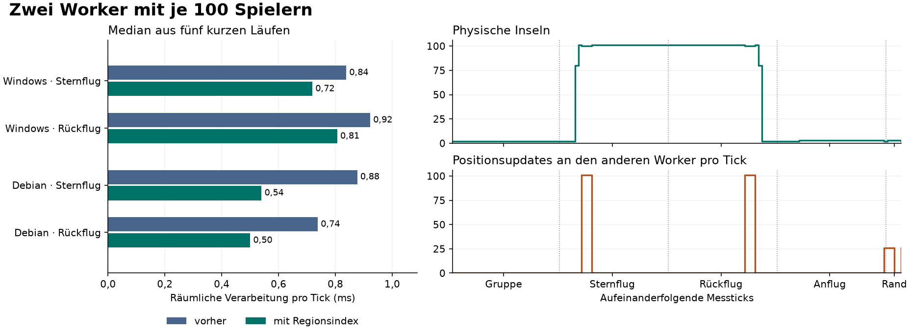

# Was passiert, wenn eine Spielergruppe auseinanderfliegt?

Ein Worker kann seine 100 Spieler weiter simulieren, auch wenn daraus 100 getrennte Inseln entstehen. Erreicht einer davon eine fremde Gruppe, erhält deren Worker die benötigten Felder als Replika. Der bisherige Worker verarbeitet weiter die Eingaben. Die Platzierung berücksichtigt Tickzeit, Speicher, Mindestverweildauer und Transferbudget. Ein gesunder Worker behält seine Gruppen. [Platzierung](../crates/zz-mesh/src/placement.rs)



## Wie viel Zeit der Index spart

Release-Builds mit identischem Flugskript, verglichen mit `9a7e77b`. Die Tabelle zeigt die räumliche Verarbeitung in Millisekunden. Für Flugphasen steht der Median der Tick-Mediane aus fünf Läufen zu je 32 Messticks. Merge und Trennung sind einzelne Ereignisse aus je elf Läufen. Windows 11 lief auf einem i7-13850HX, Debian 12 in einer VM mit sechs vCPUs auf demselben Rechner. Die seriellen Messungen liefen jeweils auf einem fest zugeordneten logischen Prozessor. [Alle Einzelmessungen und Tickverläufe](benchmarks/raumgruppen.json.gz)

| Lastfall | Windows vorher → neu | Debian vorher → neu |
| --- | ---: | ---: |
| Bewegung innerhalb der zwei Gruppen | 0,126 → 0,122 | 0,123 → 0,129 |
| 100 Spieler fliegen sternförmig auseinander | 0,838 → 0,719 | 0,877 → 0,540 |
| 100 Spieler fliegen zurück | 0,922 → 0,807 | 0,738 → 0,500 |
| Ein Spieler nähert sich der zweiten Gruppe | 0,115 → 0,157 | 0,109 → 0,129 |
| Vier Gruppen verschmelzen abrupt, 256 Spieler | 16,41 → 14,67 | 16,20 → 13,78 |
| Dieselben Gruppen trennen sich abrupt | 13,45 → 7,15 | 9,66 → 5,51 |

Im Sternflug sanken die Kandidaten für die abschließende Replikatprüfung von **54.014 auf 400**, beim Rückflug von **63.731 auf 400**. Beide Versionen lieferten in jedem Tick dieselben physischen Inseln und dieselbe Anzahl an Updates. Während des Vorbeiflugs flossen 303 Updates zwischen den Workern. Am äußeren Ende gab es keine gegenseitigen Abonnements mehr. Der Einzelanflug brauchte trotz weniger Kandidaten etwas länger. Beim Windows-Rückflug stieg der p95 des gesamten Ticks einschließlich Zustellung und Inselabfrage von 2,19 auf 2,67 ms.

**10.000 bewegte Spieler in 625 Inseln.** Bei 32 Worker-Welten auf einem Simulationsthread sank die räumliche Phase unter Windows von 16,97 auf 15,20 ms und unter Debian von 14,45 auf 12,06 ms. Mit vier Simulationsthreads in vier unabhängigen Referenzrahmen-Partitionen lag der **p95 des gesamten Ticks** unter Windows bei 26,35 → 26,31 ms und unter Debian bei 30,96 → 26,29 ms, jeweils als Median der sieben Lauf-p95. In dieser Konfiguration blieben mit dem neuen Stand alle 280 Messticks je Betriebssystem unter 50 ms. Jeder Lauf bestätigte 100.000 Eingaben und übernahm 400.000 Peer-Updates im Prozess. Der separate mTLS-Test mit acht Prozessen und 64 Spielern zählte zwischen getrennten Ursprungsinseln erst null, während der vollständigen Vereinigung 1.536 und nach der Trennung wieder null Updates im jeweiligen Haltefenster. [Netzwerktest](../examples/infinite-stars/src/bin/cluster-wire.rs)

## Welche Grenzen das Spiel einstellt

Für die Sicht eines einzelnen Spielers gelten standardmäßig 100 m zu Spielern und 500 m zu Schiffen. Reichweiten, Kontaktboxen und Haltepuffer stehen in `space.json`. [Spielersicht und Konfiguration](spielersicht.md)

`SpatialRule` liefert für jede Figur ein `SpatialProfile`. `bounds` bestimmt ihre räumliche Ausdehnung im lokalen Bezugssystem. `velocity` und `ahead` erweitern die Suche in Bewegungsrichtung. `retention` erweitert die Austrittsgrenze eines bestehenden Abonnements in Millimetern. Physische Inseln ergeben sich aus zusammenhängenden, überlappenden aktiven Bereichen. Zwei entfernte Enden einer solchen Kette können unterschiedliche Sicht haben. [Spielregel im Beispiel](../examples/infinite-stars/src/lib.rs) · [Directory](../crates/zz-mesh/src/spatial.rs)

Im Flugtest hat jeder Spieler eine Box mit 5 m Halbausdehnung und 1 m Haltepuffer. Auf der getesteten X-Achse erscheint die Replika bei 10 m Abstand. Beim Rückzug bleibt sie bei 10,5 m und genau 11 m erhalten. Bei 11,001 m verschwindet sie. Beim nächsten Anflug entsteht der Kontakt wieder bei 10 m. Jede Phase prüft die installierte Bevy-Replika und den zuständigen Writer.

## Welche Arbeit pro Bewegung anfällt

Eine geänderte Figur meldet ihre neue Position. Kleine Suchhüllen mit Mittelpunkt in derselben 32,768-m-Zelle teilen sich einen Eintrag im Octree. Innerhalb der Zelle sind die Kandidaten nach Worker gruppiert. Die Suche kann den gesamten eigenen Worker überspringen. Für eine bislang unverbundene Figur reichen im günstigen Fall bis zu acht Zellabfragen, unabhängig davon, wie viele eigene Spieler dort stehen. Mehr als 128 Einträge einer Empfängergruppe in einer Zelle bekommen einen lokalen Octree. Große oder weit vorausberechnete Hüllen bleiben einzeln im Octree. Die Zellgröße ist eine interne Suchgröße. [Regionsindex](../crates/zz-mesh/src/regions.rs)

Nahe einer fremden Gruppe prüft das Directory die betroffenen Boxen exakt in 3D. Treffen im selben Tick viele neue Positionen ein, sammelt es betroffene Objekte und berechnet deren Empfänger nach den Bewegungen gemeinsam. Erreicht die Warteschlange ihr Budget, verarbeitet es die bis dahin vorgemerkten Änderungen früher. Die physische Inselübersicht wird zwischengespeichert und bei Bedarf nach einer möglichen Kontaktänderung neu berechnet. Ein dichtes Zusammentreffen erzeugt Arbeit für die tatsächlich neu sichtbaren Figuren und deren Empfänger. [Batch und räumliche Abonnements](../crates/zz-mesh/src/spatial.rs)

## Sternflug, wachsende Hülle und Voronoi

Zwei Worker starten 64 m voneinander entfernt mit je 100 Spielern. Über 32 Ticks fliegen die ersten 100 in verschiedene Richtungen auf eine Kugel mit 256 m Radius. Dadurch werden aus zwei physischen Inseln 101. Beim Rückflug entstehen wieder zwei. Anschließend nähert sich ein einzelner Spieler der anderen Gruppe. Die Platzierungsprüfung läuft bei jedem Tick. Alle 200 Writer behalten Generation 1.

Am Ende des Sternflugs überlappen die Hüllboxen, die jeweils alle Spieler eines Workers umschließen. Eine Suche allein mit diesen zwei Hüllen lässt **10.000 mögliche Spielerpaare** übrig. Die exakte Prüfung findet **null** Kontakte zwischen den Gruppen. Bei zwei festen Voronoi-Zentren und 1 m Puffer jenseits der Mittelebene lägen **45 Spieler** bereits auf der anderen Seite. Das ist eine geometrische Auswertung derselben Positionen. Die Zeitmessungen vergleichen die beiden ausführbaren Octree-Varianten. [Flugpfade und Geometrievergleich](../examples/infinite-stars/src/bin/cluster-bench.rs) · [Definition der Voronoi-Zelle](https://doc.cgal.org/latest/Voronoi_diagram_2/index.html)

## Den Kurztest wiederholen

```sh
cargo run --release --locked -p infinite-stars --bin cluster-bench -- target/flug.json --flight
cargo run --release --locked -p infinite-stars --bin cluster-bench -- target/merge.json --crowd 256
cargo run --release --locked -p infinite-stars --bin mesh-profile -- --players 10000 --workers 32 --partitions 4 --ticks 40 --output target/inseln-10000.json
```

Der Flugtest prüft nach jedem Tick alle physischen Inseln gegen eine vollständige paarweise Suche. Er kontrolliert außerdem Empfänger, Feldinhalt, Writer und installierte Repliken. `trace` enthält Inselzahl und Worker-Updates pro Tick. `spatial_candidates` zählt die an die abschließende Objektprüfung übergebenen Kandidaten. Die Zeitmessung umfasst die normale räumliche Tickphase. Die unabhängigen Kontrollen liegen außerhalb der Messzeit.
