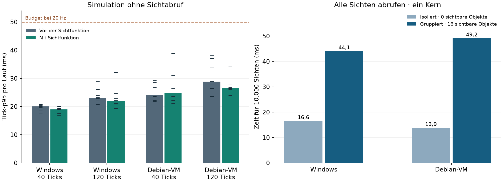

# Wen sieht ein Spieler in Infinite Stars?

Jeder Spieler hat seine eigene Sichtkugel. Standardmäßig sieht er alle anderen Spieler bis **100 m** und Schiffe bis **500 m**, gemessen zwischen den Mittelpunkten im selben 3D-Bezugssystem. Die Grenze zählt mit. Ein Spieler bei 100,001 m verschwindet bei der nächsten aktuellen Sichtabfrage. Innerhalb der Reichweite kommen alle als öffentlich registrierten Komponenten mit der exakten Spielprojektion an. Inventar, private Eingaben und interne Worker-Komponenten bleiben geschützt.

| Situation | Sicht aus der Perspektive von A |
| --- | --- |
| A, B und C bilden überlappende Simulationsbereiche. B ist 90 m von A entfernt, C ist 180 m entfernt. | A sieht B. C kann für B gleichzeitig sichtbar sein. |
| Ein Schiff liegt relativ zu A bei (300 m, 400 m, 0 m). | A sieht das Schiff bei genau 500 m. Ein zusätzlicher Millimeter in Z-Richtung bringt es außerhalb der Kugel. |
| Fünf Spieler gehören demselben Worker und liegen in fünf weit entfernten Regionen. | Jeder hat eine leere Nachbarsicht. Der Worker kann alle fünf weiter simulieren. |
| Ein Spieler auf einem zweiten Worker ist 80 m entfernt. | A erhält die öffentlichen Felder direkt vom zuständigen Worker. Eine Übergabe der Figur ist dafür entbehrlich. |

## Reichweiten einstellen

Eine Datei `space.json` im Worker-Verzeichnis genügt. Alle Distanzen in der Datei sind **Meter**, auch Dezimalwerte sind möglich. Der Host liest sie beim Start und rechnet einmal auf ganzzahlige Millimeter um. Fehlende Schlüssel verwenden die Standardwerte.

```json
{
  "player_sight_m": 100,
  "ship_sight_m": 500,
  "contact_buffer_m": 1
}
```

Die Sichtweiten legt der Directory-Worker in Slot 1 für das Mesh fest. Bei der Bereitstellung mehrerer Rechner kopiert `provision` die Datei aus `control` in jedes neue Worker-Verzeichnis. Auf bestehenden Installationen die Datei im jeweiligen Worker-Verzeichnis ändern und den Prozess neu starten. Die Vorlage enthält auch Box-Halbausdehnungen und die Anzahl vorausberechneter Bewegungsticks. In einem eingebetteten Spiel nimmt `world_with_settings` dieselben Regeln als `SpaceSettings` entgegen. [Kopierbare Vorlage](../examples/infinite-stars/space.example.json) · [Spielregeln](../examples/infinite-stars/src/space.rs)

Die **10 und 11 m** aus dem Flugtest beschreiben den Worker-Kontakt zweier 5-m-Boxen entlang einer Achse. Mit `player_half_extent_m = 8` und `contact_buffer_m = 2.5` entsteht der Kontakt bei 16 m und bleibt beim Rückzug bis einschließlich 18,5 m. Der Haltepuffer und `forecast_ticks` steuern Peer-Replikation. Die Spielersicht verwendet die aktuellen gemeldeten Mittelpunkte und den zum Zieltyp gehörenden Radius. Koordinaten unterschiedlicher Bezugssysteme werden unabhängig ausgewertet. [Inseln und Hysterese](raumgruppen.md)

Für angrenzende Sektoren mit möglichem Sichtkontakt meldet das Spiel Positionen in einem gemeinsamen Frame, etwa relativ zum selben Stern. Räumliche Inseln und Worker können sich innerhalb dieses Frames ändern. Verwendet das Spiel zusätzlich schiffslokale Koordinaten, rechnet es sie für die Sichtprüfung in diesen gemeinsamen Frame um.

## Im Spiel nutzen

Eine Spielfigur als `(Managed, Player, Position, …)` anlegen, ein Schiff als `(Managed, Ship, Position, …)`. Das Spiel vergibt die stabilen Objekt-IDs. Zusätzliche öffentliche Komponenten, etwa das Aussehen der Figur oder der Schiffstyp, mit `mesh_component` und `Visibility::Public` registrieren.

- **Mehrere Welten im Prozess.** Nach `pool.step()?` liefert `pool.player_sight(actor_id)?` eine nach Objekt-ID geordnete Sicht. Für viele gleichzeitige Leser erhält `pool.visit_player_sights(&actor_ids, |actor, records| …)?` die öffentlichen Datensätze als geliehene Referenzen. Benachbarte Leser im selben Aufruf teilen sich die Projektion. Der eigene Actor hat seinen separaten bestätigten Zustand.
- **Echte Spielclients.** Auf dem Authority-Rechner stellt `infinite-stars provision-client control spieler-a ACTOR_UUID` ein eigenes Zertifikat für die Figur aus. Vom Client aus zeigt `infinite-stars sight spieler-a WORKER_ADRESSE` die aktuelle Nachbarschaft. Jeder Worker kann als Einstieg dienen und die Abfrage für sein angemeldetes Konto an das Directory weiterreichen.
- **Laufender Client.** Eine `PlayerSightClient`-Instanz und die authentifizierte Verbindung zum Einstiegsworker halten. `refresh(&mut worker, connect_source)` verwendet das Spielerzertifikat auch für sichtbare Quellen. Nach Erfolg enthält `records()` die vollständige Sicht einschließlich der Ein- und Austritte. Bei einem Verbindungsfehler bleibt die letzte vollständige Sicht desselben Kontos verfügbar. Den nächsten Abruf im Netzwerk-Task des Spiels einplanen. [Client-API](../crates/zz-mesh/src/sight.rs)

Der Octree sucht Kandidaten im relevanten Raum. Danach entscheidet die exakte Kugeldistanz je Zieltyp. Das Directory liefert die Adressen der beteiligten Worker. Jeder Quellworker prüft die Sicht für das angemeldete Konto erneut und liefert seine öffentlichen Daten direkt. Über 128 Nachbarn oder eine volle Nachricht führen zu Folgeseiten. Ein einzelner öffentlicher Objektdatensatz muss in den 1-MiB-Wire-Frame passen. Große Ressourcen gehören in den Bulkpfad. Eine Abfrage beginnt beim zuletzt gemeldeten räumlichen Stand. Ein Zuzug während einer mehrseitigen Abfrage kann beim nächsten Abruf erscheinen.

Im lokalen Simulationstick führt die Spielersicht keine zusätzliche Suche oder Positionspflege aus. Im Prozessverbund enthält eine reguläre räumliche Änderungsmeldung zusätzlich den Zieltyp. Gleiche Boxen, Geschwindigkeiten und Mittelpunkte werden darin einmal kodiert. Beim ersten Clientabruf sendet die Quelle die ganze öffentliche Seite. Bei Folgeabrufen bestätigt sie identische Inhalte mit einer kurzen Antwort. Änderungen an Position, öffentlichen Feldern oder Mitgliedschaft liefern eine neue Seite. Der Quellworker muss die angeforderte Sicht auch für diese Bestätigung auswerten. Die Abruffrequenz bestimmt das Spiel unabhängig von der Tickrate.

**Geprüft** sind fünf weit voneinander entfernte Spieler auf einem Worker, der Zuzug zu einem Spieler und einem Schiff auf zwei Workern sowie der Ausflug aus beiden Radien. Über mTLS prüft der Test auch den Einstieg über den zweiten Worker, unveränderte Seiten und die Positionsänderung eines sichtbaren Nachbarn. Weitere Tests decken 205 sichtbare Nachbarn, Byte-Paginierung, private Komponenten, identische Koordinaten in verschiedenen Frames, diagonale Grenzfälle und Positionen nahe den i64-Grenzen ab. [ECS-Tests](../examples/infinite-stars/tests/player_sight.rs) · [mTLS-Prozesstest](../examples/infinite-stars/tests/process.rs)

## Was kosten 10.000 Spielersichten?

Der interne Release-Benchmark startet zwei Bevy-Worker mit gemeinsamem SQLite-Store im RAM. In der dünn besetzten Welt liegen die Spieler jeweils 2 km auseinander. In der zweiten Welt teilen sich je 16 Spieler ein Gebiet, ein Schiff steht in 400 m Abstand. Jeder Spieler sieht genau 15 andere Spieler und ein Schiff. Alle erwarteten IDs und die Sichtbarkeit der Felder werden geprüft. Ein kompletter Durchgang liefert damit 160.000 öffentliche Datensätze an ihre jeweiligen Empfänger. [Benchmarkprogramm](../examples/infinite-stars/src/bin/sight-bench.rs)

| 10.000 vollständige Sichten, ein CPU-Kern | Windows, einzelne Abrufe | Windows, gemeinsam | Debian-VM, einzelne Abrufe | Debian-VM, gemeinsam |
| --- | ---: | ---: | ---: | ---: |
| 10.000 isolierte Spieler | 15,59 ms | 16,56 ms | 13,74 ms | 13,85 ms |
| 625 Gebiete mit je 16 Spielern und einem Schiff | 290,79 ms | **44,11 ms** | 240,66 ms | **49,17 ms** |

Für einzelne Abrufe ist die Summe der Aufrufzeiten angegeben. Der gemeinsame Abruf misst die Laufzeit des ganzen Durchgangs mit geliehenen Datensätzen. Ein Leser außerhalb der Reichweite erhält eine leere Sicht. Überlappende Leser sparen die wiederholte Prüfung der Zuständigkeit und die erneute Projektion desselben Ziels. Bei 20 vollständigen Abrufen pro Sekunde würde die gruppierte Szene für diesen Anteil rechnerisch 0,88 bzw. 0,98 CPU-Kerne beanspruchen. Spielsimulation, Änderungen der Welt während des Abrufs und Netzwerktransport benötigen eigene Laufzeit. Die Messung verwendet den Median aus neun Durchgängen unter Windows und drei unter Debian. [Einzelmessungen](benchmarks/spielersicht.json.gz)

Mit fester lokaler Gruppengröße wächst die Anzahl der auszuliefernden Datensätze proportional zur Spielerzahl. Sind in einem Gebiet alle `n` Spieler gegenseitig sichtbar, entstehen dort `n × (n − 1)` gerichtete Spielerbeziehungen. Der Octree spart die Prüfungen zwischen entfernten Gebieten. In einem echten Netztest mit 64 Figuren und acht Worker-Prozessen kamen in der getrennten Phase 768 Peer-Updates am Ziel an, davon null in fremden Gruppen. Beim Zusammenflug entstanden zusätzliche Verbindungen. Nach dem Trennen fiel der Datenverkehr zu fremden Ausgangsgruppen wieder auf null. [Szenen, Barrieren und TLS-Bytes](benchmarks/spielersicht.json.gz)

Eine Quellseite aus der gruppierten Szene mit neun sichtbaren Objekten benötigt im nativen Protokoll **566 Byte** für Anfrage und volle Antwort. Beim Folgeabruf mit unverändertem Inhalt sind es **37 Byte** einschließlich Prüfsumme in der Anfrage. Diese Zahlen beziehen sich auf die Bincode-Nutzdaten. TLS, Frame-Header und die Entdeckung der Quellen kommen hinzu. Die Kapazität mit 10.000 gleichzeitig verbundenen nativen mTLS-Spielclients auf mehreren physischen Servern ist eine eigene Abnahme. [Kapazitätsplan](kapazitaetsplan.md)

## Was kostet die Funktion im Simulationstick?

Verglichen wurde mit dem unmittelbar vorherigen Commit `bc9bc2a`. Beide Release-Versionen simulierten 10.000 bewegte Spieler in 625 voneinander getrennten Inseln, mit 32 Worker-Welten, vier Simulationsthreads und Speicher-Datenbank. Zwei Worker waren je Insel beteiligt. Jeder 40-Tick-Lauf bestätigte **100.000 Eingaben**, installierte **400.000 Peer-Updates** und prüfte null Abonnements außerhalb der eigenen Insel. Windows 11 und eine Debian-12-VM mit sechs vCPUs liefen nacheinander auf demselben Intel Core i7-13850HX. Auf dem Host waren für die Vergleichsreihe acht feste Performance-Kerne verfügbar. Die Werte sind Mediane der jeweiligen Laufperzentile. [Messdaten und Aufbau](benchmarks/spielersicht.json.gz)

| Plattform und Messfenster, je sieben Laufpaare | Tick-p50 vorher → neu | Tick-p95 vorher → neu | Ticks über 50 ms vorher → neu |
| --- | ---: | ---: | ---: |
| Windows, 40 Ticks | 17,29 → 17,01 ms | 20,06 → 18,97 ms | 0 → 0 von je 280 |
| Windows, 120 Ticks | 19,24 → 18,30 ms | **23,11 → 22,05 ms** | 0 → 0 von je 840 |
| Debian-VM, 40 Ticks | 21,88 → 19,92 ms | 24,13 → 24,81 ms | 0 → 0 von je 280 |
| Debian-VM, 120 Ticks | 23,47 → 22,90 ms | **28,80 → 26,48 ms** | 0 → 1 von je 840 |

Wegen des um rund 0,7 ms höheren Debian-p95 im kurzen Fenster lief eine zweite Serie mit denselben Binaries und dreimal so vielen Ticks. In dieser Serie sank der p95 auf beiden Systemen. Auf Debian dauerte ein einzelner Tick **84,67 ms**. Die Phasen-Maxima verteilen sich in diesem Lauf auf mehrere Threads. Die genaue Ursache dieser Spitze bleibt offen. Die summierte CPU-Zeit der vier Simulationsthreads pro Tick sank in der längeren Reihe unter Windows von 59,11 auf 55,34 ms und unter Debian von 72,43 auf 69,68 ms.



Eine Zwischenfassung erhöhte den p95 unter Windows von 22,19 auf 25,76 ms und in der VM von 48,79 auf 55,88 ms. Diese fünf früheren Laufpaare sind in den Rohdaten enthalten. Die ausgelieferte Fassung verwendet bei Deltas vorhandene Feldpuffer weiter, übernimmt gespeicherte Komponenten nach einem erfolgreichen Checkpoint und prüft bestehende Dokumentrevisionen direkt im SQL-Update. Der Octree besucht nur belegte Kinder und gibt Treffer direkt an den Aufrufer. Im selben 10.000er-Lastfall fallen damit pro Tick **41.103 statt 53.603 Rust-Allokationen** an (−23,3 %). Das zugewiesene Volumen sank von 13,14 auf 12,59 MB pro Tick. [Publisher](../crates/zz-mesh/src/publish.rs) · [Checkpoints](../crates/zz-mesh/src/bevy_runtime.rs) · [Octree](../crates/zz-mesh/src/octree.rs)

Als separate Kontrolle lief die ursprüngliche WebSocket-Demo (`3ef0d78`) gegen die heutige Demo, jeweils mit drei Servern, drei Clients und 3.000 NPCs. In drei Windows-Laufpaaren zu je zehn Sekunden sank der p95 des langsamsten Servers von **3,36 auf 2,10 ms** (−37,5 %). Beide Versionen lieferten rund 20 Snapshots pro Sekunde. Die neuen Sichtregeln gehören zum nativen Bevy-Spiel. [Einzelläufe und Binär-Hashes](benchmarks/spielersicht.json.gz)

Am 26. November 2026 bestanden auf Windows und Debian jeweils 707 Rust-Tests im Workspace. Auf Windows bestanden zusätzlich die drei TypeScript-Testsuiten, der Client-Produktionsbuild und beide Live-Smokes für Eingabebestätigung und Peer-Replikation.

Zum Nachmessen unter Windows oder Linux genügen zwei kurze Release-Aufrufe.

```sh
npm run bench:sight -- 10000 target/sight.json
npm run bench:profile -- --players 10000 --workers 32 --partitions 4 --ticks 40 --output target/tick.json
```
