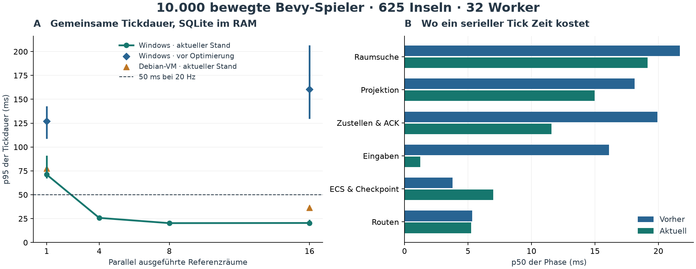
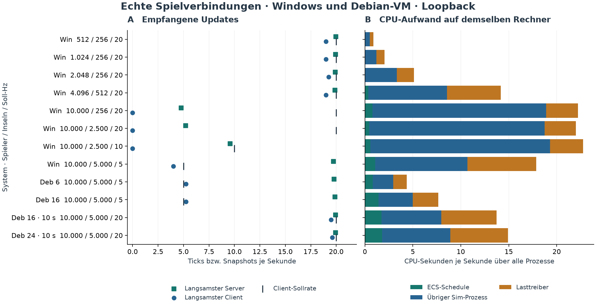
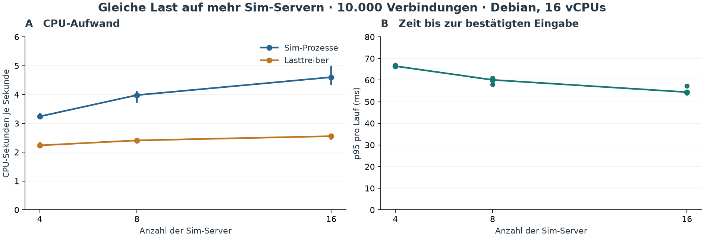

# Tickkosten und 10.000 Spieler

Die Zahlen auf dieser Seite gehören zum jeweils angegebenen Messstand. Die aktuellen V1-Grenzwerte und ihr reproduzierbarer Lastlauf stehen in der [Modulabnahme](mesh-v1-abnahme.md).

Die neueste Vergleichsmessung untersucht Änderungen an Octree, Replikation und Speicherbedarf. Der kurze Kerntest ermittelt auf dem Zielrechner, wie viele parallele Simulationsthreads das 50-ms-Budget einhalten. [Kernskalierung und AMD-EPYC-Planung](kernskalierung.md)

Wie die Gruppengröße den Verkehr bestimmt, zeigen zusätzliche Messungen mit 1.024 bis 4.096 WebSocket-Clients. Für 10.000 mTLS-Sitzungen und eine gemeinsame Schlacht gibt es einen dimensionierten Testaufbau mit Abnahmekriterien. [Kapazitätsplan und Regionskurven](kapazitaetsplan.md)

**10.000 gleichzeitige WebSocket-Spieler bestanden auf Debian alle vier Lastläufe mit 24 vCPUs, acht Sim-Servern und acht Lasttreibern.** Die Sollrate betrug 20 Snapshots und fünf Eingaben je Spieler und Sekunde. In drei Vier-Sekunden-Läufen und einem Zehn-Sekunden-Lauf kamen **1.100.000 von 1.100.000 geplanten Eingaben** zurück. Im längeren Lauf betrug das Eingabe-p95 **75,6 ms**, der langsamste Client empfing **19,6 Snapshots/s**. Die Spieler bildeten 5.000 räumlich getrennte Paare über Workergrenzen hinweg. Der interne Test des persistenten Bevy-Spiels prüft zusätzlich 10.000 bewegte Spieler in 625 Inseln mit eigener Sitzung, eigenem Inventar und einer sichtbaren Kopie auf einem zweiten Worker.



## Wo sich Parallelität lohnt

Auf dem Windows-Rechner dauerte ein serieller Spieltick nach der Optimierung bei p95 **71,2 ms**. Mit denselben 32 Workern, verteilt auf 16 gleichzeitig ausgeführte Referenzräume, waren es **20,4 ms**. Alle 120 gemessenen Ticks dieser drei RAM-Läufe blieben unter 50 ms. Je Lauf kamen **100.000 Eingaben** und **400.000 Peer-Updates** an. Alle 10.000 Zielrouten wurden mit dem erwarteten Peer abgeglichen. Zwischen den getrennten Inseln gab es keine fremde Subscription.

| Aktivität und Ausführung, Windows | p95 vorher | p95 aktuell |
| --- | ---: | ---: |
| 10.000 bewegt, ein Raum, SQLite im RAM | 127,2 ms | 71,2 ms |
| 10.000 bewegt, vier Räume, RAM | – | 25,8 ms |
| 10.000 bewegt, acht Räume, RAM | – | 20,3 ms |
| 10.000 bewegt, 16 Räume, RAM | 160,6 ms | 20,4 ms |
| 2.500 bewegt, 7.500 ruhend, 16 Räume, RAM | – | 11,6 ms |
| 10.000 ruhend, 16 Räume, RAM | – | 1,4 ms |
| 128 bewegt, ein Raum, RAM | 1,7 ms | 1,5 ms |
| 10.000 bewegt, 16 Räume, gemeinsame SQLite-Datei, WAL mit `FULL` | 387,2 ms | 44,4 ms |

Ein und 16 Räume mit voller Bewegung im RAM zeigen den Median der drei Lauf-p95. Die Dateimessung enthält zwei Läufe je Stand, die übrigen Zeilen sind Einzelmessungen. Beim aktuellen Datei-Store überschritten **zwei von 80 Ticks** das 50-ms-Budget, der längste dauerte **50,9 ms**. Die 16 Worker-Threads nutzten im RAM zusammen durchschnittlich 4,2 bis 4,9 logische CPUs. Mehr Threads brachten ab acht Räumen auf diesem Rechner keinen weiteren Gewinn. Bei ruhenden Spielern blieben die gemessenen Komponentenprojektionen und Peer-Updates bei null.

Im seriellen Lauf beanspruchen die räumliche Verarbeitung **19,2 ms**, die Projektion **15,0 ms** und das Zustellen samt Bestätigung **11,6 ms** je Tick (Phasen-p50). Die Eingabeprüfung sank von **16,1 auf 1,3 ms**. Rust-Heap-Anforderungen auf dem Worker-Thread gingen von **158.373 auf 95.550 pro Tick** zurück, ihr Gesamtumfang von **34,2 auf 23,0 MB**. Bei einer Größenänderung zählt die neue angeforderte Größe. Die Zeitersparnis kommt unter anderem aus gebündelten Authority-Lesevorgängen, der Wiederverwendung von Inselzugehörigkeiten und weniger Kopien beim Aufbau einer Projektion.

In der Debian-VM mit sechs vCPUs erreichten dieselben 10.000 bewegten Spieler mit 16 Räumen intern **36,5 ms p95** im RAM und **57,9 ms** mit dauerhafter Datei. Die Referenz lag bei **114,2 ms** bzw. **363,0 ms**. Im aktuellen Dateilauf überschritten 14 von 40 Ticks das Budget. Beim Absturz kann gewöhnliche Bewegung bis zum letzten Checkpoint zurückfallen. Bestätigte Inventar- und Wirtschaftsaktionen haben ihren eigenen dauerhaften Commit. [Persistenz und Spielaktionen](infinite-stars.md)

### Wenn Inseln zusammenlaufen

Bei 256 Spielern und acht Workern lagen getrennte Gruppen bei **1,3 ms** Tick-p95 und die vereinte Gruppe bei **5,6 ms**. Der einzelne Tick der Verschmelzung dauerte **20,1 ms**, die Trennung **12,1 ms**. Die Spitze gleichzeitig anstehender Peer-Nachrichten stieg von 256 auf 1.792. Der einmalige Aufbau zusätzlicher Nachbarschaften ist in der Messung enthalten. Für 10.000 Spieler im selben Sichtbereich gibt es hier keinen entsprechenden Lastnachweis. [Messkurven für Annäherung, Überlappung und Trennung](octree-messung.md)

Der separate mTLS-Lauf des persistenten Spiels prüfte bis zu **64 Spieler, acht Worker-Prozesse und vier Inseln** mit eigenem Authority-Datenträger. Im getrennten Zustand wurden **768 Updates** installiert, davon **null zwischen fremden Ursprungsgruppen**. Beim vollständigen Zusammenschluss kamen im Haltefenster 1.536 Updates zwischen den vorher getrennten Gruppen an. Nach der Trennung sank dieser Wert wieder auf null. In 5,5 Sekunden Stillstand wurden keine Entity-Updates erzeugt. Auf den TLS-Verbindungen lief weiter Kontrollverkehr.

Für die Kapazitätsplanung des eigenen Spiels zählt auch der Zugang zum Worker. Der verteilte Bevy-Beispielhost nimmt höchstens 256 gleichzeitige Verbindungen je Worker an, darunter auch Peer-Verbindungen. Sein synchroner mTLS-Listener führt pro aktiver Verbindung einen Thread. Mit `provision-client` lassen sich Zertifikate an die Actor-IDs eigener Spieler binden. Für die persönliche Sichtabfrage ist die Kapazität mit 10.000 gleichzeitigen Spielclients offen. [Beispielhost](../examples/infinite-stars/src/host.rs) · [Listener](../crates/is-mesh/src/wire.rs) · [Spielersicht](spielersicht.md)

## Was die Spieler tatsächlich empfangen



**Debian, 10.000 Verbindungen.** Bei 16 Sim-Servern, 5.000 Zweiergruppen, 5 regulären Snapshots und 2 Inputs je Sekunde bestanden **zwei von drei Läufen** auf sechs vCPUs alle Kriterien. In diesen beiden Läufen kamen jeweils 80.000 von 80.000 Echos an, p95 lag bei **88 und 109 ms**. Im dritten Lauf waren es **79.727 Echos** und **166 ms**. In allen drei Läufen sah jeder Spieler seine eigene Bewegung und einen Nachbarn des anderen Workers. Im ersten Lauf beanspruchten die Sim-Prozesse 2,94 CPU-Kerne, der Schedule-Thread davon 0,82 und die Treiber zusätzlich 1,41. Empfangen wurden 59 Mbit/s WebSocket-Nutzdaten, für UDP eingereiht wurden 125 Mbit/s.

| Debian mit 16 vCPUs, dieselben 10.000 Spieler | 4 Sim-Server | 8 Sim-Server | 16 Sim-Server |
| --- | ---: | ---: | ---: |
| Zweiergruppen, 5 Snapshots / 2 Eingaben pro Sekunde | 3/3 bestanden | 3/3 bestanden | 3/3 bestanden |
| Eingabe-p95 in diesen drei Läufen | 66–67 ms | 58–61 ms | 54–57 ms |
| CPU der Sim-Prozesse, Median | 3,24 Kerne | 3,98 Kerne | 4,60 Kerne |



Vier Server erledigten dieselbe Arbeit mit weniger Gesamt-CPU. Zusätzliche Server verkürzten die Eingabelatenz. In 2.500 Vierergruppen bei 10 Snapshots/s und zwei Eingaben/s bestätigten acht Server in allen drei Läufen sämtliche 80.000 Eingaben. Zweimal erhielt der langsamste Client 9 Snapshots/s, einmal 8,75. Der letzte Lauf unterschritt damit die gewählte Empfangsschwelle.

**Volle Rate mit 10.000 Verbindungen.** Bei 20 Snapshots/s, 5 Inputs/s und 16 vCPUs schafften 16 Sim-Server mit vier Lasttreibern alle 199.786 gesendeten Echos. 214 geplante Eingaben verpasste der Treiber. Acht Sim-Server mit acht Treibern bestanden zwei von drei Vier-Sekunden-Läufen. Beim dritten Lauf fehlten drei Echos und p95 stieg auf 167 ms. Im zusätzlichen Zehn-Sekunden-Lauf bestand dieselbe Konfiguration alle Kriterien. Die Server liefen mit mindestens 19,94 Hz, sämtliche Spieler sahen ihre Bewegung und ihren Nachbarn. Die Sim-Prozesse belegten **7,97 logische CPUs**, davon **1,72** im synchronen Schedule. Weitere **5,77** entfielen auf die Lasttreiber. Der WebSocket-Empfang erreichte **190 Mbit/s**, für UDP wurden **126 Mbit/s** eingereiht. Die Ausgangswarteschlange verweigerte in diesem Fenster keinen Snapshot.

Bei gleicher Konfiguration mit **24 vCPUs** lagen die drei kurzen Eingabe-p95 bei **77,9 / 71,6 / 72,4 ms**. Im Zehn-Sekunden-Lauf bestätigten die acht Server alle **500.000 Eingaben**, p95 lag bei **75,6 ms**, p99 bei **86,2 ms**. Der langsamste Server lief mit **19,94 Hz**. Auf die Sim-Prozesse entfielen **8,89 CPUs**, davon **1,81** im synchronen ECS-Schedule, auf die Lasttreiber **6,03**. Die Nutzlast blieb bei **190 Mbit/s** für WebSocket und **125 Mbit/s** für UDP. Zusätzliche verfügbare CPU verbesserte an diesem Lastpunkt die Zustelllatenz bei vergleichbarem Datenvolumen.

| Windows, vier Sekunden | Inseln | Snapshot / Input je Sekunde | Langsamster Server / Client | Bestätigt / geplant | Eingabe-p95 |
| --- | ---: | ---: | ---: | ---: | ---: |
| 512 Spieler, 4 Server | 256 | 20 / 5 | 20,0 / 19,0 Hz | 10.240 / 10.240 | 62 ms |
| 1.024 Spieler, 4 Server | 256 | 20 / 5 | 19,9 / 19,0 Hz | 20.480 / 20.480 | 60 ms |
| 2.048 Spieler, 8 Server | 256 | 20 / 5 | 19,9 / 19,25 Hz | 40.960 / 40.960 | 62 ms |
| 4.096 Spieler, 8 Server | 512 | 20 / 5 | 19,9 / 19,0 Hz | 81.887 / 81.920 | 89 ms |
| 10.000 Spieler, 16 Server | 256 | 20 / 5 | 4,8 / 0 Hz | 10.081 / 200.000 | 8.066 ms |
| 10.000 Spieler, 16 Server | 2.500 | 20 / 5 | 5,2 / 0 Hz | 11.786 / 200.000 | 7.671 ms |
| 10.000 Spieler, 16 Server | 5.000 | 5 / 2 | 19,7 / 4,0 Hz | 75.602 / 80.000 | 521 ms |

Bei 4.096 Spielern bestätigte der Server alle gesendeten Eingaben. Der Lasttreiber verpasste 33 geplante Sendezeitpunkte. Der höchste vollständig bestandene Windows-Lastpunkt in dieser Reihe lag deshalb bei 2.048. Eine weitere Serie mit 4.096 Spielern in 2.048 getrennten Paaren bestand beide Läufe. Im dünn besetzten 10.000er-Lauf sahen alle Spieler ihre eigene Bewegung und einen Nachbarn eines anderen Workers. Vor der separaten Entdeckung neu belegter Regionen sahen unter derselben Last nur 1.328 Spieler ihren Nachbarn. Jeder Lauf prüft die Sichtgrenze auch in den tatsächlich empfangenen Frames. [Vergleich bei gleicher Gruppengröße](kapazitaetsplan.md)

Bei 10.000 Spielern in 2.500 Inseln und 20 gewünschten Snapshots/s belegten die Windows-Sim-Prozesse zusammen **18,7 logische CPUs**, davon **0,45** auf dem Thread innerhalb des ECS-Schedules. Die Lasttreiber belegten weitere **3,26**. Durch kamen nur **23 Mbit/s WebSocket-Nutzdaten**, **39 Mbit/s** wurden für UDP eingereiht. Mit 5.000 Inseln und 5 gewünschten Snapshots/s waren es **10,7 Sim-CPUs**, **1,08** im Schedule, **7,16** für die Treiber und **56 / 130 Mbit/s**. Unter dieser Last kosten Versand, Empfang, Laufzeitplanung und die Verarbeitung vieler kleiner Nachrichten erheblich CPU. Für eine physische Netzwerkkarte liefert Loopback keine Sättigungsgrenze. Die Eingabelatenz ist nur für tatsächlich empfangene Echos definiert.

Im ursprünglichen Browser-Szenario mit drei Servern, drei Clients und 3.000 NPCs sank der Tick-p95 des langsamsten Servers von **2,83 auf 2,05 ms**, p99 von **3,92 auf 2,76 ms**. Beide Varianten lieferten **19,98 Hz**. Je zwei 15-Sekunden-Läufe wechselten die Startreihenfolge.

## Im eigenen Spiel messen

Aus dem Repository-Stamm laufen dieselben Befehle unter Windows und Linux. Für 10.000 echte Verbindungen verwendete das Debian-Startterminal `ulimit -n 32768`. Der erste Build benötigt länger. Ein interner Lauf misst 40 oder 60 Ticks, der Socket-Test standardmäßig vier Sekunden nach der Anmeldung aller Spieler.

```sh
npm run bench:profile -- --players 10000 --workers 32 --partitions 16 --ticks 40 --output target/profile.json
npm run bench:profile -- --players 10000 --workers 32 --partitions 16 --active-percent 25 --ticks 40
npm run bench:profile -- --players 10000 --workers 32 --partitions 16 --ticks 40 --database target/new-world.sqlite
npm run bench:sockets -- --servers 16 --islands 2500 --snapshot-ticks 2 --input-hz 2 --seconds 4
npm run bench:sockets -- --servers 8 --socket-drivers 8 --islands 5000 --snapshot-ticks 1 --input-hz 5 --seconds 10 --require-budget
```

Der Datenbankpfad muss neu sein. Ohne Pfad benutzt der Test eine gemeinsame SQLite-Datenbank im RAM. Mit einer Datei gelten WAL und `synchronous=FULL`. `--require-20hz` beendet den internen Test mit einem Fehler, sobald ein gemessener Tick länger als 50 ms dauert. `--require-budget` prüft im Socket-Test die unten beschriebenen Kriterien. Für eigene Bevy-Systeme liefert `Pool::step_observed` die Phasengrenzen. Der Heap-Zähler ist ausschließlich in das Profiling-Binary gelinkt.

### Was pro Tick anfällt

| Arbeit | Auslöser und Kosten |
| --- | --- |
| Bewegung | Eine gültige Eingabe des Beispielspiels steuert vier Simulationsticks. Der Profiler verteilt die Eingaben über diese vier Ticks. Der Extremfall mit 100 % Aktivität bewegt jeden Spieler bei jedem Tick. |
| Eingaben prüfen | Eine unveränderliche Sitzungsbindung bleibt am lokalen Spieler gespeichert. `apply_inputs` nimmt bis zu 128 Bewegungseingaben in Reihenfolge an. Ein konsistenter Lesevorgang prüft Worker-Inkarnation, Gruppengeneration und den Übergabestatus. Dauerhafte Spielaktionen verwenden ihre eigenen Transaktionen. |
| Octree und Inseln | Geänderte räumliche Beschreibungen aktualisieren die Verzeichnisse. Ein Objekt kann seinen Eintrag innerhalb eines passenden Octree-Knotens überschreiben. Die Liste der physischen Inseln lässt sich als Slice ausleihen. Hinzufügen, Entfernen und mögliche Überschneidungswechsel machen sie ungültig. Große dichte Begegnungen können viele tatsächliche Interessenbeziehungen erzeugen. |
| Replikation | Nur abonnierte Empfänger bekommen Änderungen. `Demand.period` legt die Abtastrate je Komponente fest. Eine ausstehende Bestätigung kann eine erneute Vollprojektion auslösen. Der Sender hält die letzte Projektion und den ausstehenden Revisionsstand. |
| Persistenz | Neue Objekte und Löschungen werden zeitnah geschrieben. Für laufende Änderungen liegt jede Gruppe in einem von 20 Checkpoint-Slots. Ein expliziter Checkpoint bleibt möglich. Bei einem Datei-Store können gleichzeitig anstehende Checkpoints einen WAL-Commit teilen. Jeder Auftrag hat seine eigene Revisionsprüfung und seinen eigenen Rollback-Punkt. |
| Browser-Snapshots | Der Demo-Server bestimmt die Sichtbarkeit über XZ-Zellen und exakte Kreistests. Gleiche Sicht und gleiche Ausgangsbasis erlauben einen gemeinsamen Binärpuffer bis zur WebSocket-Nachricht. Abweichende ACKs und volle Empfängerwarteschlangen behalten ihren eigenen Zustand. TLS, WebSocket-Framing, Kernel und Client verursachen weitere Arbeit. |
| Entdeckung neuer Demo-Regionen | Alle vier Ticks prüft der Worker die belegten Zellen. Eine Änderung und ein regelmäßiges Lebenszeichen übertragen eine 1-KiB-Maske je Peer. Dieser Bloomfilter kann zusätzliche kalte Peer-Updates auslösen. Der exakte Sichttest auf dem Empfänger schützt die Grenzen der Spieleransicht. |

Für das persistente Bevy-Spiel regelt `SpatialRule` die Worker-Abonnements und ihre Perioden. Die persönliche Sicht verwendet die Radien in `space.json`. Authority, Worker und native Clients gemeinsam auf Wire-Version 2 umstellen. Die Browser-Demo verwendet für den Austausch der Regionsmaske das Peer-Protokoll v3. [Bevy-Integration](infinite-stars.md) · [Spielersicht](spielersicht.md)

Die Browser-Demo unterstützt `MESH_SNAPSHOT_TICKS` und `MESH_IDLE_SNAPSHOT_TICKS` von 1 bis 20. Beide stehen standardmäßig auf Tickversand. Bei Intervall 2 sind zehn reguläre Snapshots pro Sekunde vorgesehen. Eine neue Basis oder eine frisch angewandte eigene Spielereingabe kann die nächste Nachricht vorziehen. Bei unverändertem Inhalt genügt ein konfigurierbares Lebenszeichen. Der Browser bestätigt kumulativ nach vier Ticknummern Fortschritt. Für größere Demo-Welten setzen alle Worker dieselbe halbe Weltbreite über `MESH_WORLD_EXTENT`, der Browser zeichnet den Boden mit `VITE_MESH_WORLD_EXTENT`. Die Sichtweite bleibt bei 500 Welteinheiten. [Sichtbarkeit und Protokolle](cluster-performance.md)

### Wie die Lastpunkte zu lesen sind

- **Interner Spieltick.** Alle Akteure besitzen eine eigene Sitzung, eine autoritative Bevy-Entität und ein privates Inventar. Eine Insel besteht standardmäßig aus 16 Spielern in zwei Simulationsgruppen mit je acht Spielern auf ihrem Worker. Die 625 Inseln ergeben 1.250 getrennt schreibbare Gruppen. Der Test verifiziert jede erwartete Peer-Übernahme, die finale Position beider Kopien, den Ausschluss privater Daten sowie alle Zielrouten. 32 Worker mit `--partitions 1` laufen seriell in einem Pool. Mit 16 Partitionen laufen 16 getrennte Referenzräume auf eigenen Threads, mit derselben Authority-Datenbank. Eine gemeinsame Uhr wartet bei jedem Tick auf den letzten Raum. Das simulierte Zeitfenster läuft ohne künstliche Tickpausen.
- **Dichte und Wechsel.** Die 10.000er-Reihe hält die Platzierung absichtlich fest. `npm run bench:clusters` misst Zusammenlaufen, Überlappung und Trennung mit laufend geprüfter Inselzugehörigkeit. `npm run bench:cluster-wire` misst echte TLS-Peer-Verbindungen. Ein einzelner großer Kampf braucht eine eigene Lastkurve. [Cluster- und Übergabemessungen](cluster-performance.md)
- **Echte Verbindungen.** Der Socket-Test startet Koordinator, Sim-Server und native WebSocket-Empfänger auf Loopback. Gruppen teilen sich zwei Worker. Jede Verbindung liest das Browserprotokoll, prüft Spielerpositionen, sendet ACKs und sucht die exakte Sequenznummer ihrer Eingabe. Der Bericht unterscheidet geplante, gesendete und bestätigte Eingaben. Der Client läuft ohne Rendering. Nach dem Sendefenster wartet der Treiber noch auf ausstehende Echos.
- **Abnahme für interaktiven Verkehr.** Alle Spieler müssen gleichzeitig angemeldet sein, Bewegung und einen Spieler eines anderen Workers sehen. Alle geplanten Eingaben müssen bestätigt sein. Für diesen Test gelten mindestens 18 Server-Ticks/s, mindestens 90 % der gewählten Snapshotrate beim langsamsten Client und p95 der Eingabebestätigung höchstens 150 ms.
- **CPU, Speicher, Netz.** Eine CPU-Sekunde pro Sekunde entspricht einer voll belegten logischen CPU. Die Telemetrie erfasst Prozess-CPU, CPU des Threads während des synchronen ECS-Schedules und CPU der Lasttreiber. Windows rechnet sehr kurze CPU-Abschnitte grob ab. Ein-/Ausgabe, Codecs, UDP-Verarbeitung und Laufzeitplanung beanspruchen ebenfalls CPU. Empfangene WebSocket-Nutzdaten und für UDP eingereihte Bytes stehen getrennt im JSON. Der interne Profiler zählt Rust-Heap-Anforderungen auf dem jeweiligen Worker-Thread. Prozess-RSS, tatsächlich kopierte Bytes und CPU der SQLite-Schreibthreads sind eigene Messgrößen. Der Debian-Gast stellte keine Hardwarezähler für Branch- und Cache-Misses bereit.

### Prüfumgebung und Vergleichsstand

Unter Windows und Debian bestanden jeweils **692 Rust-Tests**, die drei TypeScript-Testsuiten, der Client-Releasebuild und die beiden Netzwerk-Smokes für Eingabe-Echos und Peer-Replikation. Ein eigenständiges Bevy-Spiel importierte den Implementierungscommit über Git und lud nach dem Neustart den gespeicherten Reaktorstand.

Gemessen am 25. November 2026 auf einem Core i7-13850HX mit 20 physischen Kernen, 28 logischen CPUs und 64 GiB RAM. Windows 11 lief nativ. Debian 12 lief auf demselben Rechner mit QEMU/WHPX, 8 GiB RAM und der jeweils angegebenen vCPU-Anzahl. Rust 1.96.1, Node 22.16.0, Release-Binaries. Zum Erzeugen der Grafiken aus dem Ergebnissatz genügt `python scripts/plot-tickprofile.py` mit Matplotlib. Die Rohdaten enthalten die Einzelmessungen, Binär-Hashes und die Instrumentierung der internen Bevy-Referenz. Der RustSec-Scan des Lockfiles ergab null bekannte Schwachstellen und drei Wartungshinweise für `bincode`, `basic-toml` und `rustls-pemfile`. [Messdaten und Advisory-Stand](benchmarks/tickprofil-10000.json.gz)

Der Bevy-Vergleich verwendet `680d362`. Der Referenzbenchmark ruft die damalige Eingabe-API und Inselabfrage mit derselben Bewegungsspur auf. Der Browser-Vergleich verwendet die portierte Originaldemo `3ef0d78`. Der instrumentierte Bevy-Stand lässt sich in einem eigenen Worktree nachbauen.

```sh
git worktree add --detach target/tick-basis 680d362
python -c "import gzip,json,pathlib; p=json.load(gzip.open('docs/benchmarks/tickprofil-10000.json.gz', 'rt', encoding='utf8')); pathlib.Path('target/tick-basis.patch').write_bytes(p['baseline_unified_diff'].encode())"
git -C target/tick-basis apply ../tick-basis.patch
cargo run --release --locked --manifest-path target/tick-basis/Cargo.toml -p infinite-stars --bin mesh-profile -- --players 10000 --workers 32 --partitions 16 --ticks 40
```
